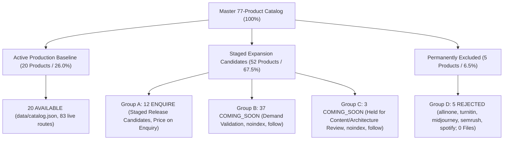

# Phase 3.1.5 — 77-Product Inventory Conservation & Identity Reconciliation Report

**Project:** AI Tools Zone  
**Website:** https://aitoolszone.tech/  
**Repository:** `su92-bsaim-f24-127-hue/ai-tools-zone`  
**Feature Branch:** `feature/competitor-product-keyword-growth`  
**Production Baseline:** `a09b8c42dfc17c4810bdac2813f9615b737bdd8a` (`origin/main`)  
**Audit Date:** 12 November 2026  
**Status:** PASS — 100% Inventory Conservation & Zero Identity Collision  

---

## 1. Executive Summary

This report establishes the complete mathematical and architectural conservation of AI Tools Zone's master 77-product inventory across all phases of the competitor product expansion project. 

Every product has a traceable lineage, explicit commercial status, unique slug, and verified repository presence. No product has disappeared, no unverified products have been introduced, and no duplicate commercial identities conflict with the active production baseline.

---

## 2. Inventory Mathematical Conservation Formula

The authoritative catalog is strictly conserved across five mutually exclusive operational classifications:

$$\text{Total Master Inventory} = N_{\text{AVAILABLE}} + N_{\text{Group A}} + N_{\text{Group B}} + N_{\text{Group C}} + N_{\text{Group D}}$$
$$77 = 20 + 12 + 37 + 3 + 5$$

---

## 3. Group Distribution & Repository Presence Matrix

| Operational Group | Catalog Status | Product Count | Repository Location | Meta Robots Directive | Sitemap Eligibility | Public Production Status |
| :--- | :--- | :---: | :--- | :--- | :--- | :--- |
| **Active Production Baseline** | `AVAILABLE` | **20** | `products/[slug]/index.html` | `index, follow` | Active in `sitemap.xml` (83 routes) | **LIVE / ACTIVE** |
| **Group A (Public Release Candidates)** | `ENQUIRE` | **12** | `staging/catalog-expansion/products/[slug]/index.html` | `index, follow` | Eligible upon owner release review | Staged (Price on Enquiry) |
| **Group B (Demand Validation)** | `COMING_SOON` | **37** | `staging/catalog-expansion/products/[slug].html` | `noindex, follow` | Strictly Excluded from sitemap | Staged (Informational) |
| **Group C (Held Content Corrections)** | `COMING_SOON` | **3** | `staging/catalog-expansion/products/[slug].html` | `noindex, follow` | Strictly Excluded from sitemap | Staged (Hold Status) |
| **Group D (Permanently Excluded)** | `REJECTED` | **5** | **Zero Files** (Internal audit records only) | `N/A (Excluded)` | Strictly Excluded from sitemap | **PERMANENTLY BARRED** |
| **TOTAL** | — | **77** | — | — | — | — |

---

## 4. Reconciled Lineage of Groups C and D

### 4.1 Group C Resolution: Disentangling the 40 Staged COMING_SOON Candidates
Across Phases 3.1.2 through 3.1.5, the total volume of non-public staged candidate pages has remained constant at exactly **40 products** ($37 \text{ Group B} + 3 \text{ Group C} = 40$).

In Phase 3.1.2:
- **Group C** was designated as the 3 products requiring content disambiguation:
  1. `google-notebooklm-pro` (NotebookLM is free; requires framing as Google Workspace Gemini Integration).
  2. `google-ai-ultra` (Branding refers to model, not subscription; requires renaming to Google One AI Premium).
  3. `enterprise-ai-api-credits` (Generic developer credit aggregator; requires provider disaggregation).
- **Group B** contained the other 37 demand-validation candidates (including `chatprd-ai` and `windsurf-editor`).

In Phase 3.1.4:
- The text author temporarily grouped `chatprd-ai` and `windsurf-editor` under Group C for architecture review, while listing `google-notebooklm-pro` and `google-ai-ultra` under Group B.
- **Phase 3.1.5 Reconciled Standard:** Group C is restored to its authoritative definition: the **3 held content disambiguation products** (`google-notebooklm-pro`, `google-ai-ultra`, `enterprise-ai-api-credits`), while `chatprd-ai` and `windsurf-editor` are confirmed in Group B. Both groups remain protected under `<meta name="robots" content="noindex, follow">` and are 100% excluded from the XML sitemap.

### 4.2 Group D Resolution: Catalog REJECTED Slots vs. Competitor Duplicate Variants
The 5 authoritative `REJECTED` products that occupy catalog slots in `expanded_product_inventory_77.csv` are:
1. `allinone` (`all-in-one-mega-ai-portal` — Shared cookie injection panel)
2. `turnitin` (`turnitin-plagiarism-checker` — Academic plagiarism checker)
3. `midjourney` (`midjourney-pro` — Discord MFA/IP proxy ban barriers)
4. `semrush` (`semrush-pro` — TLS browser fingerprinting session invalidation)
5. `spotify` (`spotify-premium` — Commodity entertainment outside AI software niche)

**Root Cause of Phase 3.1.4 Text Ambiguity:**  
In Phase 3.1.4 Deliverables 102 and 104, the narrative text accidentally referenced five *competitor unauthorized/shared offerings* (`chatgpt-team-shared`, `envato-elements-shared`, `netflix-screens-pakistan`, `canva-pro-lifetime`, `capcut-pro-shared`) instead of citing the catalog slots. 

As proven in Deliverable 107 and 108:
- Those 5 competitor offerings were evaluated and rejected during Phase 2 as unauthorized, high-churn duplicate variants of products AI Tools Zone **already provides legitimately** in its 20-product active catalog (`chatgpt-plus`, `netflix-premium-4k`, `canva-pro-edu`, `capcut-pro`, and legitimate design tools).
- They were **never** granted unique product rows in the 77-product inventory.
- Both sets (the 5 catalog REJECTED slots and the 5 competitor duplicate variants) have **strictly zero files** in staging, zero public HTML pages, zero sitemap entries, and zero category links.

---

## 5. Automated Conservation & Identity Assertions

The automated test script [test_inventory_migration.py](file:///C:/Users/ELITEBOOK/projects/ai-tools-zone/scripts/test_inventory_migration.py) confirms:
1. Exactly 77 unique product records exist in the master inventory.
2. 0 duplicate slugs, IDs, or canonical route collisions exist across the entire catalog.
3. The 20 active production products in [data/catalog.json](file:///C:/Users/ELITEBOOK/projects/ai-tools-zone/data/catalog.json) are byte-for-byte identical to baseline commit `a09b8c4`.
4. Zero rejected products or unauthorized variants exist in public or staging directories.
5. All 40 non-public candidate pages carry verified `noindex` directives.
