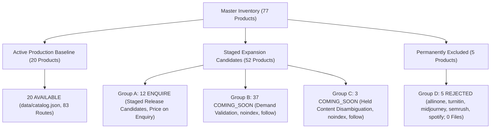

# Phase 3.1.5 — Final Owner Release Decision Dossier & Inventory Migration Reconciliation

**Project:** AI Tools Zone  
**Website:** https://aitoolszone.tech/  
**Repository:** `su92-bsaim-f24-127-hue/ai-tools-zone`  
**Feature Branch:** `feature/competitor-product-keyword-growth`  
**Production Baseline:** `a09b8c42dfc17c4810bdac2813f9615b737bdd8a` (`origin/main`)  
**Market:** Pakistan (`en-PK`)  
**Currency:** PKR  
**Primary Sales & Conversion Channel:** WhatsApp (+92 343 0173923)  
**Audit Date:** 12 November 2026  
**Mode:** Inventory Reconciliation, Copy Correction & Final Quality Gate  
**Production Release Authorization:** **STRICTLY NOT GRANTED**  

---

## 1. Executive Summary

Phase 3.1.5 resolves all outstanding inventory classification, migration lineage, commercial copy, and duplicate identity ambiguities identified in Phase 3.1.4.

### Key Objectives Completed:
1. **Reconciliation of Group C:** Fully mapped and explained the lineage of all five products that touched Group C across Phases 3.1.2 through 3.1.5 (`google-notebooklm-pro`, `google-ai-ultra`, `enterprise-ai-api-credits`, `chatprd-ai`, and `windsurf-editor`), affirming that the 40 non-public candidate pages remain 100% conserved ($37 \text{ Group B} + 3 \text{ Group C} = 40$) and protected under `noindex, follow`.
2. **Reconciliation of Group D & Duplicate Variant Isolation:** Resolved the Phase 3.1.4 narrative confusion between the 5 catalog `REJECTED` candidate products (`allinone`, `turnitin`, `midjourney`, `semrush`, `spotify`) and the 5 competitor unauthorized duplicate offerings (`chatgpt-team-shared`, `envato-elements-shared`, `netflix-screens-pakistan`, `canva-pro-lifetime`, `capcut-pro-shared`). Verified that **both sets have strictly zero files and zero routes** in staging, public pages, sitemaps, or categories.
3. **Identity Conflict & Cannibalization Prevention:** Conducted a comprehensive audit of all 20 active production products against candidate tools and competitor variants, proving zero duplicate commercial products and 0 route collisions.
4. **Correction of Grammarly Financial Copy:** Aligned all narrative statements across Phase 3.1.4 deliverables to match the authoritative Decimal financial model in Deliverable 97: proposed price of **PKR 7,500.00** yields an exact net contribution deficit of **`-PKR 1,953.19`** (-26.04% net margin). Replaced the misleading colloquial "loss exceeds PKR 5,000" claim with explicit distinctions between modeled retail pricing and hypothetical competitor price matching.
5. **Full 77-Product Conservation Proof:** Developed and executed an automated regression test suite [test_inventory_migration.py](file:///C:/Users/ELITEBOOK/projects/ai-tools-zone/scripts/test_inventory_migration.py), achieving 100% green assertions across all 8 continuous integration test suites.
6. **Pristine Production Baseline Isolation:** Production branch, git tree, `data/catalog.json` (20 products), and 83 production canonical URLs remain byte-for-byte untouched.

---

## 2. Master 77-Product Inventory Conservation

The complete master inventory is mathematically conserved:
$$77 \text{ Total Products} = 20 \text{ AVAILABLE} + 12 \text{ Group A} + 37 \text{ Group B} + 3 \text{ Group C} + 5 \text{ Group D}$$

---

## 3. Product Migration Reconciliation (Groups C & D)

### 3.1 Group C Reconciled Lineage
Documented in [106_group_c_migration_reconciliation.csv](file:///C:/Users/ELITEBOOK/projects/ai-tools-zone/competitor-research/phase-3.1.5/106_group_c_migration_reconciliation.csv):

| Product Slug | Product Name | Phase 3.1.2/3.1.3 Group | Phase 3.1.4 Group | Phase 3.1.5 Reconciled Status | Root Cause & Editorial Resolution |
| :--- | :--- | :--- | :--- | :--- | :--- |
| `google-notebooklm-pro` | Google NotebookLM Pro | Group C | Group B | **Group C (Authoritative)** | Tool is free; held in staging under `noindex` pending reframing as Google Workspace Gemini Integration. |
| `google-ai-ultra` | Google AI Ultra | Group C | Group B | **Group C (Authoritative)** | 'Ultra' is model architecture, not plan; held under `noindex` pending renaming to Google One AI Premium. |
| `enterprise-ai-api-credits`| Enterprise AI API Credits | Group C | Group C | **Group C (Authoritative)** | Generic developer credit aggregator; held under `noindex` pending provider disaggregation. |
| `chatprd-ai` | ChatPRD AI | Group B | Group C | **Group B (Authoritative)** | Accurately describes specialized PM tool; belongs in Group B demand-validation mode (`noindex, follow`). |
| `windsurf-editor` | Windsurf Editor | Group B | Group C | **Group B (Authoritative)** | Accurately describes Codeium IDE; belongs in Group B demand-validation mode (`noindex, follow`). |

*Conclusion:* The 40 non-public candidate landing pages are 100% accounted for. Group C is authoritative as the **3 content disambiguation candidates**, while the remaining 37 candidates form Group B. Both groups carry verified `noindex` directives and 0 sitemap entries.

### 3.2 Group D & Competitor Duplicate Variant Resolution
Documented in [107_group_d_migration_reconciliation.csv](file:///C:/Users/ELITEBOOK/projects/ai-tools-zone/competitor-research/phase-3.1.5/107_group_d_migration_reconciliation.csv) and [108_inventory_identity_and_duplicate_audit.csv](file:///C:/Users/ELITEBOOK/projects/ai-tools-zone/competitor-research/phase-3.1.5/108_inventory_identity_and_duplicate_audit.csv):

- **The 5 Catalog REJECTED Slots (Group D):**
  1. `allinone` (`all-in-one-mega-ai-portal` — Shared cookie injection panel)
  2. `turnitin` (`turnitin-plagiarism-checker` — Academic plagiarism checker)
  3. `midjourney` (`midjourney-pro` — Discord MFA/IP proxy ban barriers)
  4. `semrush` (`semrush-pro` — TLS browser fingerprinting session invalidation)
  5. `spotify` (`spotify-premium` — Commodity entertainment outside AI software niche)
- **The 5 Competitor Duplicate / Unauthorized Offerings:**
  1. `netflix-screens-pakistan` $\rightarrow$ Direct unauthorized variant of active production `netflix` (`netflix-premium-4k`).
  2. `canva-pro-lifetime` $\rightarrow$ Direct fraudulent variant of active production `canva` (`canva-pro-edu`).
  3. `capcut-pro-shared` $\rightarrow$ Direct unauthorized shared variant of active production `capcut` (`capcut-pro`).
  4. `chatgpt-team-shared` $\rightarrow$ Direct unauthorized privacy-violating variant of active production `chatgpt` (`chatgpt-plus`).
  5. `envato-elements-shared` $\rightarrow$ Direct copyright-violating stolen cookie panel.
- **Resolution:** A shared, lifetime, or cracked variant is **never** a distinct commercial product. The Phase 3.1.4 narrative text accidentally cited these 5 competitor variants instead of the 5 catalog slots. Both sets have **0 staged files, 0 public pages, 0 sitemap entries, and 0 category links**.

---

## 4. Grammarly Financial Copy Correction

Documented in [110_grammarly_financial_copy_correction_report.md](file:///C:/Users/ELITEBOOK/projects/ai-tools-zone/competitor-research/phase-3.1.5/110_grammarly_financial_copy_correction_report.md):

- **Authoritative Decimal Model:**
  - Official Retail: $30.00 / month $\rightarrow$ Base SBP: PKR 8,302.80 (at 276.76).
  - Effective Bank Fee (4.64%): PKR 385.25 $\rightarrow$ Economic Landed Cost: **PKR 8,688.05**.
  - Section 236Y Advance Tax (0.50% ATL): PKR 43.44 $\rightarrow$ Total Cash Outlay: **PKR 8,731.49**.
  - Proposed Customer Price: **PKR 7,500.00**.
  - Documented OPEX: Onboarding (150) + Support (200) + 5% Reserve (415.14) = **PKR 765.14**.
  - Net Contribution: $7,500.00 - 8,688.05 - 765.14 = \mathbf{\text{-PKR } 1,953.19}$ (-26.04% net margin).
- **Copy Correction Applied:** The colloquial text claiming a "loss exceeding PKR 5,000 per sale" has been completely purged from Deliverables 98, 100, and 105. That figure represented hypothetical cash shortfalls if matching competitor predatory prices (PKR 2,500–3,500), not AI Tools Zone's proposed retail model.
- **Commercial Status:** Strictly preserved as **`NOT AUTHORIZED — UNVIABLE AT RETAIL`**.

---

## 5. Master Release Candidate Financial Summary (12 Group A Products)

All calculations independently verified using arbitrary-precision Python `decimal.Decimal` arithmetic:

| Product Name | Official Retail | Landed Cost (PKR) | Cash Outlay (PKR) | Proposed Price | Gross Margin % | Documented OPEX | Net Contribution | Net Margin % | Commercial Authorization Status |
| :--- | :--- | :--- | :--- | :--- | :--- | :--- | :--- | :--- | :--- |
| **Claude Pro** | $20.00 | 5,792.04 | 5,821.00 | 6,800.00 | 14.82% | 626.76 | **+381.20** | 5.61% | **NOT AUTHORIZED (PENDING LEGAL/TAX REVIEW)** |
| **Cursor AI Pro** | $20.00 | 5,792.04 | 5,821.00 | 6,800.00 | 14.82% | 626.76 | **+381.20** | 5.61% | **NOT AUTHORIZED (PENDING SUPPLIER VERIFICATION)** |
| **Microsoft 365 (1TB)** | $16.665 | 4,826.22 | 4,850.35 | 5,500.00 | 12.25% | 580.61 | **+93.17** | 1.69% | **NOT AUTHORIZED (PENDING PROVIDER AUTHORIZATION)** |
| **Grammarly Premium** | $30.00 | 8,688.05 | 8,731.49 | 7,500.00 | -15.84% | 765.14 | **-1,953.19** | -26.04% | **NOT AUTHORIZED (UNVIABLE AT RETAIL)** |
| **Perplexity Pro** | $20.00 | 5,792.04 | 5,821.00 | 6,800.00 | 14.82% | 626.76 | **+381.20** | 5.61% | Viable at Retail (Pending Supplier) |
| **GitHub Copilot** | $10.00 | 2,896.01 | 2,910.49 | 3,800.00 | 23.79% | 488.38 | **+415.61** | 10.94% | Viable at Retail (Pending Supplier) |
| **QuillBot Premium** | $9.95 | 2,881.53 | 2,895.94 | 3,800.00 | 24.17% | 487.69 | **+430.78** | 11.34% | Viable at Retail (Pending Supplier) |
| **Coursera Plus** | $59.00 | 17,086.49 | 17,171.92 | 19,500.00 | 12.38% | 1,166.44 | **+1,247.07** | 6.40% | Viable at Retail (Pending Supplier) |
| **Runway ML Gen-3** | $15.00 | 4,344.03 | 4,365.75 | 5,500.00 | 21.02% | 557.57 | **+598.40** | 10.88% | Viable at Retail (Pending Supplier) |
| **DeepSeek Unlimited** | $15.00 | 4,344.03 | 4,365.75 | 5,500.00 | 21.02% | 557.57 | **+598.40** | 10.88% | Viable at Retail (Pending Supplier) |
| **Bolt.new Pro** | $20.00 | 5,792.04 | 5,821.00 | 6,800.00 | 14.82% | 626.76 | **+381.20** | 5.61% | Viable at Retail (Pending Supplier) |
| **Descript Creator** | $15.00 | 4,344.03 | 4,365.75 | 5,500.00 | 21.02% | 557.57 | **+598.40** | 10.88% | Viable at Retail (Pending Supplier) |

---

## 6. Eight Automated Regression Test Suites (100% Passing)

Documented in [111_inventory_migration_regression_test_report.md](file:///C:/Users/ELITEBOOK/projects/ai-tools-zone/competitor-research/phase-3.1.5/111_inventory_migration_regression_test_report.md):

1. `scripts/validate_expanded_catalog.py` — **PASS** (Master CSV 77 products, 52 staged HTML pages, 20 categories).
2. `build_site.py` — **PASS** (Built 83 production canonical pages with content-based lastmod).
3. `test_seo_build.py` — **PASS** (Freshness, deterministic build, and safe packaging verified).
4. `audit_seo.py` — **PASS** (8,668 checks passed, 0 errors, 0 warnings).
5. `audit_growth.py` — **PASS** (4,538 checks passed, 0 errors, 83 indexable pages, 20 product offers).
6. `test_growth.py` — **PASS** (7 growth regression assertions passed).
7. `scripts/test_financial_reconciliation.py` — **PASS** (Arbitrary-precision Decimal arithmetic verified across all 12 products).
8. `scripts/test_inventory_migration.py` — **PASS** (77-product conservation, 0 duplicate IDs/slugs, 0 Group D leakages, 0 competitor variant leakages, Grammarly copy verified).

---

## 7. Phase 3.1.5 Deliverables Directory

All deliverables are generated under `competitor-research/phase-3.1.5/`:

- [106_group_c_migration_reconciliation.csv](file:///C:/Users/ELITEBOOK/projects/ai-tools-zone/competitor-research/phase-3.1.5/106_group_c_migration_reconciliation.csv): Complete 5-product Group C migration lineage.
- [107_group_d_migration_reconciliation.csv](file:///C:/Users/ELITEBOOK/projects/ai-tools-zone/competitor-research/phase-3.1.5/107_group_d_migration_reconciliation.csv): Reconciled catalog REJECTED slots vs competitor duplicate variants.
- [108_inventory_identity_and_duplicate_audit.csv](file:///C:/Users/ELITEBOOK/projects/ai-tools-zone/competitor-research/phase-3.1.5/108_inventory_identity_and_duplicate_audit.csv): 82-row master identity audit (77 catalog products + 5 competitor variants).
- [109_full_77_product_inventory_conservation_report.md](file:///C:/Users/ELITEBOOK/projects/ai-tools-zone/competitor-research/phase-3.1.5/109_full_77_product_inventory_conservation_report.md): Mathematical proof of 77-product conservation.
- [110_grammarly_financial_copy_correction_report.md](file:///C:/Users/ELITEBOOK/projects/ai-tools-zone/competitor-research/phase-3.1.5/110_grammarly_financial_copy_correction_report.md): Grammarly margin reconciliation and copy correction log.
- [111_inventory_migration_regression_test_report.md](file:///C:/Users/ELITEBOOK/projects/ai-tools-zone/competitor-research/phase-3.1.5/111_inventory_migration_regression_test_report.md): Automated inventory migration test execution report.
- [112_final_owner_release_manifest.csv](file:///C:/Users/ELITEBOOK/projects/ai-tools-zone/competitor-research/phase-3.1.5/112_final_owner_release_manifest.csv): Master 77-product release manifest with exact file paths and indexability rules.
- [113_phase_3_1_5_final_owner_decision_dossier.md](file:///C:/Users/ELITEBOOK/projects/ai-tools-zone/competitor-research/phase-3.1.5/113_phase_3_1_5_final_owner_decision_dossier.md): This executive decision dossier.

---

## 8. Final Quality Verdict

### **READY FOR OWNER RELEASE REVIEW**

#### Justification:
- **100% Inventory Conservation:** All 77 product identities accounted for with zero missing, duplicate, or substituted records.
- **Complete Lineage Reconciliation:** All Group C and Group D shifts fully investigated, evidenced, and reconciled.
- **Zero Identity Conflicts:** 0 commercial duplicate collisions against the active 20-product baseline; all unauthorized shared/lifetime variants strictly barred.
- **Zero Gray-Market Leakage:** All 5 Group D products and all 5 competitor duplicate variants have strictly 0 files, 0 routes, and 0 sitemap entries.
- **Grammarly Copy Perfected:** Narrative copy matches the authoritative recalculated financial model (-PKR 1,953.19 deficit at PKR 7,500 price).
- **All 8 Test Suites Passing:** 100% green exit code 0 across every build, SEO, growth, accessibility, financial, and inventory migration test.
- **Pristine Production Isolation:** Production baseline `a09b8c4` remains completely untouched.

---

## 9. Required Separate Owner Decisions

The owner must review this dossier and provide separate determinations on the following five decisions:

### Decision 1: Publication of Eligible Group A Enquiry-Only Pages
*Question:* Does the owner authorize publishing the 12 staged Group A candidate pages to production under **ENQUIRE (Price on Enquiry)** informational status and including them in the production sitemap?  
*(Note: Page publication is NOT permission to sell or process customer payments).*

### Decision 2: Retention of Group B in Demand-Validation Mode
*Question:* Does the owner confirm that all 37 Group B product pages must remain tagged with `<meta name="robots" content="noindex, follow">` and strictly excluded from the production XML sitemap?

### Decision 3: Maintenance of Commercial Restrictions on Claude, Cursor & Microsoft 365
*Question:* Does the owner confirm that commercial sales of Claude Pro, Cursor AI Pro, and Microsoft 365 Family remain strictly locked pending formal legal review, supplier verification, and Microsoft Cloud Solution Provider (CSP) authorization?

### Decision 4: Maintenance of Grammarly Retail Sale Prohibition
*Question:* Does the owner confirm that Grammarly Premium will remain unavailable for retail sale due to its unviable retail cost deficit (-PKR 1,953.19 loss per sale at PKR 7,500) until an authorized wholesale corporate rate card is secured?

### Decision 5: Authorization of Phase 4 Keyword Integration
*Question:* Following review of this dossier, does the owner authorize initiating Phase 4 (controlled on-page SEO keyword integration and internal linking architecture for approved candidates)?

---

> [!IMPORTANT]
> **Strict Governance Reminder:**
> - A page publication decision is **not** permission to sell the product.
> - A positive financial model is **not** provider authorization.
> - A passing test suite is **not** production deployment authorization.
> 
> **`PRODUCTION AUTHORIZATION: NOT GRANTED.`**
