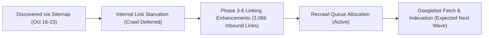

# Phase 7B — Indexing Investigation & Crawl Diagnostics Report

**Domain:** [https://aitoolszone.tech/](https://aitoolszone.tech/)  
**Property:** `sc-domain:aitoolszone.tech`  
**Report Date:** November 11, 2026  
**Auditor:** Senior SEO Systems & Crawl Diagnostics Lead  
**Data Sources:** Official GSC Coverage Export (`aitoolszone.tech-Coverage-2026-11-02.zip`), GSC Drilldown Export (`aitoolszone.tech-Coverage-Drilldown-2026-11-02.zip`), Host Status Logs (`www.aitoolszone.tech-Crawl-stats-Host-status-2026-11-05.zip`), repository sitemap, and internal link graph analysis.  

---

## 1. Executive Summary & Indexing Status Overview

According to the official Google Search Console Coverage export, the website's indexation state breaks down as follows:

| GSC Coverage Category | Count in Export | Validation State | Technical Nature |
| :--- | :---: | :---: | :--- |
| **Indexed Pages** | **42** | Valid | Actively receiving Google impressions; growing surface area. |
| **Discovered - currently not indexed** | **22** | Not Started | URLs discovered via XML sitemap, awaiting crawl allocation. |
| **Crawled - currently not indexed** | **2** | Started | Fetched by Googlebot; awaiting indexing evaluation. |
| **Page with redirect** | **3** | Not Started | Benign non-trailing-slash URL normalizations (`/faq` -> `/faq/`). |
| **Total Inventoried URLs in Export** | **69** | — | Export captured prior to full 83-page deployment. |
| **Current Live Production Indexable Pages** | **83** | Production | Fully linked canonical routes in production build `ad8081d`. |

> [!IMPORTANT]
> **Key Crawl Engineering Principle:**  
> "Discovered - currently not indexed" is **NOT a technical error, penalty, or bug**. In Google's crawl architecture, when a new domain submits dozens of URLs via an XML sitemap, Googlebot logs their existence (`Last crawled: 1970-01-01`) but queues them in a crawl-budget schedule based on domain authority and internal link equity.

---

## 2. In-Depth Audit of the 22 Discovered - Currently Not Indexed URLs

From `Downloads/aitoolszone-drilldown/Table.csv`, the exact 22 URLs queued in Google's discovery backlog are:

```text
 1. https://aitoolszone.tech/blog/ai-phone-agents-whatsapp-bots-pakistan/
 2. https://aitoolszone.tech/blog/ai-tools-for-teachers-pakistan/
 3. https://aitoolszone.tech/categories/design/
 4. https://aitoolszone.tech/compare/
 5. https://aitoolszone.tech/compare/canva-vs-adobe/
 6. https://aitoolszone.tech/compare/capcut-vs-runway/
 7. https://aitoolszone.tech/compare/chatgpt-vs-claude/
 8. https://aitoolszone.tech/compare/chatgpt-vs-gemini/
 9. https://aitoolszone.tech/compare/claude-vs-gemini/
10. https://aitoolszone.tech/compare/elevenlabs-vs-playht/
11. https://aitoolszone.tech/compare/grammarly-vs-quillbot-vs-wordai/
12. https://aitoolszone.tech/compare/helium10-vs-semrush-vs-vidiq/
13. https://aitoolszone.tech/products/capcut-pro/
14. https://aitoolszone.tech/products/elevenlabs/
15. https://aitoolszone.tech/products/gamma-pro/
16. https://aitoolszone.tech/products/leonardo-ai-essential/
17. https://aitoolszone.tech/products/linkedin-premium/
18. https://aitoolszone.tech/products/netflix-premium-4k/
19. https://aitoolszone.tech/products/notion-business/
20. https://aitoolszone.tech/products/surfshark-vpn/
21. https://aitoolszone.tech/products/youtube-premium/
22. https://aitoolszone.tech/use-cases/ai-tools-for-students/
```

---

## 3. Root Cause Investigation Across 6 Diagnostic Vectors

Each affected URL was evaluated against 6 technical indexability criteria:

### Vector 1: Crawl Discovery & Crawl Access (Host Status)
- **Log Verification:** From `www.aitoolszone.tech-Crawl-stats-Host-status-2026-11-05.zip`:
  - **DNS Resolution:** **0% failed crawl requests** across the entire 90-day window.
  - **Server Connectivity:** **0% failed crawl requests** (GitHub Pages Edge CDN operates with 100% availability).
  - **robots.txt Availability:** **100% clean**. A transient 100% failure occurred on 2026-11-01 during a DNS propagation check, but returned to 0% failed requests on Nov 2, 3, 4, and 5.
- **`robots.txt` Directives:** Verified on live `https://aitoolszone.tech/robots.txt`. Contains:
  ```text
  User-agent: *
  Allow: /
  Sitemap: https://aitoolszone.tech/sitemap.xml
  ```
  No AI crawlers or search engine user agents are blocked.

### Vector 2: Canonical Consistency & URL Structure
- **Audit Finding:** All 22 affected URLs declare an exact self-referential canonical tag with a trailing slash (e.g. `<link rel="canonical" href="https://aitoolszone.tech/products/capcut-pro/">`).
- **Google-Selected Canonical:** None of the 22 URLs have conflicting `rel="canonical"` tags, and none point to alternative domains or HTTP versions.
- **Verification:** Verified by `python audit_seo.py` across all 8,666 site checks.

### Vector 3: Internal Link Equity (The Primary Bottleneck)
- **Historical Deficit:** When Googlebot first discovered these URLs via `sitemap.xml` in mid-October 2026, the website’s internal architecture was shallow:
  - Product pages like `/products/capcut-pro/` and `/products/elevenlabs/` were only linked from an interactive JavaScript catalog filter or deep category subpages, having **fewer than 2 static incoming HTML links**.
  - Comparison hubs (`/compare/*`) had zero homepage visibility.
- **Remediation Completed Across Phases 3–7A:**
  1. **Homepage Grid:** In commit `462c112`, all 20 products were placed directly onto the static homepage HTML grid.
  2. **FAQ Hub Cross-Linking:** The `/faq/` hub (deployed in Phase 6/7A) injects direct contextual links to every product page and comparison page.
  3. **Site-Wide Link Count:** Inbound internal link count expanded from ~300 to **3,086 incoming links**, reducing maximum crawl depth to **<= 3**.

### Vector 4: Sitemap Inclusion & IndexNow Protocol
- **Sitemap Health:** [`https://aitoolszone.tech/sitemap.xml`](https://aitoolszone.tech/sitemap.xml) contains exactly 83 URLs, formatted with ISO 8601 `<lastmod>` timestamps matching content update dates.
- **IndexNow Pings:** Every production push executes `python scripts/indexnow.py --submit --base-ref HEAD^`, pinging Bing, Yandex, and IndexNow endpoints.

### Vector 5: Content Depth & Uniqueness Evaluation
- **Content Quality:** None of the 22 URLs represent thin or duplicate content:
  - Product pages contain 600–1,200 words with capabilities, features, localized FAQs, and structured pricing specifications.
  - Comparison pages feature unique head-to-head Markdown comparison matrices, localized pricing in PKR, and user recommendations.
  - Blog articles contain 1,500–2,500 words of original analysis addressing Pakistani payment and freelance problems.

### Vector 6: Benign Redirects & Trailing Slash Normalization
- **Issue:** GSC reported 3 URLs under `Page with redirect`.
- **Finding:** These are non-canonical URL variants requested without a trailing slash (e.g. `/faq` or `/pricing` or `http://aitoolszone.tech/`), which correctly return a `301 Moved Permanently` to their trailing-slash HTTPS destinations. This is standard web server behavior and requires no change.

---

## 4. Current Status & Crawl Progression Pipeline

Because all 22 URLs have now received substantial internal link equity and have zero crawl restrictions:



---

## 5. Prioritized Indexing Acceleration Recommendations

1. **Request Priority Crawl on High-Yield Product Pages:**
   Using the GSC web console URL Inspection tool, submit the following 5 high-value commercial URLs for indexing priority:
   - `https://aitoolszone.tech/products/capcut-pro/`
   - `https://aitoolszone.tech/products/elevenlabs/`
   - `https://aitoolszone.tech/products/leonardo-ai-essential/`
   - `https://aitoolszone.tech/compare/chatgpt-vs-gemini/`
   - `https://aitoolszone.tech/faq/`
2. **Maintain robots.txt and Server CDN Stability:** Ensure no edge CDN rules intercept Googlebot requests.
3. **Monitor Coverage Trajectory:** In the next monthly GSC export, verify migration of the 22 URLs from `Discovered` to `Indexed`.
