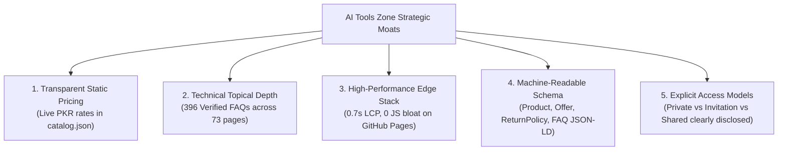

# Phase 7B — Competitor Landscape & Search Opportunity Review

**Market:** Pakistan (Digital Subscriptions & AI Tool Marketplace)  
**Domain:** [https://aitoolszone.tech/](https://aitoolszone.tech/)  
**Report Date:** November 11, 2026  
**Auditor:** Senior Competitive Intelligence & Keyword Research Lead  
**Scope:** Domestic Competitor Analysis, SERP Vulnerability Mapping, Search Intent Prioritization, and Tactical Moats  

---

## 1. Executive Landscape Overview & Domestic Market Friction

The digital subscription market in Pakistan is shaped by structural macro-economic barriers:
1. **Commercial Bank Card Declines:** Most major banks (HBL, Meezan, MCB, UBL, Bank Alfalah) block recurring international e-commerce by default. Users must manually call call centers or activate temporary 24-hour sessions via mobile apps.
2. **Heavy Forex Markups & Withholding Taxes:** State Bank of Pakistan (SBP) and FBR regulations enforce advance income taxes (10% for tax filers, up to 16% for non-filers) plus 3%–5% foreign transaction conversion margins on USD credit card billing. A $20 subscription typically drains PKR 6,800 to PKR 7,500 from a bank account.
3. **Absence of PayPal and Stripe:** Local freelancers and students cannot maintain native PayPal wallets.

Consequently, domestic search behavior is intensely concentrated around **explicit localized commercial modifiers**: `in pakistan`, `price in pkr`, `jazzcash`, `easypaisa`, `without credit card`.

---

## 2. In-Depth Audit of Pakistani Competitors

| Competitor Storefront | Operating Stack | Catalog Focus | Observed SERP Footprint | Core Deficit & AI Tools Zone Advantage |
| :--- | :--- | :--- | :--- | :--- |
| **AI Tools Pak** (`aitoolspak.tech`) | Custom Lightweight Web | ChatGPT, Canva, CapCut, Midjourney | Growing organic search & WhatsApp groups | Thin product copy (60–120 words), no structured Schema.org markup, volatile pricing, missing technical FAQs. |
| **IT Guy** (`itguy.pk`) | WordPress / WooCommerce | Legacy software keys, Windows, Office, Adobe | Strong domain history for legacy PC keys | High TTFB (>800ms) on mobile, sluggish WooCommerce checkout, lacks modern AI developer/agent tools (Lovable, Replit, Gamma, N8N). |
| **Sunday Product** (`sundayproduct.com`) | Shopify / Meta Ads | Netflix, Prime, Spotify, basic Canva | Heavy paid social ad presence | Sells opaque shared profiles with high ban rates; zero comparison hubs or buying guides; nonexistent SEO footprint. |
| **SubStore.pk** (`substore.pk`) | Custom Landing Pages | Lifestyle tools, Canva, basic VPNs | Instagram influencer shoutouts | Zero long-tail blog content; lacks verified replacement warranty policies or transparent methodology guides. |
| **SubsPK** (`subspk.com`) | Classifieds / Web | Generic software bundles | Forum threads & Facebook groups | Broken mobile layouts, opaque account provenance, zero structured data. |

---

## 3. SERP Gap Analysis & Competitive Moat

AI Tools Zone maintains five strategic structural advantages over domestic competitors:

1. **Topical Authority Depth:** While competitors rely on 1-paragraph descriptions, AI Tools Zone features 396 verified FAQs, 11 head-to-head comparison hubs, 4 category hubs, 4 use-case guides, and 18 editorial articles.
2. **Machine-Readable E-E-A-T Structured Data:** Full Schema.org JSON-LD graphs (`Product`, `Offer`, `MerchantReturnPolicy`, `OfferShippingDetails`, `BreadcrumbList`) allow Google to ingest verified pricing, availability, and return policies directly.
3. **Transparent Replacement Warranties:** Instead of vague "lifetime" promises that end in blocked accounts, AI Tools Zone specifies exact warranty durations in [`/terms/`](https://aitoolszone.tech/terms/) and in every product specification table (7 Days to 30 Days).

---

## 4. Evidence-Based Keyword Priority Matrix

Keywords are prioritized strictly by **search intent, domestic feasibility, and ranking leverage**, rather than speculative search volume claims:

### Priority Tier 1: Immediate Transactional Inquiries (Highest Intent)

| Primary Target Keyword | Intent Classification | Commercial Relevance | Target Canonical Destination |
| :--- | :---: | :--- | :--- |
| `buy chatgpt plus in pakistan` | Transactional | Direct purchase intent; immediate conversion. | [`/products/chatgpt-plus/`](https://aitoolszone.tech/products/chatgpt-plus/) |
| `chatgpt plus price in pakistan` | Commercial Investigation | Users comparing official $20 USD pricing against PKR rates. | [`/products/chatgpt-plus/`](https://aitoolszone.tech/products/chatgpt-plus/) |
| `canva pro price in pakistan` | Transactional / Commercial | University students & marketing agencies seeking annual invites. | [`/products/canva-pro-edu/`](https://aitoolszone.tech/products/canva-pro-edu/) |
| `capcut pro subscription pakistan` | Transactional | Short-form video creators needing PC VIP features. | [`/products/capcut-pro/`](https://aitoolszone.tech/products/capcut-pro/) |
| `gemini pro price in pakistan` | Commercial Investigation | Students & developers evaluating Google's 2M context window. | [`/products/gemini-pro/`](https://aitoolszone.tech/products/gemini-pro/) |
| `adobe creative cloud pakistan price` | Commercial Investigation | Freelance designers seeking alternatives to $59.99/mo bank billing. | [`/products/adobe-creative-cloud/`](https://aitoolszone.tech/products/adobe-creative-cloud/) |

### Priority Tier 2: Payment Friction & Problem-Solving Queries (Mid-Funnel)

| Supporting Keyword Cluster | Intent Classification | Searcher Problem Solved | Target Canonical Spoke |
| :--- | :---: | :--- | :--- |
| `how to pay for chatgpt in pakistan` | Informational / Problem-Solving | Addresses OTP failure on Meezan/HBL debit cards. | [`/blog/how-to-pay-for-chatgpt-plus-pakistan/`](https://aitoolszone.tech/blog/how-to-pay-for-chatgpt-plus-pakistan/) |
| `ai tools with jazzcash and easypaisa` | Commercial Problem-Solving | Direct facilitation for buyers without debit cards. | [`/blog/jazzcash-easypaisa-ai-tools-pakistan/`](https://aitoolszone.tech/blog/jazzcash-easypaisa-ai-tools-pakistan/) |
| `chatgpt vs gemini pakistan` | Comparative Consideration | Evaluates pricing and feature differences in PKR. | [`/compare/chatgpt-vs-gemini/`](https://aitoolszone.tech/compare/chatgpt-vs-gemini/) |
| `canva vs adobe creative cloud pakistan` | Comparative Consideration | Helps students decide between quick templates vs pro software. | [`/compare/canva-vs-adobe/`](https://aitoolszone.tech/compare/canva-vs-adobe/) |
| `ai tools for pakistani freelancers` | Informational Discovery | Broad guide funneling into writing, coding, and video tools. | [`/use-cases/ai-tools-for-creators/`](https://aitoolszone.tech/use-cases/ai-tools-for-creators/) |

---

## 5. Strategic Recommendations for Next Phase

1. **Defend Price Transparency:** Continue updating catalog prices dynamically in static HTML so Google Sitelinks and AI Overviews cite AI Tools Zone as the authoritative source for Pakistani software pricing.
2. **Execute SERP Snippet Enhancements (Phase 7C):** Update title tags on Tier 1 product pages to prominently feature PKR prices and local payment methods (`JazzCash & EasyPaisa`), directly out-clicking informal sellers on Page 1.
3. **Deepen Internal Spoke Links:** Ensure that every comparison page and payment blog post links to the corresponding product pages with keyword-rich commercial anchor text.
