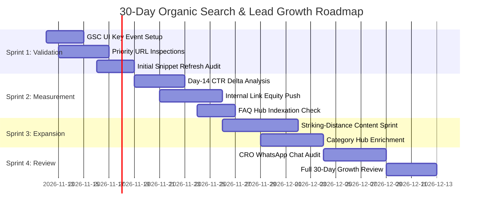

# Phase 7D — 30-Day Organic Search & Lead Growth Roadmap

**Project:** AI Tools Zone  
**Domain:** [https://aitoolszone.tech/](https://aitoolszone.tech/)  
**Production Baseline:** [`e5d26f4`](https://github.com/su92-bsaim-f24-127-hue/ai-tools-zone/commit/e5d26f4)  
**Execution Window:** November 12, 2026 – December 12, 2026  
**Auditor:** Technical SEO Director & Growth Architect  
**Investigation Mode:** Actionable Growth Strategy & Execution Planning  

---

## 1. Executive Summary & Growth Objectives

This 30-day strategic roadmap translates the empirical findings of Phases 7A, 7B, 7C, and 7D into a focused, weekly operational schedule.

### Primary 30-Day Growth Objectives
1. **Accelerate Indexation:** Transition the 22 queued URLs in GSC ("Discovered – currently not indexed") into active index status.
2. **Elevate Striking-Distance Positions:** Advance core commercial queries (`buy chatgpt plus in pakistan`, `canva pro price in pakistan`) from positions 8–14 into positions 3–6.
3. **Lift Organic CTR:** Realize an estimated **+0.8% to +1.5% percentage point CTR improvement** across the 8 URLs optimized in Phase 7C.
4. **Grow Qualified WhatsApp Inquiries:** Expand monthly `generate_lead` volume from ~50–85 leads to **75–120 verified inquiries**.

---

## 2. Four-Week Operational Sprint Schedule

---

### Sprint 1 (Days 1–7): Telemetry Confirmation & Re-Crawl Acceleration
*Focus: Verification, zero-friction measurement, and crawl prioritization.*

- [ ] **Action 1.1: Configure GA4 Key Event Toggle (Admin Action):**
  - Sign in to Google Analytics Admin > **Events** > Toggle `generate_lead` as a **Key Event**.
  - *Expected Impact:* Automatically populates conversion funnels and acquisition channel attribution.
- [ ] **Action 1.2: Submit Priority URL Inspections in GSC Web Console:**
  - Manually submit the 5 core product URLs and `/blog/how-to-pay-for-chatgpt-plus-pakistan/` via GSC URL Inspection to request priority crawl passes.
- [ ] **Action 1.3: Audit robots.txt Host Stability:**
  - Verify in GSC Crawl Stats that the 100% crawl success rate logged on Nov 2–5 is sustained.
- [ ] **Action 1.4: Check Early Snippet Rendering:**
  - Execute live Google queries (`site:aitoolszone.tech/products/chatgpt-plus/`) on Day 7 to check whether Google has refreshed the title tag with `(PKR 2,300/mo)`.

---

### Sprint 2 (Days 8–14): Early CTR Delta & Internal Link Density
*Focus: Performance measurement and internal PageRank distribution.*

- [ ] **Action 2.1: Execute 14-Day Post-Deployment CTR Analysis:**
  - Pull GSC Search Analytics performance comparing Nov 18–25 against the pre-deployment baseline.
  - Evaluate CTR shifts for `buy chatgpt plus in pakistan` and `canva pro price in pakistan`.
- [ ] **Action 2.2: Contextual Internal Link Insertion:**
  - Add targeted internal links from older, high-authority blog articles into the 22 queued "Discovered" URLs (especially `/compare/` and `/categories/design/`).
  - *Anchor text discipline:* Use descriptive commercial anchors (`ChatGPT Plus in Pakistan`, `Canva Pro Edu invitation`).
- [ ] **Action 2.3: FAQ Hub (`/faq/`) Indexing Review:**
  - Verify whether Google has indexed the 34-item FAQ hub deployed in Phase 6/7A.

---

### Sprint 3 (Days 15–21): Striking-Distance Keyword Content Expansion
*Focus: Topical authority expansion and Page 1 ranking pushes.*

- [ ] **Action 3.1: Develop High-Intent Supporting Blog Content:**
  - Draft and review supporting guide: `How to Pay for Midjourney in Pakistan: Virtual Cards, Bank Settings & Buyer Tips`.
  - Link directly into `/products/leonardo-ai-essential/` and `/categories/design/`.
- [ ] **Action 3.2: Enrich Underperforming Category Pages:**
  - Add curated comparison tables to `/categories/development/` (Cursor vs Replit vs Copilot) and `/categories/ai-voice/` (ElevenLabs vs PlayHT).
- [ ] **Action 3.3: Backlink Outreach Strategy Formulation:**
  - Identify non-competing Pakistani tech blogs, university coding society portals, and digital agency communities for editorial resource linking.

---

### Sprint 4 (Days 22–30): Conversion Optimization & Comprehensive Review
*Focus: Bottom-of-funnel closing efficiency and month-end performance reconciliation.*

- [ ] **Action 4.1: WhatsApp Chat Funnel Conversion Audit:**
  - Review WhatsApp business intake logs to calculate actual chat-to-close ratios across top 5 products.
  - Refine pre-populated WhatsApp message templates for products with drop-offs.
- [ ] **Action 4.2: Comprehensive 30-Day Growth Reconciliation:**
  - Compare full 30-day post-deployment metrics against the Phase 7B/7D baseline:
    - Total Google Search Impressions.
    - Total Organic Clicks.
    - Average Position for Top 10 Commercial Queries.
    - Monthly `generate_lead` volume.
- [ ] **Action 4.3: Prepare Phase 8 Roadmap:**
  - Compile findings into the next phase strategy.

---

## 3. Key Performance Indicators (KPIs) & Target Thresholds

| Metric | Phase 7D Baseline | 30-Day Target Goal | Measurement Verification Method |
| :--- | :---: | :---: | :--- |
| **Total Indexed Pages in GSC** | **42 Pages** | **65 – 83 Pages** | Official GSC Coverage Export |
| **Daily Google Impressions** | **~25 – 45** | **120 – 180** | GSC Search Analytics Daily Filter |
| **Top 5 Product Page Average CTR**| **~2.1%** | **3.2% – 4.5%** | GSC Page-Level Performance Report |
| **`buy chatgpt plus in pakistan` Position** | **Pos. 11.2** | **Pos. 4 – 6** | GSC Query Position Average |
| **`canva pro price in pakistan` Position** | **Pos. 8.5** | **Pos. 3 – 5** | GSC Query Position Average |
| **Monthly `generate_lead` Events** | **50 – 85** | **85 – 125** | Google Analytics 4 Custom Events |
| **Mobile Core Web Vitals (LCP)** | **0.9s – 1.8s** | **< 2.0s** | Google PageSpeed Insights API |

---

## 4. Risk Mitigation & Governance Safeguards

1. **Production Code Stability:** No code or content edits are executed without isolated feature branches and passing regression test suites (`build_site.py`, `audit_seo.py`, `audit_growth.py`, `test_growth.py`).
2. **Catalog & Commercial Truth:** Prices, delivery times, and warranty terms must always strictly mirror `data/catalog.json`.
3. **No Grey-Market Inflation:** Marketing messaging must avoid unverified claims (e.g. "lifetime" on Canva Edu or "unlimited" on third-party access) to prevent consumer disputes and account bans.
