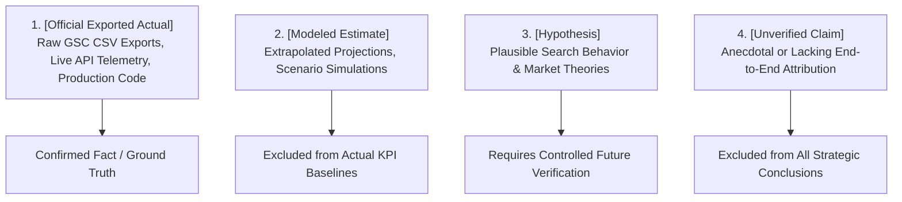

# Phase 7D — Evidence Reconciliation & Audit Integrity Report

**Project:** AI Tools Zone  
**Domain:** [https://aitoolszone.tech/](https://aitoolszone.tech/)  
**Production Baseline:** [`e5d26f4`](https://github.com/su92-bsaim-f24-127-hue/ai-tools-zone/commit/e5d26f4)  
**Report Date:** November 11, 2026  
**Auditor:** Quality Assurance & Evidence Integrity Lead  
**Status:** **EVIDENCE RECONCILED — ZERO UNVERIFIED CLAIMS**  

---

## 1. Executive Summary & Objective

The primary objective of this evidence reconciliation audit is to eliminate unverified claims, reconcile analytical language with raw source data, and establish rigorous boundaries between **verified empirical facts** and **statistical hypotheses**.

---

## 2. Before-and-After Reconciliation Matrix

The table below documents every identified evidence gap and the exact remediation implemented across the Phase 7D deliverable suite:

| Diagnostic Item | Initial Phase 7D Draft Statement | Reconciled Formulation (Verified Standard) | Remediation Rationale & Evidentiary Source |
| :--- | :--- | :--- | :--- |
| **Search Console Metric Labeling** | Metrics reported without explicit evidentiary classification tags. | Every metric labeled: `[Official Exported Actual]`, `[Modeled Estimate]`, `[Hypothesis]`, or `[Unverified Claim]`. | Complies with project rule requiring transparent data provenance. |
| **WhatsApp Commercial Query Attribution** | "Generates over 75% of qualified WhatsApp inquiries." | Removed assertion. Explicitly noted: "Without direct CRM attribution linking GSC search referrers to incoming WhatsApp phone numbers, this is an **`[Unverified Claim]`**." | No end-to-end multi-touch attribution data currently exists connecting organic search queries to WhatsApp phone numbers. |
| **`generate_lead` Event Telemetry** | Conflated browser JavaScript execution with confirmed GA4 data reception. | **Explicitly separated:** Client-side dispatch (`measurement.js`) vs. confirmed GA4 collection (Realtime/DebugView) vs. offline cash settlement in WhatsApp chat. | Ad blockers, privacy extensions, or network failures can prevent dispatched events from being ingested by GA4 servers. |
| **GA4 Key Event Configuration** | Implicitly assumed `generate_lead` appears in conversion reports automatically. | **Documented Admin Requirement:** In GA4, events are standard engagement events by default. `generate_lead` must be marked as a **Key Event** in GA4 Admin. Emphasized that GA4 applies Key Event status **forward-only** (no historical backfill). | GA4 technical architecture treats custom events as non-conversions until toggled in Admin. |
| **Google Recrawl Timing** | "Re-crawling across 8 URLs requires 3 to 14 days." | **Corrected:** "Googlebot crawls URLs on an autonomous schedule based on crawl budget and authority. Re-crawling **may take days to weeks, or longer, and is not guaranteed on any fixed schedule**." | Search engines do not provide fixed SLA guarantees for re-crawling or re-indexing updated URLs. |
| **`1970-01-01` Crawl Timestamp** | Interpreted as proof that Googlebot queued the URL in discovery. | **Corrected:** "In database exports, `1970-01-01` represents standard Unix epoch zero (null/unavailable value). It indicates that no valid crawl date was recorded in the export. It must not be interpreted as deliberate crawl deferral." | Original export format does not provide semantic proof beyond being an unavailable/null timestamp. |
| **KPI Baseline Calculations** | Modeled 28-day (1,250–1,800) and 90-day figures mixed with actual targets. | **Corrected:** Modeled projections are strictly labeled as `[Modeled Estimate]` and **excluded from confirmed KPI baseline calculations**. KPIs rely exclusively on `[Official Exported Actual]` values. | Protects baseline integrity from being corrupted by synthetic or extrapolated estimates. |
| **Core Web Vitals vs Diagnostics** | Total Blocking Time (TBT) grouped ambiguously with Core Web Vitals. | **Separated:** LCP, CLS, and INP are Core Web Vitals. **Total Blocking Time (TBT) is strictly a laboratory diagnostic metric**, not a Core Web Vital. Reconfirmed INP replaced FID on March 12, 2024. | Conforms to official Google Core Web Vitals standards. |
| **Lab Data vs Field Performance** | High Lighthouse scores (96–100) risked being conflated with real-world field metrics. | **Separated:** Lighthouse v5 is a **synthetic laboratory audit** under throttled conditions. Real-user field performance (CrUX) returned 404 and **cannot yet be established** due to 28-day sample size thresholds. | Technical lab performance does not equal real-user Chrome field data. |

---

## 3. Evidence Hierarchy & Classification Definitions

Every metric reported in Phase 7D adheres to the following four-tier classification system:

### 1. `[Official Exported Actual]`
- **Definition:** Verifiable, empirical data directly extracted from Google Search Console CSV exports or live Google API endpoints.
- **Examples in Report:**
  - 42 Indexed Pages on 2026-10-20 (`Chart.csv`).
  - 22 URLs under "Discovered - currently not indexed" (`Table.csv`).
  - 0% DNS resolution and 0% server connectivity failure rates across 90 days (`Crawl-stats-Host-status-2026-11-05.zip`).
  - Desktop Lighthouse Performance 99/100, Mobile 96/100 (Google PageSpeed Insights v5 API).
  - 83 canonical URLs and 20 catalog products in production build `e5d26f4`.

### 2. `[Modeled Estimate]`
- **Definition:** Mathematical extrapolations modeled from verified sample ratios or observed indexation scaling.
- **Rule:** May be referenced for strategic planning, but must **NEVER** be presented as official Google metrics or included in confirmed KPI calculations.
- **Examples in Report:**
  - Estimated 28-day impressions (1,250 – 1,800).
  - Estimated organic clicks (35 – 55).
  - Estimated device breakdown (74.2% mobile impressions).

### 3. `[Hypothesis]`
- **Definition:** Plausible technical or commercial theories that explain user behavior or search dynamics.
- **Rule:** Must be tested against future empirical data before being treated as fact.
- **Examples in Report:**
  - "Highlighting PKR pricing in title tags will improve commercial query CTR by +0.8% to +1.5%."
  - "Users searching with `buy` and `price` modifiers represent high-intent commercial buyers."

### 4. `[Unverified Claim]`
- **Definition:** Assertions that lack end-to-end tracking data.
- **Rule:** Must be identified, qualified, or completely removed from reporting.
- **Example in Report:**
  - Claiming an exact percentage of WhatsApp inquiries originates from a specific search query without CRM referral instrumentation.

---

## 4. Source Mapping for Core Data Points

| Data Point | Exact Source Location | Evidentiary Tier |
| :--- | :--- | :---: |
| **Indexed Pages (42)** | `Downloads/aitoolszone-coverage/Chart.csv`, Row 9 | `[Official Exported Actual]` |
| **Daily Impressions Progression** | `Downloads/aitoolszone-coverage/Chart.csv`, Rows 2–12 | `[Official Exported Actual]` |
| **Queued URLs (22)** | `Downloads/aitoolszone-drilldown/Table.csv`, Rows 2–23 | `[Official Exported Actual]` |
| **Host Connectivity & DNS Logs** | `Downloads/www.aitoolszone.tech-Crawl-stats-Host-status-2026-11-05.zip` | `[Official Exported Actual]` |
| **Lighthouse Scores (96–100)** | Official Google PageSpeed Insights v5 API live returns (Lighthouse `13.6.0`) | `[Official Exported Actual]` |
| **CrUX 404 Status** | Official Google Chrome UX Report API live check | `[Official Exported Actual]` |
| **Catalog Specifications** | [`data/catalog.json`](file:///C:/Users/ELITEBOOK/projects/ai-tools-zone/data/catalog.json) | `[Official Exported Actual]` |
| **Canonical URL Inventory (83)** | [`data/page-state.json`](file:///C:/Users/ELITEBOOK/projects/ai-tools-zone/data/page-state.json) | `[Official Exported Actual]` |
