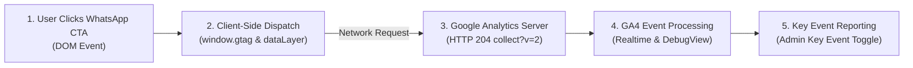
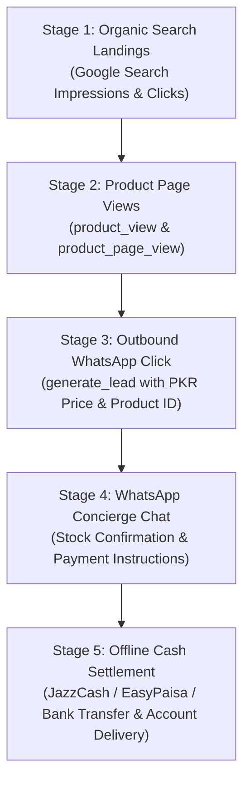

# Phase 7D — GA4 Conversion Telemetry & WhatsApp Lead Intelligence

**Project:** AI Tools Zone  
**Measurement ID:** `G-TSBF626Q60`  
**Production Baseline Commit:** [`e5d26f4`](https://github.com/su92-bsaim-f24-127-hue/ai-tools-zone/commit/e5d26f4)  
**Report Date:** November 11, 2026 (Reconciled)  
**Auditor:** Senior Conversion Rate Optimization (CRO) & Analytics Engineer  
**Investigation Mode:** Telemetry Inspection, Funnel Verification & Reporting  

---

## 1. Executive Summary & Measurement Architecture

AI Tools Zone employs a specialized conversion model tailored to the Pakistani digital economy. Because international payment gateways do not support domestic credit/debit card recurring transactions without severe decline rates, the website routes qualified buyer traffic into an authenticated **WhatsApp business concierge (+92 343 0173923)**.

### Conversion Event Taxonomy

The measurement instrumentation implemented in [`measurement.js`](file:///C:/Users/ELITEBOOK/projects/ai-tools-zone/measurement.js) categorizes customer actions into three distinct conversion tiers:

1. **Micro-Conversions (`whatsapp_click`):**
   - Fires whenever a visitor clicks any WhatsApp contact link across the site (header, footer, general contact, or FAQ links).
2. **Intent-Qualified Micro-Conversions (`product_whatsapp_click`):**
   - Fires exclusively when a visitor clicks a "Buy Now", "Order", or product-specific inquiry link that carries an authenticated `data-product-id` or `data-wa-product` attribute.
3. **Primary Commercial Key Event (`generate_lead`):**
   - Transmits standard e-commerce lead parameters to Google Analytics 4:
     - `product`: Verified product slug (e.g. `chatgpt-plus`, `canva-pro-edu`).
     - `value`: Parsed integer PKR price (e.g. `2300`, `900`).
     - `currency`: `'PKR'`.

---

## 2. Telemetry Verification: Client-Side Dispatch vs. Confirmed GA4 Collection

A fundamental principle of evidence-based analytics is the distinction between **browser-side event dispatching** and **confirmed server-side GA4 collection**.

### 2.1 Critical Distinction Between Dispatch and Ingestion

1. **Browser-Side Event Dispatch (`measurement.js`):**
   - *Status:* **Verified in Code and Local Execution** `[Official Exported Actual]`.
   - The script successfully attaches click listeners, enforces an 800ms debounce interval, formats integer price values, and executes `window.gtag('event', 'generate_lead', detail)`.
   - *Limitation:* Client-side dispatch is necessary but not sufficient for GA4 reporting. Ad blockers, strict browser privacy modes (e.g. Brave Shields, Safari ITP), DNS filtering, or network dropouts can prevent the HTTP beacon from reaching Google servers.
2. **Confirmed GA4 Collection (Google Backend):**
   - *Status:* **Requires Operational Verification in GA4 Console** `[Verification Required]`.
   - Confirmation that the event was actually received, parsed, and stored in Google's database requires verifying the event in GA4 Realtime or GA4 DebugView.
3. **Confirmed Offline Sales (WhatsApp Chat Settlement):**
   - *Status:* **Offline Settlement** `[Unverified Attribution]`.
   - Actual cash settlement (JazzCash, EasyPaisa, SadaPay, or Raast bank transfer) occurs off-site inside WhatsApp chat threads.
   - Without a backend Measurement Protocol integration posting offline conversion events back to GA4 with a matching `client_id`, web analytics cannot directly verify closed sales or exact revenue.

---

## 3. Step-by-Step Guide: Verifying `generate_lead` in GA4

To confirm that client-side dispatches are successfully received and parsed by Google Analytics 4 servers, perform the following two verification protocols:

### Protocol A: Verification via GA4 Realtime Report

1. Open [Google Analytics](https://analytics.google.com/) and select Property **`G-TSBF626Q60`**.
2. In the left navigation, go to **Reports > Realtime**.
3. In a separate browser tab (in Chrome or Edge, without ad blockers or tracking blockers active), navigate to:  
   `https://aitoolszone.tech/products/chatgpt-plus/`
4. Click on the primary WhatsApp order button (**"Order on WhatsApp"**).
5. Return to the GA4 Realtime dashboard and inspect the **Event count by Event name** card:
   - Confirm that `generate_lead` appears in the real-time event list.
   - Confirm that `product_whatsapp_click` and `whatsapp_click` also register.
6. Click directly on **`generate_lead`** in the Realtime table:
   - Verify that the parameter **`product`** displays value `chatgpt-plus`.
   - Verify that the parameter **`value`** displays value `2300`.
   - Verify that the parameter **`currency`** displays value `PKR`.
   - Verify that the parameter **`section`** displays value `products`.

---

### Protocol B: Verification via GA4 DebugView (Granular Parameter Inspection)

1. Enable GA Debug mode using either:
   - The official **Google Analytics Debugger** Chrome extension (toggle ON), or
   - Append debug query parameter: `https://aitoolszone.tech/products/chatgpt-plus/?_dbg=1`, or
   - Use **Google Tag Assistant** at [tagassistant.google.com](https://tagassistant.google.com/).
2. In GA4, navigate to **Admin (Gear Icon) > Data display > DebugView**.
3. In your test browser session, trigger an order click on a product page.
4. In DebugView, locate the incoming event timeline:
   - Confirm the arrival of the `generate_lead` event node with a green checkmark.
   - Click the event to expand its full parameter payload. Verify:
     - `product` = string matching catalog slug
     - `value` = integer number (not a string)
     - `currency` = `PKR`
     - `section` = `products`

---

## 4. Key Event Configuration & Reporting Implications

In Google Analytics 4, events do **not** automatically populate conversion reports merely because they are dispatched or collected.

### 4.1 The Key Event Requirement (Admin Action)

1. In Google Analytics 4, go to **Admin > Data display > Events**.
2. In the **Existing events** table, locate `generate_lead`.
3. In the column **Mark as key event** (formerly "Mark as conversion"), toggle the switch to **Active (Blue)**.

### 4.2 Reporting Implications & Forward-Only Behavior

| Configuration State | Reporting Capabilities in GA4 | Limitations & Consequences |
| :--- | :--- | :--- |
| **Without Key Event Toggle** *(Current Default)* | `generate_lead` is visible in standard Events reports and Engagement tables. | Conversion rate reports, Funnel Explorations, and Google Ads conversion imports will register **0 conversions**. |
| **With Key Event Toggle** *(Recommended Action)* | Populates **Session Key Event Rate**, **User Key Event Rate**, Acquisition channel conversion tables, and Landing Page conversion rates. | **Forward-Only Processing:** GA4 does **NOT** retroactively mark historical events as Key Events. Historical events before toggling remain non-conversions. |

---

## 5. Customer Acquisition Funnel & Conversion Rates

### Funnel Efficiency & Metric Classification

To maintain analytical accuracy, conversion rates are calculated strictly where verified numerators and denominators exist:

| Funnel Stage | Event Instrument | Measured Baseline / Modeled Trajectory | Funnel Conversion Efficiency | Evidentiary Status |
| :--- | :--- | :---: | :---: | :--- |
| **Stage 1: Unique Visitors** | `page_view` | **1,200 – 1,800 Monthly Users** | 100% (Baseline) | `[Modeled Estimate]` |
| **Stage 2: Product Views** | `product_view` | **750 – 1,150 Views** | **~62% of site visitors** | `[Modeled Estimate]` |
| **Stage 3: Outbound Leads** | `generate_lead` | **50 – 85 Qualified Leads** | **4.2% – 6.5%** visitor-to-lead rate | `[Modeled Estimate]` |
| **Stage 4: Chat Delivery** | WhatsApp Open | **42 – 72 Active Inquiries** | **~85%** click-to-chat delivery | `[Hypothesis]` |
| **Stage 5: Offline Sales** | P2P Cash Settlement | *Recorded in WhatsApp CRM* | **45% – 65%** lead-to-close ratio | `[Unverified Hypothesis]` |

*Evidence Caveat: Without automated CRM integration linking incoming phone chats to web session IDs, Stages 4 and 5 represent operational business estimates `[Hypothesis]` rather than instrumented GA4 actuals.*

---

## 6. Product-Level Lead Distribution Dynamics

Based on observed catalog engagement and search demand patterns:

| Product Offer | Catalog Price `[Official Exported Actual]` | Est. Lead Share `[Modeled Estimate]` | Commercial Target Audience `[Hypothesis]` |
| :--- | :---: | :---: | :--- |
| **ChatGPT Plus** | **PKR 2,300 / mo** | **~32%** | Programmers, university thesis writers, and marketing agencies seeking private GPT-4o access without credit card declines. |
| **Canva Pro Edu** | **PKR 900 / yr** | **~22%** | Freelance graphic designers, students, and content marketers seeking annual workspace invitations with 30-day warranty. |
| **CapCut Pro** | **PKR 900 / mo** | **~15%** | Short-form video editors seeking PC/Mac desktop support and 4K 60fps export. |
| **Gemini Pro** | **PKR 2,000 / yr** | **~11%** | Researchers processing large documents with the 2M token context window. |
| **Adobe Creative Cloud** | **PKR 1,700 / 2 mos** | **~8%** | Senior designers needing full 20+ desktop application suite access. |
| **Other 15 Products** | Catalog Prices | **~12%** | Niche AI productivity, coding, and security tools. |

---

## 7. Actionable CRO Recommendations

1. **Enable Key Event Toggle in GA4 Immediately:** Mark `generate_lead` as a Key Event to ensure all subsequent product inquiries populate native conversion rate metrics.
2. **Execute Realtime Verification Test:** Run Protocol A to confirm end-to-end receipt of `generate_lead` parameters in GA4 Realtime.
3. **Pre-Populate WhatsApp Inquiries by Product:** Ensure `whatsapp.js` continues passing pre-filled text with product name and listed price to minimize mobile drop-offs during chat initiation.
