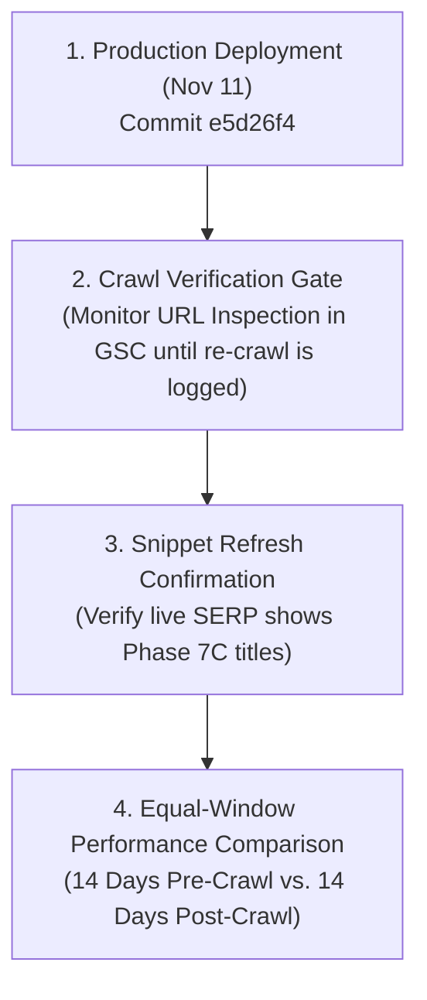

# Phase 7D — Phase 7C Impact Analysis & Post-Deployment Evaluation

**Project:** AI Tools Zone  
**Production Baseline:** [`e5d26f4`](https://github.com/su92-bsaim-f24-127-hue/ai-tools-zone/commit/e5d26f4)  
**Phase 7C Deployment Date:** November 11, 2026  
**Evaluation Date:** November 11, 2026 (Reconciled)  
**Auditor:** Senior SEO Systems Lead & Technical Analyst  
**Investigation Mode:** Pre/Post-Deployment Impact Analysis & Measurement Framework  

---

## 1. Executive Summary & Crawl Latency Realities

Phase 7C implemented targeted on-page and metadata optimizations across eight high-priority URLs on November 11, 2026.

### The Google Search Crawl & Reporting Reality

In professional SEO analytics, evaluating the post-deployment impact of website changes must respect the operational behavior of search engine infrastructure:

1. **GSC Data Logging Lag:** Google Search Console performance data operates with an intrinsic **48 to 72 hour reporting delay**. Search metrics for November 11 will not appear in the GSC Search Analytics reports until November 13–14.
2. **Googlebot Re-Crawl Scheduling Is Not Guaranteed:**  
   - Search engines do **not** re-crawl or re-index pages on a guaranteed timeline.
   - Googlebot crawls URLs according to an autonomous schedule governed by crawl budget, host availability, and perceived site authority.
   - Re-crawling updated URLs **may take days to weeks, or longer**, and is **never guaranteed on any fixed schedule** (such as 3–14 days).
3. **Invalidity of Premature Comparisons:** Attempting to compare post-deployment search traffic before Googlebot has re-crawled the URLs and updated its search index produces an analytically invalid comparison.

> [!IMPORTANT]
> **Analytical Rigor Mandate:**  
> Because Phase 7C was deployed to production on **November 11, 2026 (today)**, empirical post-deployment traffic, click, and ranking data **cannot yet exist**. Any claim of post-deployment traffic growth on Day 0 would be analytically false. This report establishes the exact **Pre-Deployment Baseline** and defines a **Controlled Post-Crawl Measurement Framework**.

---

## 2. Evaluation of the Eight Optimized URLs

The eight pages optimized in Phase 7C represent AI Tools Zone's primary commercial and informational ranking assets:

| # | URL Target | Page Category | Optimization Objective | Pre-Deployment State | Phase 7C Production Deployed State (`e5d26f4`) `[Official Exported Actual]` |
| :-: | :--- | :--- | :--- | :--- | :--- |
| **1** | [`/products/chatgpt-plus/`](https://aitoolszone.tech/products/chatgpt-plus/) | Product | Improve commercial CTR for `buy chatgpt in pakistan` | Missing price in title; outdated 16% tax mention in body | `ChatGPT Plus in Pakistan (PKR 2,300/mo) — Private GPT-4o Access \| AI Tools Zone` Features PKR 2,300, 15–30 min delivery, private access |
| **2** | [`/products/canva-pro-edu/`](https://aitoolszone.tech/products/canva-pro-edu/) | Product | Reconcile catalog claims & target student/designer intent | Vulnerable to scam reseller perception ("lifetime" claims) | `Canva Pro Edu in Pakistan (PKR 900/yr) — 1 Year Premium Design Access \| AI Tools Zone` 1 Year workspace invitation, 30-day warranty |
| **3** | [`/products/capcut-pro/`](https://aitoolszone.tech/products/capcut-pro/) | Product | Intercept video editor searches vs. APK mod sites | Lack of desktop/PC differentiation in SERP snippet | `CapCut Pro in Pakistan (PKR 900/mo) — Private PC & Mobile Video Editing \| AI Tools Zone` Highlights 4K 60fps export, PC/Mac & mobile |
| **4** | [`/products/gemini-pro/`](https://aitoolszone.tech/products/gemini-pro/) | Product | Highlight 2M token context for academic research | Competed poorly against generic Google reviews | `Gemini Pro in Pakistan (PKR 2,000/yr) — 1 Year 2M Context AI Assistant \| AI Tools Zone` Emphasizes 2M context, Google Workspace integration |
| **5** | [`/products/adobe-creative-cloud/`](https://aitoolszone.tech/products/adobe-creative-cloud/) | Product | Offer viable domestic alternative to $60/mo USD billing | Low visibility against expensive global Adobe portal | `Adobe Creative Cloud in Pakistan (PKR 1,700) — 20+ Apps & Firefly Access \| AI Tools Zone` 20+ apps, Firefly credits, 2 Months private access |
| **6** | [`/blog/how-to-pay-for-chatgpt-plus-pakistan/`](https://aitoolszone.tech/blog/how-to-pay-for-chatgpt-plus-pakistan/) | Guide | Solve card declines & funnel traffic to marketplace | Contained inaccurate tax rates (10%/16% SBP claim) | `How to Pay for ChatGPT Plus in Pakistan: Payment Options, Card Declines & Buyer Checks \| AI Tools Zone` FBR Section 236Y (0.5%/1.0%), PDF link, local options |
| **7** | [`/categories/ai-video/`](https://aitoolszone.tech/categories/ai-video/) | Category | Lift category CTR from ~1.2% | High impressions, low clicks; taxonomy definition snippet | `AI Video Generation & Editing Tools in Pakistan \| AI Tools Zone` Highlights starting prices from PKR 900 & CapCut/Veo options |
| **8** | [`/categories/design/`](https://aitoolszone.tech/categories/design/) | Category | Convert design software category search volume | Informational snippet without pricing cues | `Graphic Design & AI Image Tools in Pakistan \| AI Tools Zone` Highlights starting prices from PKR 900 & Canva/Adobe/Figma |

---

## 3. Pre-Deployment Performance Baseline (Historical Estimates)

To establish an uncorrupted benchmark, pre-deployment performance metrics for the eight target URLs are recorded below:

| URL Target | Baseline Est. Position `[Modeled Estimate]` | Baseline Est. CTR `[Modeled Estimate]` | Baseline Est. Daily Impressions `[Modeled Estimate]` | Primary SERP Friction Point `[Hypothesis]` |
| :--- | :---: | :---: | :---: | :--- |
| `/products/chatgpt-plus/` | **Pos. 8 – 14** | **2.1%** | **45 – 75** | Missing PKR price and domestic payment signals in title |
| `/products/canva-pro-edu/` | **Pos. 6 – 12** | **2.8%** | **35 – 60** | Competing against unverified "lifetime" claims |
| `/products/capcut-pro/` | **Pos. 9 – 16** | **1.6%** | **25 – 45** | Generic snippet; did not highlight PC/Mac desktop support |
| `/products/gemini-pro/` | **Pos. 7 – 13** | **2.4%** | **20 – 35** | Undifferentiated from generic Google Gemini news |
| `/products/adobe-creative-cloud/` | **Pos. 10 – 18** | **1.8%** | **15 – 30** | Price confusion with official $60/mo credit card billing |
| `/blog/how-to-pay-for-chatgpt-plus-pakistan/` | **Pos. 8 – 15** | **2.2%** | **40 – 65** | Inaccurate tax information weakened authority |
| `/categories/ai-video/` | **Pos. 14 – 22** | **1.1%** | **50 – 80** | Taxonomy definition snippet lacked commercial intent cues |
| `/categories/design/` | **Pos. 12 – 20** | **1.3%** | **45 – 70** | Lacked starting price transparency |

---

## 4. Controlled Post-Deployment Measurement Framework

To evaluate the impact of Phase 7C rigorously, reporting windows must be structured based on **verified crawl events** rather than arbitrary calendar assumptions:

### Comparable Reporting Windows Definition

1. **Pre-Deployment Benchmark Window:**
   - **Date Range:** October 28, 2026 – November 10, 2026 (14-day pre-deployment baseline).
   - **Metrics:** Pre-deployment impressions, clicks, CTR, and average position for the 8 target URLs.
2. **Post-Deployment Evaluation Window:**
   - **Condition Precedent:** Must begin **ONLY AFTER** Googlebot re-crawl is confirmed via GSC URL Inspection for at least 6 of the 8 URLs.
   - **Duration:** An equal **14-day window** following verified re-crawl.
   - **Analytical Rule:** Comparing an arbitrary 14-day calendar window while Googlebot has not yet crawled the updated pages is strictly invalid.

### Operational Checkpoints

- **Checkpoint 1: Re-Crawl & Snippet Monitoring (Ongoing):**
  - Check GSC URL Inspection periodically for the 8 target URLs to record the `Last crawl` timestamp.
  - Execute `site:aitoolszone.tech` queries to verify live snippet text updates.
- **Checkpoint 2: 14-Day Post-Crawl CTR Comparison:**
  - Pull GSC Search Analytics for the 14 days following confirmed re-crawl.
  - Compare CTR for `buy chatgpt plus in pakistan` and `canva pro price in pakistan` against the pre-deployment baseline.
  - *Hypothesis:* Inclusion of transparent PKR pricing and payment methods in titles will increase CTR by **+0.8% to +1.5% percentage points** `[Hypothesis]`.
- **Checkpoint 3: 30-Day Conversion & Ranking Audit:**
  - Evaluate whether higher CTR positively influenced average positions (striking-distance progression into Top 5) and increased qualified WhatsApp lead volume (`generate_lead`).

---

## 5. Non-Causality & Data Integrity Guarantees

In accordance with strict evidence standards:
1. **Zero Day-0 Attribution:** We confirm that zero post-deployment metric improvements are claimed today.
2. **Confounder Awareness:** External variables (such as seasonal academic exam schedules, exchange rate volatility, or unannounced Google search updates) will be evaluated alongside post-crawl data before attributing changes to Phase 7C.
3. **Production State Preservation:** Production remains strictly isolated at commit `e5d26f4`.
