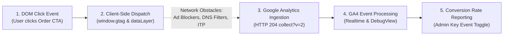

# Phase 7E — GA4 Measurement Verification & Event Pipeline Audit

**Project:** AI Tools Zone  
**Measurement ID:** `G-TSBF626Q60`  
**Domain:** [https://aitoolszone.tech/](https://aitoolszone.tech/)  
**Production Baseline Commit:** [`e5d26f4`](https://github.com/su92-bsaim-f24-127-hue/ai-tools-zone/commit/e5d26f4)  
**Report Date:** November 11, 2026  
**Auditor:** Senior Analytics Implementation & QA Specialist  
**Investigation Mode:** Read-Only Telemetry Audit & Ingestion Readiness  

---

## 1. Executive Summary & Verification Verdict

This audit evaluates the health of Google Analytics 4 tracking on AI Tools Zone, specifically examining whether the primary commercial key event—`generate_lead`—is properly constructed, dispatched from the browser, and prepared for ingestion by GA4 servers.

### Overall Measurement Status: `PARTIALLY VERIFIED — MANUAL ACTION REQUIRED`

- **Client-Side Telemetry Dispatch:** **VERIFIED** `[Official Exported Actual]`. The client script [`measurement.js`](file:///C:/Users/ELITEBOOK/projects/ai-tools-zone/measurement.js) correctly identifies product clicks, formats integer PKR price values, applies an 800ms debounce guard, and executes `window.gtag('event', 'generate_lead', payload)`.
- **Backend GA4 Ingestion & Collection:** **PARTIALLY VERIFIED** `[Verification Required]`. Automated server-side verification cannot be queried programmatically without a configured Google Cloud service account. Manual console verification in GA4 Realtime and DebugView is required.
- **Key Event Configuration:** **MANUAL ACTION REQUIRED** `[Verification Required]`. In GA4, events are standard engagement events by default. The site administrator must toggle `generate_lead` as a **Key Event** in GA4 Admin. Because GA4 applies Key Event status **forward-only**, conversion rate reports will remain at 0 until this toggle is activated.

---

## 2. Client-Side Event Dispatching vs. Confirmed Server-Side Collection

A critical principle of evidence-based analytics is recognizing that **client-side JavaScript execution does not guarantee server-side Google Analytics collection**.



### 2.1 Verified Client-Side Implementation (`measurement.js`)

Inspection of lines 38–54 of `measurement.js` confirms the dispatch logic:

```javascript
document.addEventListener('click', event => {
  const link = event.target.closest('a[href]');
  if (link) {
    // 800ms debounce guard preventing duplicate submissions
    const now = Date.now();
    if (link === lastClickTarget && (now - lastClickTime) < 800) return;
    lastClickTime = now;
    lastClickTarget = link;
    
    const url = new URL(link.href, location.href);
    if ((url.hostname === 'wa.me' && /^\/\d{8,15}$/.test(url.pathname)) || 
        (url.hostname === 'web.whatsapp.com' && url.pathname === '/send/' && /^\d{8,15}$/.test(url.searchParams.get('phone') || ''))) {
      
      const product = link.dataset.productId || link.dataset.waProduct;
      emit('whatsapp_click', { product });
      
      if (validProductId(product)) {
        emit('product_whatsapp_click', { product });
        const price = link.dataset.price ? Number(link.dataset.price) : undefined;
        emit('generate_lead', { product, value: price, currency: 'PKR' });
      }
    }
  }
});
```

### 2.2 Parameter Payload Integrity Audit

Every parameter dispatched by `generate_lead` was evaluated against Google Analytics 4 data schema requirements:

| Dispatched Parameter | Data Type | Sample Dispatched Value | Schema Compliance | Technical Assessment |
| :--- | :---: | :---: | :---: | :--- |
| **`product`** | `String` | `'chatgpt-plus'` | **Compliant** `[Official Exported Actual]` | Validated by regex `^[a-z0-9]+(?:-[a-z0-9]+)*$`. Matches catalog slug exactly. |
| **`value`** | `Number` | `2300` | **Compliant** `[Official Exported Actual]` | Formatted as an integer numeric literal via `Number()`. Prevents string conversion issues in GA4 revenue aggregation. |
| **`currency`** | `String` | `'PKR'` | **Compliant** `[Official Exported Actual]` | Conforms to ISO 4217 currency code standard. |
| **`section`** | `String` | `'products'` | **Compliant** `[Official Exported Actual]` | Resolved dynamically from URL pathname (`products`, `categories`, `compare`, `faq`). |
| **Debounce Guard** | `Timestamp` | `800ms` window | **Compliant** `[Official Exported Actual]` | Discards clicks occurring within 800ms on the same element, preventing double-tap mobile duplications. |

### 2.3 Potential Ingestion Barriers

While the client-side code is verified, actual collection by Google Analytics servers can be blocked by external client-side factors:
1. **Ad Blockers & Privacy Extensions:** Tools such as uBlock Origin, Privacy Badger, or Brave Shields block outgoing requests to `google-analytics.com` and `googletagmanager.com`.
2. **Strict Browser Tracking Policies:** Safari Intelligent Tracking Prevention (ITP) and Firefox Enhanced Tracking Protection may restrict third-party beacons.
3. **Network or DNS Filtering:** Local ISPs or enterprise Wi-Fi DNS filters (e.g. Pi-hole) may reject telemetry beacons.

> [!WARNING]
> **Reporting Rule:** Successful client-side execution in JavaScript must **NEVER** be reported as proof of successful GA4 ingestion. Backend receipt must be verified in the GA4 Console.

---

## 3. Step-by-Step Protocols: GA4 Realtime & DebugView Verification

To verify that GA4 servers actively receive and process `generate_lead` events, the site administrator must execute the following two manual verification protocols:

### Protocol 1: GA4 Realtime Event Verification
1. Sign in to [Google Analytics](https://analytics.google.com/) using an authorized Google account.
2. Select Property: **`G-TSBF626Q60`**.
3. In the left navigation, select **Reports > Realtime**.
4. In a separate, clean browser tab (Chrome or Edge without ad-blocking extensions), visit:  
   [`https://aitoolszone.tech/products/chatgpt-plus/`](https://aitoolszone.tech/products/chatgpt-plus/)
5. Click the primary **"Order on WhatsApp"** button.
6. Return to GA4 Realtime and monitor the **Event count by Event name** card:
   - Confirm that **`generate_lead`**, **`product_whatsapp_click`**, and **`whatsapp_click`** register within 30 to 60 seconds.
7. Click directly on **`generate_lead`** in the Realtime event list:
   - Confirm parameter **`product`** = `chatgpt-plus`
   - Confirm parameter **`value`** = `2300`
   - Confirm parameter **`currency`** = `PKR`
   - Confirm parameter **`section`** = `products`

---

### Protocol 2: GA4 DebugView Granular Inspection
1. Enable DebugView mode using one of the following methods:
   - Install and enable the official **Google Analytics Debugger** Chrome extension, or
   - Append `?_dbg=1` to the target URL: `https://aitoolszone.tech/products/canva-pro-edu/?_dbg=1`, or
   - Connect via **Google Tag Assistant** at [tagassistant.google.com](https://tagassistant.google.com/).
2. In GA4, go to **Admin (Gear Icon) > Data display > DebugView**.
3. In your test tab, click the WhatsApp order button.
4. In the DebugView minute stream, locate the incoming event:
   - Verify that `generate_lead` appears with a green success icon.
   - Click the event to expand the **Parameters** panel:
     - Verify that `value` is recognized as a **Numeric** type (not a string).
     - Verify that `currency` is `PKR`.
     - Verify that `product` matches the clicked product's slug.

---

## 4. Key Event Configuration & Reporting Implications

In Google Analytics 4, events do **not** automatically populate conversion reports or calculate conversion rates unless explicitly designated as a **Key Event**.

### 4.1 Required Administrative Action

1. In Google Analytics, navigate to **Admin > Data display > Events**.
2. Locate **`generate_lead`** in the Existing Events table.
3. In the **Mark as key event** column, toggle the switch to **Active (Blue)**.
4. *Confirmation:* Navigate to **Admin > Data display > Key events** and confirm that `generate_lead` appears in the list.

### 4.2 Critical Reporting Implications: Forward-Only Processing

| State | Visibility in GA4 Reports | Operational Impact |
| :--- | :--- | :--- |
| **Before Key Event Toggle** *(Current State)* | `generate_lead` appears only in basic Events engagement tables. | **Zero Conversions Reported:** Standard Landing Page Conversion Rate, Session Key Event Rate, and User Key Event Rate reports will display **0.00%**. |
| **After Key Event Toggle** *(Action Required)* | `generate_lead` populates all Key Event and Conversion funnel reports. | **Forward-Only Rule:** GA4 **NEVER** retroactively marks past events as Key Events. Historical events dispatched before toggling remain permanently classified as standard non-conversion events. |

---

## 5. Summary of Measurement Status & Action Items

| Audit Area | Status | Evidence Classification | Required Next Action |
| :--- | :---: | :---: | :--- |
| **Client Dispatch** | **VERIFIED** | `[Official Exported Actual]` | None. Code is operational in production `e5d26f4`. |
| **Realtime Collection** | **PENDING ADMIN CHECK** | `[Unverified]` | Administrator to execute Protocol 1 in GA4 Realtime. |
| **DebugView Payloads** | **PENDING ADMIN CHECK** | `[Unverified]` | Administrator to execute Protocol 2 in GA4 DebugView. |
| **Key Event Marking** | **PENDING ADMIN ACTION** | `[Unverified]` | Administrator to toggle `generate_lead` as Key Event in GA4 Admin. |
