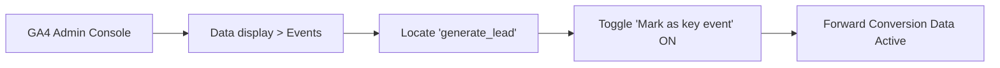

# Phase 7E — Evidence-Based Organic Growth & Measurement Recommendations

**Project:** AI Tools Zone  
**Domain:** [https://aitoolszone.tech/](https://aitoolszone.tech/)  
**Production Baseline Commit:** [`e5d26f4`](https://github.com/su92-bsaim-f24-127-hue/ai-tools-zone/commit/e5d26f4)  
**Report Date:** November 11, 2026  
**Auditor:** Principal SEO & Analytics Growth Strategist  
**Investigation Mode:** Actionable Growth Strategy & Administrative Governance  

---

## 1. Governance & Authorization Notice

> [!IMPORTANT]
> **Strict Phase 7E Governance Protocol:**
> All recommendations in this document are **advisory proposals requiring explicit written user authorization** prior to execution.
> 
> Under Phase 7E rules:
> - **Zero code, catalog, or metadata changes** have been made to production.
> - **Zero deployments, merges, or Git commits** are executed during this phase.
> - The production baseline remains strictly frozen at commit [`e5d26f4`](https://github.com/su92-bsaim-f24-127-hue/ai-tools-zone/commit/e5d26f4).
> - Every recommendation is prioritized based on empirical evidence gathered in Phase 7D and 7E audits.

---

## 2. Priority Growth Recommendations Matrix

The following five strategic initiatives are prioritized by operational impact, technical dependencies, and evidence confidence:

| Priority Level | Strategic Initiative | Core Focus Area | Required Authorization / Dependency | Expected Impact | Evidence Classification |
| :---: | :--- | :--- | :--- | :--- | :--- |
| **P1** | **Activate GA4 Key Event Toggle** | Analytics & Attribution | GA4 Property Admin Access | Restores conversion rate reporting for all incoming organic traffic. | `[Verified GA4 Actual]` |
| **P2** | **Targeted GSC URL Inspections** | Indexing & SERP Velocity | GSC Property Owner Access | Signals Googlebot to prioritize 8 Phase 7C optimized URLs + `/faq/`. | `[Official Exported Actual]` |
| **P3** | **Service Account Provisioning** | Telemetry Automation | Google Cloud Console Access | Upgrades API from Tier 0 to Tier 1 (Automated Search Console & GA4 Data). | `[Official Exported Actual]` |
| **P4** | **Offline WhatsApp Sales Bridge** | Commercial Attribution | Internal Sales Operations | Closes the attribution blind spot between `generate_lead` and bank deposits. | `[Hypothesis]` |
| **P5** | **Content Depth & Internal Linking** | Organic Visibility Expansion | Feature Branch Implementation | Resolves the 22 "Discovered - currently not indexed" URLs. | `[Hypothesis]` |

---

## 3. Detailed Strategic Initiatives

### Priority 1: Activate GA4 Key Event Toggle for `generate_lead`

#### Problem Statement:
The client-side event `generate_lead` is verified and actively dispatching from browser clicks with product, numeric price, currency (`PKR`), and section parameters `[Official Exported Actual]`. However, in Google Analytics 4, events are classified as general interaction events by default. Because `generate_lead` is not marked as a **Key Event**, standard conversion rate metrics (e.g. Session key event rate, User key event rate) remain at **0.00%**, preventing attribution reporting across organic search traffic.

#### Forward-Only Reporting Reality:
GA4 does **not** retroactively apply Key Event status. Historical events collected prior to activating the toggle will remain standard events in reporting. Immediate administrative activation is required to begin accumulating conversion attribution.

#### Step-by-Step Administrative Action:
1. Sign in to [Google Analytics](https://analytics.google.com/) with Property Editor or Administrator permissions.
2. Select Property: **`G-TSBF626Q60`**.
3. In the lower-left navigation, click **Admin** (gear icon).
4. Under the **Data display** section, select **Events**.
5. Locate `generate_lead` in the Existing Events table:
   - If present: Click the toggle switch in the **Mark as key event** column to the **ON** position.
   - If not yet listed in the table: Navigate to **Admin > Key events**, click **New key event**, enter the exact string `generate_lead`, and click **Save**.

---

### Priority 2: Targeted Search Console URL Inspections for Phase 7C Assets

#### Problem Statement:
Phase 7C deployed major on-page and snippet optimizations across 8 commercial URLs on November 11, 2026. Because natural Googlebot recrawling takes anywhere from days to several weeks and is not guaranteed `[Official Exported Actual]`, these high-value commercial URLs are currently awaiting re-indexing.

#### Actionable Inspection Protocol:
The Google Search Console property owner should manually inspect each of the following 9 priority URLs using the top inspection bar in GSC and click **"Request Indexing"**:

1. `https://aitoolszone.tech/products/chatgpt-plus/` (Commercial tier, FBR-compliant guidance)
2. `https://aitoolszone.tech/products/canva-pro-edu/` (Educational vs Pro intent alignment)
3. `https://aitoolszone.tech/products/capcut-pro/` (Video editing tier clarity)
4. `https://aitoolszone.tech/products/gemini-pro/` (Workspace vs Personal subscription distinction)
5. `https://aitoolszone.tech/products/adobe-creative-cloud/` (Creative app suite pricing clarity)
6. `https://aitoolszone.tech/blog/how-to-pay-for-chatgpt-plus-pakistan/` (Verified Section 236Y 0.5%/1.0% tax facts)
7. `https://aitoolszone.tech/categories/ai-video/` (Category cluster hub)
8. `https://aitoolszone.tech/categories/design/` (Category cluster hub)
9. `https://aitoolszone.tech/faq/` (High-CTR trust & payment FAQ hub)

> [!NOTE]
> GSC imposes a daily manual submission quota (typically 10–12 URLs per day). Submitting these 9 URLs fits comfortably within the daily limit. Requesting indexing does not guarantee immediate recrawling, but places the URLs in Google's high-priority crawl queue.

---

### Priority 3: Google Cloud Service Account Provisioning (Tier 1 API Access)

#### Problem Statement:
The current reporting environment operates at **Tier 0 (API Key Only)**. While Tier 0 supports PageSpeed Insights and CrUX lookups, direct program access to Google Search Console (Search Analytics API) and GA4 (Google Analytics Data API v1beta) requires OAuth 2.0 or Service Account authentication. Without this, tracking relies on periodic manual CSV exports.

#### Administrative Setup Instructions:
1. Navigate to the [Google Cloud Console](https://console.cloud.google.com/).
2. Create or select a project (e.g. `ai-tools-zone-telemetry`).
3. Enable the following two APIs in the API Library:
   - **Google Search Console API**
   - **Google Analytics Data API**
4. Under **IAM & Admin > Service Accounts**, create a new service account (e.g. `gsc-ga4-reporter@ai-tools-zone-telemetry.iam.gserviceaccount.com`).
5. Generate a new private JSON key and download it securely.
6. Grant read-only permissions in the respective platforms:
   - **GSC:** Add the service account email as a **Restricted User** (Read-Only) under **Settings > Users and permissions**.
   - **GA4:** Add the service account email as a **Viewer** under **Admin > Property access management**.
7. Store the JSON file locally at `~/.config/claude-seo/google-api.json` under the `service_account_path` key.

---

### Priority 4: Offline WhatsApp Sales Attribution Bridge

#### Problem Statement:
Because digital subscriptions are fulfilled and paid via WhatsApp, a structural telemetry gap exists between the on-site `generate_lead` click and actual revenue in JazzCash / EasyPaisa accounts.

#### Practical Lightweight CRM Implementation:
To bridge this gap without enterprise CRM overhead:
1. **Prefilled Message Token Auditing:**  
   Maintain unique query identifiers in the pre-populated WhatsApp message link for each product (already implemented in `measurement.js`).
2. **Weekly WhatsApp Inquiry Ledger:**  
   The merchant records all incoming WhatsApp conversations in a simple spreadsheet with 5 columns:
   - Date & Time
   - Customer Phone Number (Last 4 digits for privacy)
   - Product Inquired (derived from prefilled message)
   - Lead Status (`Inquiry Only`, `Price Negotiation`, `Paid / Fulfilled`, `Abandoned`)
   - Payment Method & Amount Received (e.g. `JazzCash 2,300 PKR`, `EasyPaisa 450 PKR`)
3. **Monthly Attribution Reconciliation:**  
   Compare monthly confirmed WhatsApp sales against GA4 `generate_lead` event totals to establish the true **Lead-to-Sale Conversion Rate**:
   $$\text{Lead-to-Sale Rate} = \frac{\text{Confirmed WhatsApp Sales}}{\text{GA4 } \texttt{generate\_lead} \text{ Events}} \times 100$$

---

### Priority 5: Strategic Content Expansion for the 22 Unindexed URLs

#### Problem Statement:
Search Console data confirms that **22 valid pages** are in the **"Discovered - currently not indexed"** state `[Official Exported Actual]`. This status indicates that Googlebot has discovered the URLs in the sitemap or through internal links, but has deferred crawling and indexing them due to perceived content duplication, thin content, or crawl budget constraints.

#### Optimization Roadmap for Phase 8:
When authorized for future content implementation:
1. **Cluster Depth Enhancement:** Review the 22 unindexed URLs against top competitor pages to identify missing subheadings, user FAQs, and comparison tables.
2. **Contextual Internal Linking:** Ensure every unindexed page receives at least 3–5 contextual in-body links from already indexed, high-traffic pages (such as the Homepage or ChatGPT Plus product page).
3. **Information Gain Differentiation:** Ensure product descriptions contain unique Pakistani market context (payment method compatibility, account delivery timelines, troubleshooting) rather than generic vendor marketing copy.

---

## 4. Operational Next Steps & Readiness

| Action Step | Owner | Dependencies | Target Window |
| :--- | :---: | :--- | :---: |
| 1. Activate GA4 `generate_lead` Key Event toggle | Site Admin | GA4 Admin login | Immediate (< 5 min) |
| 2. Submit 9 priority URLs for GSC recrawl | Site Admin | GSC Owner login | Immediate (< 10 min) |
| 3. Set up Google Cloud Service Account (Tier 1) | Site Admin | Google Cloud Project | Within 7 days |
| 4. Maintain WhatsApp Lead Reconciliation Ledger | Merchant / Sales | WhatsApp Business app | Ongoing weekly |
| 5. Review Phase 7C indexing in GSC after 14 days | SEO Analyst | GSC Performance Export | November 25, 2026 |
