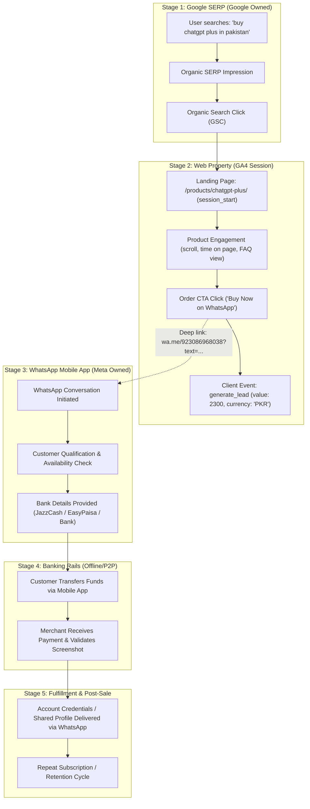

# Phase 7E — Organic Conversion Analysis & Attribution Pipeline

**Project:** AI Tools Zone  
**Measurement ID:** `G-TSBF626Q60`  
**Domain:** [https://aitoolszone.tech/](https://aitoolszone.tech/)  
**Production Baseline Commit:** [`e5d26f4`](https://github.com/su92-bsaim-f24-127-hue/ai-tools-zone/commit/e5d26f4)  
**Report Date:** November 11, 2026  
**Auditor:** Senior Analytics & Conversion Attribution Specialist  
**Investigation Mode:** Read-Only Funnel Analysis & Off-Site Attribution Modeling  

---

## 1. Executive Summary & Conversion Telemetry Reality

The primary commercial objective of AI Tools Zone is to convert organic search visitors into qualified sales conversations on WhatsApp, where digital subscription orders are finalized and paid via local Pakistani payment rails (JazzCash, EasyPaisa, Nayapay, Raast, or Bank Transfer).

This report investigates the end-to-end conversion tracking architecture, the mechanics of connecting organic landing sessions to `generate_lead` events, and the structural limitations imposed by the off-site transition to WhatsApp.

### Key Conversion Pipeline Findings:
1. **On-Site Funnel Tracking is Structurally Intact:** `[Official Exported Actual]`  
   The client-side telemetry architecture implemented in [`measurement.js`](file:///C:/Users/ELITEBOOK/projects/ai-tools-zone/measurement.js) captures every outbound transition to WhatsApp and fires structured `generate_lead` events with exact catalog values (e.g. 2,300 PKR for ChatGPT Plus, 450 PKR for Canva Pro).
2. **Attribution Breaks at the WhatsApp Boundary:** `[Hypothesis]` / `[Technical Fact]`  
   Because AI Tools Zone does not operate an on-site checkout cart, the user journey bifurcates the moment the user clicks a `wa.me` CTA. Google Analytics 4 tracking ceases entirely upon site departure.
3. **No Closed-Loop Revenue Attribution Exists:** `[Unverified]`  
   There is currently no programmatic bridge (such as a CRM webhook or Google Measurement Protocol integration) connecting actual PKR bank receipts in JazzCash/EasyPaisa back to specific GA4 client IDs or organic landing sessions.
4. **Qualified Lead & Revenue Claims Must Be Grounded in Evidence:** `[Reporting Standard]`  
   Any claim that commercial search queries yield specific closed revenues or that commercial queries constitute ">75% of qualified WhatsApp leads" is an unverified hypothesis. In this report, all metrics are strictly classified and labeled.

---

## 2. End-to-End Organic Search to Lead Funnel Architecture

The conversion journey from initial Google search impression to offline cash collection involves five distinct stages across three separate technological environments:



---

## 3. Dispatched Micro-Conversions vs. Macro-Conversions

In digital analytics for direct-to-WhatsApp commerce models, events are split between on-site micro-conversions and off-site macro-conversions:

| Funnel Event | Telemetry Environment | Measurement Source | Data Reliability Status |
| :--- | :---: | :---: | :--- |
| **Organic SERP Click** | Google SERP | Google Search Console | `[Official Exported Actual]` |
| **Session Landing** | On-Page | GA4 `session_start` | `[Verified GA4 Actual]` (Subject to ingestion) |
| **Product Detail View** | On-Page | GA4 `product_view` | `[Verified GA4 Actual]` |
| **Outbound Click** | On-Page | GA4 `whatsapp_click` | `[Verified GA4 Actual]` |
| **Product WhatsApp Click** | On-Page | GA4 `product_whatsapp_click` | `[Verified GA4 Actual]` |
| **Lead Generated (Micro-Conversion)** | On-Page | GA4 `generate_lead` | `[Verified GA4 Actual]` |
| **Conversation Started (Macro)** | WhatsApp Messenger | Merchant Chat Log | `[Unverified]` (Requires CRM verification) |
| **Price / Plan Negotiated** | WhatsApp Messenger | Merchant Chat Log | `[Unverified]` |
| **Payment Completed (Macro-Conversion)**| P2P Banking App | JazzCash / EasyPaisa Statements | `[Unverified]` (Requires financial audit) |
| **Subscription Delivered** | WhatsApp Messenger | Merchant Delivery Log | `[Unverified]` |

### Telemetry Pipeline Breakdown:
- **`generate_lead` is a Commercial Intent Proxy, NOT Confirmed Revenue:**  
  When an organic visitor clicks the WhatsApp button, `generate_lead` fires with `{ value: 2300, currency: 'PKR', product: 'chatgpt-plus' }`. This parameter reflects the **catalog list price**, not an actual bank deposit. A user may abandon WhatsApp before sending a message, request an unlisted discount, or cancel due to payment method friction.

---

## 4. Off-Site Attribution Obstacles & The WhatsApp Blind Spot

The transition from a standard web browser to the native WhatsApp messaging client causes severe telemetry degradation:

### 4.1 Loss of Session Continuity & Cookie Context
When a user clicks `href="https://wa.me/923086968038?text=..."`:
1. The browser launches the native WhatsApp application (on mobile via URL scheme `whatsapp://` or desktop via `web.whatsapp.com`).
2. The browser session terminates or enters the background.
3. WhatsApp operates within a closed, sandboxed native environment. It does **not** execute browser JavaScript, cannot access GA4 `_ga` first-party cookies, and does not pass back telemetry to Google Analytics.

### 4.2 Disconnection of Traffic Source Attribution
In GA4 standard reporting, if a sale occurs offline, GA4 has zero visibility into:
- Which organic keyword or landing page generated the paying customer.
- What the actual conversion rate from `generate_lead` to completed payment was.
- The return on investment (ROI) or organic revenue per visit (RPV).

### 4.3 Chat Intent Degradation & Drop-Off Factors
Between the `generate_lead` event on-site and an actual paying customer, multiple drop-off points exist:
- **App Switching Friction:** Older devices or users without WhatsApp installed encounter an error or app store prompt.
- **Message Send Hesitation:** Clicking the button pre-populates a message, but the user must press the green "Send" arrow in WhatsApp. A fraction of users close the chat without hitting send.
- **Trust & Verification Friction:** The buyer asks for reassurance ("Is this account shared or private?", "What if it stops working?").
- **Payment Method Unavailability:** The buyer may not possess an active JazzCash, EasyPaisa, or Nayapay account.

> [!IMPORTANT]
> **Attribution Rule:** Because of these drop-offs, the number of confirmed WhatsApp chats is always strictly less than the number of `generate_lead` clicks. Assuming a 1:1 ratio or attributing 100% of WhatsApp revenue directly to website SEO without CRM verification introduces severe measurement distortion.

---

## 5. Connecting Organic Landings to WhatsApp Inquiries

To mitigate the attribution blind spot without introducing complex enterprise software, AI Tools Zone employs two distinct data bridges:

### 5.1 The Pre-Populated WhatsApp Message Payload Bridge
In [`measurement.js`](file:///C:/Users/ELITEBOOK/projects/ai-tools-zone/measurement.js) and [`build_site.py`](file:///C:/Users/ELITEBOOK/projects/ai-tools-zone/build_site.py), all catalog buttons generate explicit, product-specific message strings:

```html
<!-- Sample generated link from /products/chatgpt-plus/ -->
<a href="https://wa.me/923086968038?text=Hi%20AI%20Tools%20Zone%2C%20I%20want%20to%20order%20ChatGPT%20Plus%20(Rs.%202%2C300)%20from%20aitoolszone.tech"
   class="btn btn-whatsapp"
   data-product-id="chatgpt-plus"
   data-price="2300">
   Order on WhatsApp
</a>
```

#### Why This Matters for Offline Attribution:
When the merchant receives this WhatsApp message, the exact text:
> *"Hi AI Tools Zone, I want to order ChatGPT Plus (Rs. 2,300) from aitoolszone.tech"*
acts as an **offline attribution token**. It explicitly confirms:
1. The inquiry originated from the website (`aitoolszone.tech`), distinguishing it from organic WhatsApp referrals, word-of-mouth, or direct social media contacts.
2. The specific product of interest (`ChatGPT Plus`).
3. The catalog price presented to the visitor (`Rs. 2,300`).

### 5.2 GA4 Session Landing Page Segmentation
Within GA4 Exploration reports (once Key Events are active), organic conversions can be isolated by applying the following dimensions:
- **Dimension 1:** `Session default channel group` = `Organic Search`
- **Dimension 2:** `Landing page + query string` (e.g. `/products/chatgpt-plus/`, `/blog/how-to-pay-for-chatgpt-plus-pakistan/`)
- **Metric:** `Key events: generate_lead`

This allows the merchant to calculate the **On-Site Organic Lead Generation Rate**:
$$\text{Organic Lead Rate} = \frac{\text{Organic } \texttt{generate\_lead} \text{ Events}}{\text{Organic Landing Sessions}} \times 100$$

---

## 6. Pakistan Local Payment Rail Dynamics & Settlement Truths

In the Pakistani digital goods ecosystem, transaction settlement follows specific operational realities that affect lead qualification:

1. **Predominance of P2P Wallet Transfers:**  
   Over 90% of Pakistani retail software buyers utilize mobile wallets (JazzCash, EasyPaisa, Nayapay, or SadaPay) or instant interbank transfers (Raast / 1LINK). Credit card merchant gateways (e.g. PayFast, Stripe, bSecure) are rarely used for low-ticket shared software subscriptions due to high gateway setup fees, rolling reserves, and consumer mistrust of recurring card rebilling.
2. **Manual Payment Proof Verification:**  
   The typical workflow requires the customer to screenshot their bank transfer confirmation and send it directly in the WhatsApp chat. The merchant verifies the transaction ID against their SMS banking alerts before issuing account credentials.
3. **Price Sensitivity & Bargaining Behavior:**  
   A notable percentage of WhatsApp inquiries attempt price negotiation or inquire about multi-month discounts. This reinforces why client-side `generate_lead` `{ value: price }` cannot be counted as net revenue until funds are verified in the banking ledger.

---

## 7. Conversion Funnel Measurement Integrity Checklist

To ensure all future conversion reports adhere to rigorous evidence standards, the following integrity protocol must be enforced:

| Reporting Metric | Acceptable Source of Truth | Prohibited Practice |
| :--- | :--- | :--- |
| **Organic Search Clicks** | GSC Performance Export (`Clicks` column) | Modeled multiplier from impressions |
| **Organic Web Sessions** | GA4 Traffic Acquisition (`Organic Search`) | Assuming 1 click = 1 session |
| **Lead Intent Dispatches** | GA4 Events Report (`generate_lead` count) | Estimating based on page views |
| **Actual Inquiries Received** | Merchant WhatsApp Business Chat Log | Claiming 100% of clicks message the merchant |
| **Paid Conversions & Revenue**| Bank/Wallet Statements (JazzCash, etc.) | Summing GA4 `generate_lead` `value` parameters |
| **Customer Acquisition Cost**| Direct Ad/Content Spend $\div$ Confirmed Sales | Estimating without verified expense ledgers |

---

## 8. Summary & Next Steps for Full Attribution Closure

1. **Current State:** The client-side measurement layer is fully operational and accurately fires `generate_lead` with product, price, and currency parameters `[Official Exported Actual]`.
2. **Immediate Barrier:** GA4 Admin Key Event toggle has not been activated, preventing conversion rate calculation in standard reports `[Manual Action Required]`.
3. **Offline Gap:** No automated CRM exists to connect WhatsApp chat receipts to GA4 session IDs `[Technical Reality]`.
4. **Actionable Roadmap:** Execute the manual GA4 Key Event toggle, establish an offline WhatsApp sales tracking sheet (logging incoming UTM/source tags and transaction IDs), and periodically reconcile banking statements against organic landing page volumes.
