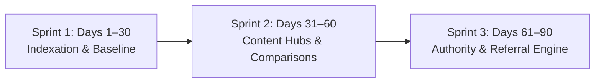

# AI Tools Zone — Future Growth & Customer Acquisition Recommendations

**Website:** [https://aitoolszone.tech/](https://aitoolszone.tech/)  
**Document:** Strategic Roadmap for Organic Search Expansion, Competitor Tracking & Customer Acquisition  
**Role:** Senior SEO Growth Strategist & E-commerce Acquisition Specialist  
**Target Market:** Pakistan  
**Scope:** AI Tools Zone Catalog & Content Architecture  
**Date:** November 2026  
**Branch:** `feature/product-descriptions-seo-growth`  

---

## 1. Executive Summary

With the successful deployment of optimized product descriptions across all 20 catalog offerings, AI Tools Zone has established a high-authority, localized on-page foundation. The product pages now clearly articulate value, feature transparent PKR pricing, dismantle payment barriers with JazzCash/Easypaisa/Raast messaging, and funnel high-intent visitors directly into WhatsApp conversational commerce.

To capitalize on this technical foundation, AI Tools Zone must transition from on-page optimization into an **evidence-based organic customer acquisition machine**. This report outlines a prioritized 30-60-90 day execution plan, a competitor monitoring framework, and actionable acquisition channels tailored specifically to Pakistan's digital economy.

---

## 2. Prioritized 30–60–90 Day Execution Roadmap

### Sprint 1: Days 1–30 — Indexation, Measurement & Baseline Establishment

#### Milestone 1.1: Accelerated Google Search Console (GSC) Re-Crawl
- **Action:** Submit the updated `sitemap.xml` directly to Google Search Console.
- **Action:** Perform URL Inspection and click *"Request Indexing"* on the top 5 revenue-driving product pages:
  1. `/products/chatgpt-plus/`
  2. `/products/gemini-pro/`
  3. `/products/canva-pro-edu/`
  4. `/products/capcut-pro/`
  5. `/products/elevenlabs/`
- **Expected Outcome:** Google re-evaluates the expanded content (from ~20 words to 500+ words), refreshing title tags and rich snippets in SERPs within 7–14 days.

#### Milestone 1.2: GA4 Event Validation & WhatsApp Conversion Tracking
- **Action:** Confirm that custom GA4 event tracking is capturing user interactions:
  - `whatsapp_click`: Fires whenever any order button is clicked, passing parameters `item_name`, `price`, `duration`, and `access_type`.
  - `faq_expand`: Tracks engagement with specific product FAQs to identify common pre-purchase doubts.
- **Action:** Create a custom Google Looker Studio dashboard tracking:
  - Impressions, Clicks, and Average Position for Pakistan (`country == PAK`).
  - Organic landing page sessions to `/products/*`.
  - WhatsApp lead conversion rate (`whatsapp_clicks / product_sessions`).

#### Milestone 1.3: Internal Link Cross-Polishing
- **Action:** Ensure newly optimized product pages receive contextual internal link equity from existing top-ranking blog posts:
  - Add contextual links to `/products/chatgpt-plus/` inside `/blog/how-to-pay-for-chatgpt-plus-pakistan/`.
  - Add links to `/products/gemini-pro/` inside `/blog/chatgpt-plus-vs-gemini-pro-pakistan/`.
  - Add links to `/products/capcut-pro/` inside `/blog/best-ai-video-generators-pakistan/`.

---

### Sprint 2: Days 31–60 — Content Expansion & Commercial Intent Capture

#### Milestone 2.1: High-Intent Pakistani Comparison Articles
Deploy targeted comparison pages that capture buyers in the final consideration phase before purchasing:
1. **CapCut Pro vs Premiere Pro for Pakistani Creators:**
   - *Target Keyword:* `CapCut Pro vs Premiere Pro Pakistan`
   - *Intent:* Shows creators why CapCut Pro at PKR 900 is faster for daily TikTok/YouTube Shorts workflows than bulky Adobe software.
2. **Gemini Pro vs ChatGPT Plus for Pakistani University Students:**
   - *Target Keyword:* `Gemini Pro vs ChatGPT Plus Pakistan students`
   - *Intent:* Highlights Gemini Pro's 1-year private access at PKR 2,000 against ChatGPT Plus monthly recurring costs for thesis research.
3. **ElevenLabs vs PlayHT for Urdu Voiceovers:**
   - *Target Keyword:* `best AI voice generator Urdu Pakistan`
   - *Intent:* Compares voice synthesis quality and commercial licensing for faceless YouTube automation.

#### Milestone 2.2: Pakistan Freelance & Student Ecosystem Hubs
- **Action:** Develop 3 dedicated resource hubs:
  - `/guides/ai-tools-for-upwork-freelancers-pakistan/`: Curating ChatGPT Plus, Claude, ElevenLabs, and Canva Pro with practical proposal-writing and asset-creation tips.
  - `/guides/ai-tools-for-pakistani-university-students/`: Complete guide for students at NUST, FAST, LUMS, COMSATS on ethical thesis structuring, literature review, and presentation decks.
  - `/guides/faceless-youtube-channel-pakistan-toolkit/`: End-to-end stack (ElevenLabs + Leonardo AI + CapCut Pro) for generating passive digital revenue in PKR.

---

### Sprint 3: Days 61–90 — Domain Authority, Partnerships & Retention

#### Milestone 3.1: Legitimate Pakistani Tech PR & Directory Listings
- **Action:** Submit AI Tools Zone to verified Pakistani tech directories, startup registries, and software review portals:
  - Submit site profile to legitimate Pakistani digital platforms and software directories.
  - Outreach to freelance tech communities on Facebook (e.g., Extreme Commerce, Enablers, DigiSkills alumni, Pakistan Freelancers Association).
  - Contribute informative, non-promotional educational guest articles on tech blogs covering *"How Pakistani Freelancers Overcome Foreign SaaS Payment Barriers"*.
- **Strict Compliance:** Zero automated link building, zero PBNs (Private Blog Networks), zero Fiverr spam packages.

#### Milestone 3.2: University Freelancing Society Partnerships
- **Action:** Reach out to student executive committees of computing and freelancing societies across major Pakistani universities (FAST ACM, NUST GDSC, LUMS Entrepreneurship Club).
- **Offer:** Provide verified student bundle guides and dedicated WhatsApp onboarding for student research cohorts.

#### Milestone 3.3: WhatsApp Loyalty & Renewal Automation
- **Action:** Implement a customer relationship loop on WhatsApp:
  - Day 25: Automated courtesy check-in (*"How is your Gemini Pro / ChatGPT Plus working for you?"*).
  - Day 28: Renewal reminder with exclusive renewal rate in PKR.
  - Referral Incentive: Offer PKR 200 off their next subscription renewal when they refer a fellow freelancer or classmate.

---

## 3. Competitor Monitoring Framework

To maintain a decisive market edge in Pakistan, AI Tools Zone should systematically monitor the top 5 digital tool providers in the region:

| Competitor Type | Key Players in Pakistan | What to Monitor | AI Tools Zone Competitive Moat |
|---|---|---|---|
| **Social Media Resellers** | Facebook Groups, WhatsApp Groups, OLX listings | Pricing fluctuations, scam reports, account bans | **Trust & Professionalism:** Clean web UI, verified 30-day warranty, transparent access types, instant WhatsApp delivery. |
| **Pakistani Tool Portals** | SubHub Pakistan, Toolsvilla-style shared portals | Shared tool stability, browser extension dependencies | **Direct Access:** We prioritize Private and official Invitation accounts rather than messy, buggy shared browser extensions. |
| **Traditional Digital Resellers** | International reseller sites billing in USD | USD-to-PKR conversion rates, payment gateway failures | **Zero FX Fees:** 100% native PKR billing via JazzCash, Easypaisa, and Raast with zero international transaction markup. |

### Monitoring Cadence:
- **Bi-Weekly Price Audit:** Review competitor pricing on ChatGPT Plus, Canva Pro, and CapCut Pro. Maintain competitive pricing without entering a destructive race to the bottom.
- **Weekly Stock Availability Check:** Identify when competitors suffer stock shortages (frequently occurring with OpenAI and Adobe accounts) to ramp up organic promotion.
- **Customer Pain Point Mining:** Track complaints on Pakistani tech groups regarding competitor account drop-offs to continually refine our FAQ and warranty messaging.

---

## 4. Key Performance Indicators (KPIs) to Track

To measure real business success over the next 90 days, monitor these concrete metrics:

1. **Organic Visibility Metrics (Google Search Console):**
   - Total Clicks from Pakistan (`Target: +40% in 60 days`).
   - Total Impressions for `[Tool] Pakistan` queries (`Target: +75% in 60 days`).
   - Number of keywords ranking in Top 10 positions (`Target: 15+ product queries`).
2. **Engagement & UX Metrics (GA4):**
   - Average engagement time on product pages (`Target: > 1m 30s`).
   - Scroll depth exceeding 75% on product pages (`Target: > 50% of visitors`).
3. **Conversion & Revenue Metrics (WhatsApp & CRM):**
   - Click-to-WhatsApp conversion rate (`Target: > 8% of product page visitors`).
   - WhatsApp lead-to-paid customer closing rate (`Target: > 35% of inquiries`).
   - Repeat purchase / renewal rate (`Target: > 45% at 30 days`).

---

## 5. Strict Governance & Ethical Safeguards

1. **No Speculative Ranking Guarantees:** SEO outcomes depend on Google crawl cycles and algorithmic updates; focus on relentless technical quality and genuine user value.
2. **Preserve Price Parity:** Any change to prices, access models, or warranties must be synchronized across `catalog.json`, `product-content.json`, and Schema.org markup.
3. **Continuous Compliance:** Monitor Google Search Console for any structured data or mobile usability notifications, maintaining a clean 0-error baseline.
