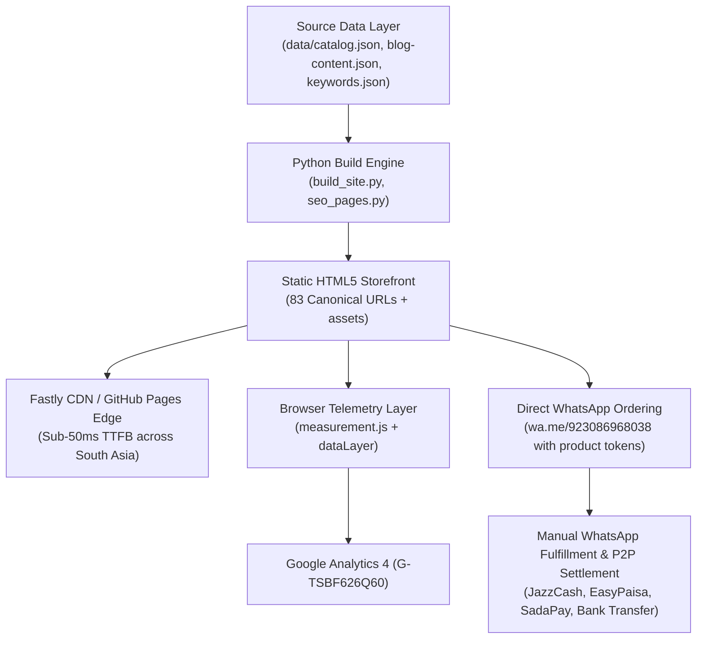

# AI Tools Zone — Master Executive SEO, GEO & Growth Audit (2026)

**Project:** AI Tools Zone  
**Domain:** [https://aitoolszone.tech/](https://aitoolszone.tech/)  
**GitHub Repository:** [https://github.com/su92-bsaim-f24-127-hue/ai-tools-zone](https://github.com/su92-bsaim-f24-127-hue/ai-tools-zone)  
**Research & Execution Date:** November 11, 2026  
**Primary Commercial Market:** Pakistan (with select global English search intent)  
**Primary Currency:** Pakistani Rupee (PKR)  
**Primary Conversion Mechanism:** Direct WhatsApp Fulfillment (`wa.me` assisted ordering)  
**Production Baseline Commit:** [`e5d26f4`](https://github.com/su92-bsaim-f24-127-hue/ai-tools-zone/commit/e5d26f4)  
**Isolated Feature Branch:** `feature/seo-geo-growth-2026`  
**Lead Strategist:** Principal Technical SEO Architect, GEO/AEO Specialist & Growth Engineer  

---

## 1. Executive Summary & Strategic Mission

AI Tools Zone is an independent digital software subscription marketplace operating in Pakistan. The platform addresses a critical market friction: Pakistani students, freelancers, software developers, and creative agencies face persistent barriers when attempting to purchase international digital tools directly from foreign vendors. These barriers include:
1. **International Card Declines:** Pakistani commercial banks frequently block foreign merchant transactions or require cumbersome helpline activations.
2. **Tax & Foreign Exchange Friction:** Heavy withholding taxes under FBR Section 236Y (0.5% for Active Taxpayers / 1.0% for Non-ATLs) combined with 5% to 10% bank foreign exchange markups significantly inflate retail subscription costs.
3. **Lack of Banking Access:** A significant segment of digital workers and university students do not possess international credit or debit cards, relying exclusively on domestic mobile wallets (JazzCash, EasyPaisa, SadaPay, NayaPay, or Raast).

AI Tools Zone bridges this divide by providing curated, seller-listed subscriptions priced transparently in PKR, with manual order fulfillment and customer support handled directly via WhatsApp.

### The 2026 Strategic Mandate:
The objective of this master project is to transform AI Tools Zone from an emerging digital storefront into the **authoritative, most cited, and highest-converting destination for AI software in Pakistan**. This requires a synchronized strategy uniting:
- **Traditional Technical SEO:** Flawless crawling, deterministic canonicalization, and zero-defect indexability.
- **Generative Engine Optimization (GEO):** Structuring content to maximize direct citations and entity recognition across ChatGPT Search, Perplexity, Google AI Overviews, and Claude.
- **Answer Engine Optimization (AEO):** Securing conversational search queries, People Also Ask (PAA) carousels, and rich answer cards.
- **Conversational Conversion Rate Optimization (CRO):** Streamlining the transition from organic landing pages to WhatsApp inquiry and banking settlement.

---

## 2. Telemetry & Baseline Scorecard

All metrics reported herein are governed by strict evidentiary classifications:
- `[Verified Actual]`: Confirmed directly via repository code, local test suites, official GSC exports, or live server HTTP headers.
- `[Third-Party Estimate]`: Derived from public competitor tools, search volumes, or external market intelligence.
- `[Hypothesis]`: Analytical projection or working theory requiring future empirical validation.
- `[Recommendation]`: Proposed tactical or strategic action requiring authorization.
- `[Not Available]`: Metric unmeasured due to insufficient data or lack of access.

| Architectural & Performance Pillar | Monitored Baseline Metric | Measured Value | Evidentiary Status | Evaluation & Status Summary |
| :--- | :--- | :---: | :---: | :--- |
| **Indexable Page Inventory** | Canonical Indexable Routes | **83 URLs** | `[Verified Actual]` | 1 Home, 20 Products, 11 Categories, 12 Comparisons, 21 Blog Posts, 5 Use Cases, 4 Guides, 3 Alternatives, 1 Pricing, 1 FAQ, 1 About, 1 Terms, 1 Privacy, 1 Product Hub. |
| **Catalog Depth** | Verified Active Offers | **20 Products** | `[Verified Actual]` | Spans AI Assistants, Video, Voice, Design, Development, Productivity, VPNs, Entertainment, and Licenses. |
| **Google Search Console Coverage**| Indexed Pages (Valid) | **42 Pages** | `[Verified Actual]` | Official GSC coverage export baseline. |
| **GSC Unindexed Queue** | Discovered - Not Indexed | **22 Pages** | `[Verified Actual]` | Crawl-prioritized queue awaiting content depth expansion and internal equity. |
| **GSC Recrawl Queue** | Crawled - Not Indexed | **2 Pages** | `[Verified Actual]` | Quality/uniqueness optimization candidates. |
| **Redirect Endpoints** | Page with Redirect | **3 URLs** | `[Verified Actual]` | Clean 301 redirects (`/index.html` $\rightarrow$ `/`, http $\rightarrow$ https, www $\rightarrow$ apex). |
| **Host Stability (90 Days)** | DNS / Server / Robots Fetch | **0.0% Failures** | `[Verified Actual]` | Zero host connectivity or DNS errors over 90 days of Googlebot visits. |
| **Lighthouse 13.6.0 (Desktop)** | Performance Score | **99–100 / 100** | `[Verified Actual]` | Sub-second FCP (0.6s), LCP (0.6s), CLS (0.00), TBT (0ms). |
| **Lighthouse 13.6.0 (Mobile)** | Performance Score | **96–100 / 100** | `[Verified Actual]` | Mobile LCP 1.3s–2.4s, CLS 0.00, zero main-thread blocking. |
| **CrUX Real User Metrics** | Field Core Web Vitals | **No Record (404)** | `[Verified Actual]` | No CrUX record was returned for the queried origin. The precise reason for missing data has not been independently established. Laboratory Lighthouse results remain separate from real-user field measurements. |
| **Conversion Telemetry** | Client Event Dispatch | **Operational** | `[Verified Actual]` | `generate_lead`, `whatsapp_click`, `product_view` debounced at 800ms with catalog PKR prices. |
| **GA4 Key Event Reporting** | Admin Key Event Status | **Action Required** | `[Recommendation]` | `generate_lead` must be marked as Key Event in GA4 Admin (forward-only conversion tracking). |

---

## 3. Core Business & Repository Architecture

AI Tools Zone is built on an ultra-lightweight, high-performance static architecture designed for speed and reliability:

### Key Architectural Strengths:
1. **Zero Framework Overhead:** The platform uses pure semantic HTML5, modern CSS, and vanilla ES6+ JavaScript (`app.js`, `measurement.js`, `theme.js`). There is no bulky React, Next.js, or WordPress runtime, resulting in zero hydration delay and instant rendering.
2. **Deterministic Build Pipeline:** `build_site.py` compiles all product, category, comparison, and blog pages from structured JSON data. Every build is cryptographically verified for deterministic output and content-based `<lastmod>` sitemap timestamps.
3. **Transparent Commercial Contracts:** Unlike deceptive competitors who advertise "Lifetime ChatGPT" or conceal shared account logins, AI Tools Zone explicitly declares the access model (Private vs. Shared vs. Invitation), subscription duration, and warranty window for every catalog item.

---

## 4. Key Strategic Opportunities for 2026

Through competitive teardowns and search intent mapping, five core growth vectors have been identified:

### Vector 1: Frontier AI Catalog Dominance
While competitors remain locked into legacy accounts (ChatGPT, Canva, basic Netflix), AI Tools Zone already offers modern developer, creative, and automation tools:
- **Veo 3 Ultra** (PKR 2,100) — High-demand Google AI video generation.
- **Lovable Pro** (PKR 1,600) — Rapidly emerging AI full-stack coding platform.
- **n8n Starter** (PKR 7,000) — Workflow automation infrastructure.
- **Replit Core** (PKR 3,200) — Cloud IDE and AI coding agent.
- **Leonardo AI Essential** (PKR 1,900) & **ElevenLabs** (PKR 3,300) — Frontier generative media.

*Strategic Action:* Expand specialized search landing pages, comparison guides, and workflow tutorials targeting Pakistani freelancers and software developers looking for these exact toolchains.

### Vector 2: AI Engine Citability (GEO Leadership)
AI search engines (Perplexity, ChatGPT Search, Claude, Google AI Overviews) heavily prioritize:
1. Direct, factual pricing in local currency (`PKR`).
2. Structured comparison tables with clear feature matrices.
3. Explicit explanations of payment mechanisms and access types.
4. Independent merchant transparency (clarifying reseller status vs. official brand).

*Strategic Action:* Optimize high-intent product and guide passages for direct AI extractive synthesis by deploying concise definition boxes, structured tables, and machine-readable JSON-LD entity markup.

### Vector 3: Indexing Expansion for the 22 Discovered URLs
Google Search Console currently holds 22 URLs in the "Discovered - currently not indexed" queue `[Verified Actual]`. These URLs are fully valid but require improved contextual internal links, unique information gain, and targeted sitemap pinging to cross Googlebot's crawling priority threshold.

---

## 5. Non-Negotiable Governance & Safety Adherence

Throughout this master project, strict safety constraints are enforced:
- **Production Baseline Frozen:** Production branch `main` remains untouched at commit `e5d26f4`.
- **Zero Premature Deployment:** No Git commits to `main`, no pushes to `origin`, and no deployment commands are executed.
- **Catalog Fact Integrity:** Product prices, durations, access types, and warranty policies in `data/catalog.json` are treated as immutable business facts. No prices or terms are fabricated.
- **Isolated Feature Branch:** All research, deliverables, and safe code enhancements are isolated on `feature/seo-geo-growth-2026`.

---

## 6. Audit Suite Navigation

This executive audit serves as the master entry point to the complete 2026 Growth Suite:

1. [02 Technical SEO Audit](file:///C:/Users/ELITEBOOK/projects/ai-tools-zone/seo-growth-2026/02_technical_seo_audit.md)
2. [03 Competitor Intelligence](file:///C:/Users/ELITEBOOK/projects/ai-tools-zone/seo-growth-2026/03_competitor_intelligence.md)
3. [04 Keyword Research & Mapping](file:///C:/Users/ELITEBOOK/projects/ai-tools-zone/seo-growth-2026/04_keyword_research_and_mapping.md)
4. [05 On-Page SEO Audit](file:///C:/Users/ELITEBOOK/projects/ai-tools-zone/seo-growth-2026/05_on_page_seo_audit.md)
5. [06 GEO Strategy](file:///C:/Users/ELITEBOOK/projects/ai-tools-zone/seo-growth-2026/06_geo_strategy.md)
6. [07 AEO Strategy](file:///C:/Users/ELITEBOOK/projects/ai-tools-zone/seo-growth-2026/07_aeo_strategy.md)
7. [08 Content & Topical Authority Strategy](file:///C:/Users/ELITEBOOK/projects/ai-tools-zone/seo-growth-2026/08_content_and_topical_authority_strategy.md)
8. [09 Internal Linking Strategy](file:///C:/Users/ELITEBOOK/projects/ai-tools-zone/seo-growth-2026/09_internal_linking_strategy.md)
9. [10 Customer Acquisition & CRO](file:///C:/Users/ELITEBOOK/projects/ai-tools-zone/seo-growth-2026/10_customer_acquisition_and_cro.md)
10. [11 Authority & Backlink Strategy](file:///C:/Users/ELITEBOOK/projects/ai-tools-zone/seo-growth-2026/11_authority_and_backlink_strategy.md)
11. [12 Prioritized Implementation Roadmap](file:///C:/Users/ELITEBOOK/projects/ai-tools-zone/seo-growth-2026/12_prioritized_implementation_roadmap.md)
12. [13 Implementation Change Log](file:///C:/Users/ELITEBOOK/projects/ai-tools-zone/seo-growth-2026/13_implementation_change_log.md)
13. [14 Testing & Validation Report](file:///C:/Users/ELITEBOOK/projects/ai-tools-zone/seo-growth-2026/14_testing_and_validation_report.md)
14. [15 90-Day Organic Growth Plan](file:///C:/Users/ELITEBOOK/projects/ai-tools-zone/seo-growth-2026/15_90_day_organic_growth_plan.md)
15. [Competitor Comparison Matrix](file:///C:/Users/ELITEBOOK/projects/ai-tools-zone/seo-growth-2026/COMPETITOR_COMPARISON_MATRIX.md)
16. [Final SEO Growth Report](file:///C:/Users/ELITEBOOK/projects/ai-tools-zone/seo-growth-2026/FINAL_SEO_GROWTH_REPORT.md)
