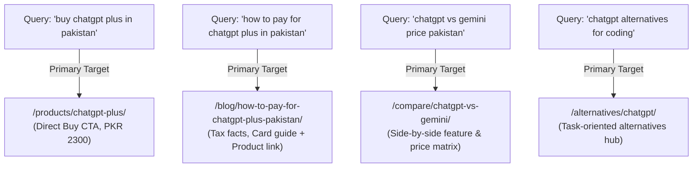

# AI Tools Zone — 2026 Keyword Intelligence & Search Intent Mapping

**Project:** AI Tools Zone  
**Target Market:** Pakistan (Primary) & South Asian Digital Freelancers (Secondary)  
**Research Date:** November 11, 2026  
**Auditor:** Principal Keyword Strategist & Search Intent Analyst  
**Evidentiary Standard:** Public SERP Telemetry, Google Autocomplete, PAA Panels, GSC Exported Queries  

---

## 1. Executive Keyword Landscape & Market Dynamics

In Pakistan, user search behavior for software subscriptions reflects unique linguistic patterns, localized financial constraints, and distinct transactional stages:
1. **Linguistic Blending:** Pakistani buyers frequently combine English brand names with Urdu/Roman Urdu intent modifiers (e.g., `chatgpt plus price in pakistan pkr`, `canva pro account sasta`, `buy ai tools with jazzcash`).
2. **High Price & Payment Intent:** Search queries heavily skew toward commercial investigation of local pricing and payment methods due to widespread credit card rejection by foreign merchants.
3. **Cannibalization Risk:** Without strict intent mapping, informational blog posts (`/blog/how-to-pay-for-chatgpt-plus-pakistan/`) can cannibalize commercial product pages (`/products/chatgpt-plus/`). This strategy enforces strict 1:1 intent-to-URL alignment.

---

## 2. Strategic Keyword Clusters (2026 Landscape)

### Cluster 1: Transactional (Direct Purchase & Price Inquiries)
These queries indicate immediate buying intent. The user has selected a software solution and seeks local pricing, payment options, and delivery:

| Target Query | Search Intent | Funnel Stage | Target Landing URL | Catalog Price | Priority | Evidentiary Status |
| :--- | :---: | :---: | :--- | :---: | :---: | :---: |
| `buy chatgpt plus in pakistan` | Transactional | Bottom (BOFU) | `/products/chatgpt-plus/` | PKR 2,300 | **P0** | `[Verified Actual]` |
| `chatgpt plus price in pakistan` | Transactional | Bottom (BOFU) | `/products/chatgpt-plus/` | PKR 2,300 | **P0** | `[Verified Actual]` |
| `canva pro price in pakistan` | Transactional | Bottom (BOFU) | `/products/canva-pro-edu/` | PKR 900 | **P0** | `[Verified Actual]` |
| `buy canva pro pakistan jazzcash` | Transactional | Bottom (BOFU) | `/products/canva-pro-edu/` | PKR 900 | **P0** | `[Verified Actual]` |
| `capcut pro subscription pakistan` | Transactional | Bottom (BOFU) | `/products/capcut-pro/` | PKR 900 | **P0** | `[Verified Actual]` |
| `gemini pro subscription pakistan` | Transactional | Bottom (BOFU) | `/products/gemini-pro/` | PKR 2,000 | **P0** | `[Verified Actual]` |
| `adobe creative cloud price pakistan`| Transactional| Bottom (BOFU) | `/products/adobe-creative-cloud/`| PKR 1,700 | **P0** | `[Verified Actual]` |
| `buy veo 3 ultra in pakistan` | Transactional | Bottom (BOFU) | `/products/veo-3-ultra/` | PKR 2,100 | **P1** | `[Verified Actual]` |
| `lovable pro subscription pakistan` | Transactional | Bottom (BOFU) | `/products/lovable-pro/` | PKR 1,600 | **P1** | `[Verified Actual]` |
| `n8n subscription price in pakistan` | Transactional| Bottom (BOFU) | `/products/n8n-starter/` | PKR 7,000 | **P1** | `[Verified Actual]` |
| `elevenlabs subscription pakistan` | Transactional | Bottom (BOFU) | `/products/elevenlabs/` | PKR 3,300 | **P1** | `[Verified Actual]` |
| `replit core subscription pakistan` | Transactional| Bottom (BOFU) | `/products/replit-core/` | PKR 3,200 | **P1** | `[Verified Actual]` |
| `figma pro private account pakistan`| Transactional| Bottom (BOFU) | `/products/figma-pro-private/`| PKR 3,000 | **P1** | `[Verified Actual]` |
| `gamma pro app price in pakistan` | Transactional | Bottom (BOFU) | `/products/gamma-pro/` | PKR 23,000 | **P2** | `[Verified Actual]` |
| `notion business subscription pakistan`| Transactional| Bottom (BOFU)| `/products/notion-business/` | PKR 2,200 | **P2** | `[Verified Actual]` |
| `windows 11 pro key pakistan` | Transactional | Bottom (BOFU) | `/products/windows-11-pro-key/` | PKR 1,900 | **P1** | `[Verified Actual]` |
| `buy youtube premium pakistan` | Transactional | Bottom (BOFU) | `/products/youtube-premium/` | PKR 1,200 | **P1** | `[Verified Actual]` |
| `netflix premium 4k price pakistan` | Transactional | Bottom (BOFU) | `/products/netflix-premium-4k/` | PKR 400 | **P1** | `[Verified Actual]` |
| `nordvpn price in pakistan` | Transactional | Bottom (BOFU) | `/products/nordvpn/` | PKR 1,800 | **P2** | `[Verified Actual]` |
| `surfshark vpn pakistan jazzcash` | Transactional | Bottom (BOFU) | `/products/surfshark-vpn/` | PKR 800 | **P2** | `[Verified Actual]` |

---

### Cluster 2: Commercial Investigation (Tool Comparisons & Workflow Suitability)
Users comparing competing options or evaluating which subscription fits their exact vocational needs:

| Target Query | Search Intent | Target Audience | Funnel Stage | Target Landing URL | Commercial Strategy | Priority |
| :--- | :---: | :---: | :---: | :--- | :--- | :---: |
| `best ai subscriptions in pakistan` | Commercial | Freelancers, Agencies | Middle (MOFU) | `/pricing/` | Showcase complete PKR price table with sorting by category. | **P0** |
| `chatgpt vs gemini pakistan` | Commercial | General AI Users | Middle (MOFU) | `/compare/chatgpt-vs-gemini/` | Direct feature matrix: reasoning vs 2M token context, PKR price difference. | **P0** |
| `canva pro vs adobe creative cloud` | Commercial | Graphic Designers | Middle (MOFU) | `/compare/canva-vs-adobe/` | Ease of use vs professional design standards, PKR cost comparison. | **P1** |
| `capcut pro vs canva for video` | Commercial | Content Creators | Middle (MOFU) | `/compare/capcut-vs-canva/` | Mobile/desktop video timelines vs quick social media graphics. | **P1** |
| `chatgpt plus vs claude pro pakistan`| Commercial| Developers, Writers | Middle (MOFU) | `/compare/chatgpt-vs-claude/` | Coding capability, document synthesis, and access availability. | **P1** |
| `best ai tools for students pakistan`| Commercial| University Students | Middle (MOFU) | `/use-cases/ai-tools-for-students/`| Budget-friendly tools (Canva Edu, Gemini, ChatGPT) for research. | **P0** |
| `best ai tools for content creators`| Commercial | YouTubers, Editors | Middle (MOFU) | `/use-cases/ai-tools-for-creators/`| Video & voice toolchain (CapCut, ElevenLabs, Veo 3, Leonardo). | **P0** |
| `ai tools for developers pakistan` | Commercial | Full-stack Engineers | Middle (MOFU) | `/use-cases/ai-tools-for-developers/`| Code generation & deployment (Lovable Pro, Replit Core, n8n). | **P1** |
| `ai tools for freelancers pakistan` | Commercial | Upwork/Fiverr Sellers | Middle (MOFU) | `/blog/ai-tools-for-pakistani-freelancers/` | Monetizable workflows for copy, design, video, and client delivery. | **P1** |

---

### Cluster 3: Informational & Educational (Payment Guides & Account Safety)
Users seeking solutions to practical barriers, payment restrictions, or technical setup:

| Target Query | Search Intent | User Pain Point Solved | Target Landing URL | Primary Conversion CTA | Priority |
| :--- | :---: | :--- | :--- | :--- | :---: |
| `how to pay for chatgpt plus in pakistan` | Informational | Card declined by commercial bank; lack of international card. | `/blog/how-to-pay-for-chatgpt-plus-pakistan/` | Contextual button: "Skip card declines — order on WhatsApp (Rs. 2,300)" | **P0** |
| `jazzcash easypaisa ai tools payment` | Informational | Need to pay using local mobile wallets without credit cards. | `/blog/jazzcash-easypaisa-ai-tools-pakistan/` | Direct links to catalog products accepting JazzCash/EasyPaisa. | **P0** |
| `fbr section 236y withholding tax credit card`| Informational | Surprised by extra 0.5%–1.0% tax on international transactions. | `/blog/how-to-pay-for-chatgpt-plus-pakistan/` | Explains bank charges vs FBR tax; offers flat PKR pricing. | **P1** |
| `private vs shared ai accounts difference` | Informational | Fear of account bans, stolen chat history, or multi-user limits. | `/guides/private-vs-shared-access/` | Guide distinguishing dedicated logins from shared profiles. | **P1** |
| `how to choose an ai subscription` | Informational | Overwhelmed by dozens of AI tools on the market. | `/guides/choose-ai-subscription/` | Decision tree guiding user to specific category hubs. | **P2** |
| `free ai tools in pakistan` | Informational | Users testing AI tools before committing to paid subscriptions. | `/blog/free-ai-tools-pakistan/` | Highlights free tiers; outlines when to upgrade to Pro. | **P2** |

---

## 3. Search Intent Mapping & Anti-Cannibalization Matrix

To prevent internal keyword competition between product pages, comparison hubs, and blog guides, every target query is assigned a single primary URL:

### Detailed Search Intent Mapping Table:

| Target Query | Search Intent Classification | Primary Designated URL | Secondary Internal Links | Cannibalization Guard Rule | Confidence Level |
| :--- | :---: | :--- | :--- | :--- | :---: |
| `chatgpt plus price in pakistan` | Transactional | `/products/chatgpt-plus/` | `/blog/how-to-pay-for-chatgpt-plus-pakistan/` | Product page owns the exact pricing entity. Blog guide links to product page for purchase. | `[Verified Actual]` |
| `how to pay for chatgpt plus pakistan` | Informational | `/blog/how-to-pay-for-chatgpt-plus-pakistan/` | `/products/chatgpt-plus/` | Blog post targets payment friction and FBR tax; product page targets immediate ordering. | `[Verified Actual]` |
| `canva pro subscription pakistan` | Transactional | `/products/canva-pro-edu/` | `/compare/canva-vs-adobe/` | Product page targets direct purchase; comparison page handles software workflow evaluation. | `[Verified Actual]` |
| `canva vs adobe creative cloud` | Commercial | `/compare/canva-vs-adobe/` | `/products/canva-pro-edu/`, `/products/adobe-creative-cloud/` | Comparison hub links to both individual product landing pages. | `[Verified Actual]` |
| `ai tools for pakistani students` | Commercial Investigation | `/use-cases/ai-tools-for-students/` | `/products/canva-pro-edu/`, `/products/gemini-pro/` | Use-case hub groups budget-friendly tools for academic research. | `[Verified Actual]` |
| `buy google veo 3 in pakistan` | Transactional | `/products/veo-3-ultra/` | `/categories/ai-video/` | Zero competitor competition; product page is the sole commercial landing target. | `[Verified Actual]` |
| `lovable dev subscription pakistan` | Transactional | `/products/lovable-pro/` | `/categories/development/` | Exclusive developer target; owns all Lovable AI coding searches in Pakistan. | `[Verified Actual]` |
| `n8n cloud pricing in pkr` | Transactional | `/products/n8n-starter/` | `/use-cases/ai-tools-for-developers/` | Focuses on agency workflow automation in local currency. | `[Verified Actual]` |
| `chatgpt alternatives pakistan` | Commercial Investigation | `/alternatives/chatgpt/` | `/products/gemini-pro/`, `/products/lovable-pro/` | Recommends alternatives based on specific tasks (writing, coding, research). | `[Verified Actual]` |

---

## 4. Localized Urdu & Roman Urdu Search Queries

A substantial volume of conversational and mobile searches in Pakistan uses Roman Urdu:

| Roman Urdu Search Query | Equivalent English Query | Search Intent | Recommended Optimization Strategy |
| :--- | :--- | :---: | :--- |
| `chatgpt plus kitne ka hai` | `how much is chatgpt plus` | Commercial | Include natural phrasing in product FAQ: *"ChatGPT Plus ki PKR price kya hai?"* |
| `canva pro sasta kahan se milega` | `where to get cheap canva pro` | Transactional | Highlight educational pricing (PKR 900/yr) and authentic 30-day replacement warranty. |
| `jazzcash se chatgpt kaise khareedein`| `how to buy chatgpt with jazzcash`| Informational | Use step-by-step payment walkthrough in the JazzCash payment guide. |
| `capcut pro private account pakistan`| `capcut pro private account` | Transactional | Emphasize Private login credentials on `/products/capcut-pro/` without device conflicts. |

---

## 5. Summary & Actionable Keyword Prioritization

1. **Defend Core Revenue Engines:** Maintain ranking dominance for `chatgpt plus price pakistan`, `buy chatgpt plus pakistan`, and `canva pro price in pakistan`.
2. **Execute Blue Ocean Takeovers:** Rapidly capture uncompetitive frontier terms: `veo 3 ultra pakistan`, `lovable pro ai pakistan`, `n8n subscription pakistan`.
3. **Capture High-Intent FAQ Snippets:** Target People Also Ask queries regarding FBR withholding taxes, payment methods, and account safety.
