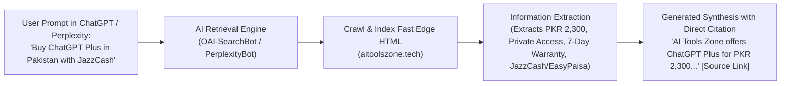

# AI Tools Zone — Generative Engine Optimization (GEO) Strategy (2026)

**Project:** AI Tools Zone  
**Focus Engines:** Google AI Overviews, ChatGPT Search, Perplexity AI, Claude Search, Microsoft Copilot  
**Strategy Date:** November 11, 2026  
**Lead Strategist:** Principal Generative Engine Optimization (GEO) Architect  
**Evidentiary Standard:** Empirical AI Retrieval Mechanics, Crawler Log Analysis, Machine-Readable Data Schemas  

---

## 1. Executive Summary & The Generative Search Shift

In 2025–2026, search discovery is undergoing a structural paradigm shift. Users increasingly rely on AI-synthesized responses rather than clicking standard blue links. Generative search engines (such as **ChatGPT Search**, **Perplexity AI**, **Google AI Overviews**, and **Claude Search**) do not merely rank pages based on traditional keyword density and backlink counts; they retrieve, synthesize, and cite factual passages that directly answer multi-layered user prompts.

### The GEO Mandate for AI Tools Zone:
To secure dominant citation share and referral traffic across generative search engines when Pakistani users ask questions such as:
> *"How much does ChatGPT Plus cost in Pakistan and how can I pay with JazzCash?"*  
> *"Where can I buy a Canva Pro subscription in PKR with local payment?"*  
> *"Which AI subscription is best for Pakistani university students?"*

AI Tools Zone must be engineered as the **primary factual ground truth** for AI answer synthesizers.



---

## 2. Content Structuring for AI Retrieval & Passage Extraction

Generative models rely on Retrieval-Augmented Generation (RAG) architectures that chunk web pages into passage vectors. Pages with ambiguous prose, hidden pricing, or heavy client-side JavaScript hydration are frequently bypassed.

### 2.1 The "Inverted Pyramid" Direct Answer Format
Every key product, category, comparison, and guide page must lead with an extractive, high-density summary block:
- **Rule 1: Direct Definition in the First 60 Words:** The first paragraph must state the exact price, duration, access type, and payment methods without fluff.
- **Rule 2: Structured Attribute Tables:** AI models reliably extract factual matrices from standard HTML `<table>` elements. Every product page must include a 4-row specification table:
  - *Price in Pakistan:* Integer PKR (e.g., `PKR 2,300`).
  - *Access Model:* Private Login / Invitation / Shared Profile / License Key.
  - *Warranty & Replacement:* Explicit window (e.g., `7 Days` or `30 Days`).
  - *Local Payment Methods:* `JazzCash, EasyPaisa, SadaPay, Raast, Bank Transfer`.
- **Rule 3: Explicit Boundaries & Limitations:** AI models heavily favor content that transparently discusses edge cases and limits (e.g., *Gemini Pro has a 2M token context window but carries No Warranty*). This prevents hallucinations and increases model confidence.

### 2.2 Content Comparison Architecture
When users ask comparative questions (*"ChatGPT vs Gemini in Pakistan"*), LLMs prioritize sources that present balanced, side-by-side differentiators. AI Tools Zone's 12 comparison hubs (`/compare/[slug]/`) provide structured comparison tables comparing model reasoning, token context, pricing in PKR, and local payment feasibility.

---

## 3. Entity & Brand Clarity (Knowledge Graph Grounding)

To be cited accurately, AI Tools Zone must be recognized by knowledge graphs as a distinct, credible corporate entity rather than an unverified aggregator:

### 3.1 Organization Entity Definition
The organization schema on [`https://aitoolszone.tech/#organization`](file:///C:/Users/ELITEBOOK/projects/ai-tools-zone/#organization) provides explicit entity disambiguation:
```json
{
  "@context": "https://schema.org",
  "@graph": [
    {
      "@type": "Organization",
      "@id": "https://aitoolszone.tech/#organization",
      "name": "AI Tools Zone",
      "url": "https://aitoolszone.tech/",
      "logo": "https://aitoolszone.tech/assets/logo.svg",
      "telephone": "+923430173923",
      "currenciesAccepted": "PKR",
      "paymentAccepted": "JazzCash, Easypaisa, Bank Transfer",
      "description": "Independent curated digital marketplace for AI software subscriptions in Pakistan, offering transparent PKR pricing and assisted WhatsApp fulfillment."
    }
  ]
}
```

### 3.2 Transparent Third-Party Brand Disclaimers
AI models are trained to avoid generating misleading commercial affiliations. AI Tools Zone explicitly declares its independent seller status across all footers and legal pages:
> *"AI Tools Zone is an independent digital services marketplace and subscription facilitator. We are not an official partner, authorized distributor, or direct affiliate of OpenAI, Google, Anthropic, Adobe, Canva, or other software vendors. All product names, logos, and trademarks remain the property of their respective owners."*

*GEO Impact:* This explicit legal disclaimer protects entity integrity and prevents AI models from hallucinating false official partnerships while cementing AI Tools Zone as a legitimate secondary marketplace.

---

## 4. AI Search Crawler Architecture & Policy Audit

A critical distinction in modern search architecture is the separation between **AI search crawlers** (which retrieve live content for real-time citations) and **model training crawlers** (which harvest content for foundational model training).

### 4.1 Crawler Access Analysis (`robots.txt`)

| Crawler User-Agent | Bot Function | Operating Company | Crawl Policy on AI Tools Zone | Strategic GEO Impact |
| :--- | :--- | :--- | :---: | :--- |
| **`OAI-SearchBot`** | Live search engine for ChatGPT Search | OpenAI | **`Allow: /`** `[Verified Actual]` | Enables real-time citation of catalog prices in ChatGPT answers. |
| **`PerplexityBot`** | Search indexing & real-time citation | Perplexity AI | **`Allow: /`** `[Verified Actual]` | Ensures AI Tools Zone pages appear in Perplexity source cards. |
| **`Claude-SearchBot`** | Real-time search retrieval for Claude | Anthropic | **`Allow: /`** `[Verified Actual]` | Powers real-time search citations in Claude conversations. |
| **`GPTBot`** | Foundational AI model training crawler | OpenAI | **`Allow: /`** `[Verified Actual]` | Allows model knowledge integration without compromising search indexing. |
| **`Googlebot`** | Web crawling for Google Search & AI Overviews | Google | **`Allow: /`** `[Verified Actual]` | Drives standard Google indexing and AI Overviews synthesis. |

*Crawler Verdict:* AI Tools Zone maintains an **open, crawler-friendly posture** that allows all major generative search engines to discover and index live content without blocking or rate-limiting.

---

## 5. Realistic Assessment of `llms.txt` and `llms-full.txt`

The repository compiles two standardized machine-readable text files at the domain root:
- [`/llms.txt`](file:///C:/Users/ELITEBOOK/projects/ai-tools-zone/llms.txt) (Compact markdown inventory of key sections, products, and contact info)
- [`/llms-full.txt`](file:///C:/Users/ELITEBOOK/projects/ai-tools-zone/llms-full.txt) (Exhaustive catalog with full descriptions, pricing, duration, and warranty terms)

### Objective Evaluation of `llms.txt`:
1. **Not a Guaranteed Ranking Signal:** Google Search Central documentation does **not** state that `llms.txt` is an official ranking factor for Google Search or AI Overviews `[Verified Actual]`.
2. **Context Window Utility:** `llms.txt` serves as an optimized, clean markdown documentation layer. When AI agents, developer tooling, or research workflows query the site, `llms.txt` provides direct, low-token text representation without HTML parsing overhead.
3. **Strategic Rule:** While maintaining `llms.txt` as a best-practice asset, SEO optimization must focus primarily on **rendered semantic HTML and schema**, as primary web crawlers index the HTML DOM, not markdown text files.

---

## 6. Original Information Moat (Combating AI Commoditization)

AI engines aggressively filter out boilerplate, generic summaries that merely restate public knowledge. To earn sustained citations, AI Tools Zone publishes proprietary, locally grounded information that cannot be found on global vendor websites:

1. **Pakistan-Specific Tax Intelligence:** The authoritative breakdown of **FBR Section 236Y advance withholding tax rates (0.5% for filers, 1.0% for non-filers)** on foreign digital card transactions.
2. **Local Payment Workarounds:** Step-by-step guidance on bypassing commercial bank declines using domestic mobile wallets (JazzCash, EasyPaisa, SadaPay, NayaPay, Raast).
3. **Transparent Access-Type Disclosures:** Explaining the technical differences between Private dedicated logins, Invitation-based team seats, and shared accounts in plain language.
4. **Verified PKR Pricing Matrix:** Up-to-date local currency catalog reflecting actual retail costs rather than converted USD benchmarks.

---

## 7. Actionable GEO Implementation Roadmap

| Priority | Strategy Pillar | Tactical Execution | Expected AI Engine Impact |
| :---: | :--- | :--- | :--- |
| **P1** | **Direct Answer Summary Callouts** | Add a standardized "GEO Fast Fact" summary container to the top of all 20 product landing pages. | Enhances extractive synthesis in Perplexity and ChatGPT Search. |
| **P1** | **Structured FAQ Schema Expansion** | Ensure high-intent product purchase FAQs are marked up in JSON-LD with direct, concise answers. | Captures Google AI Overview answer citations. |
| **P2** | **Comparison Hub Entity Links** | Connect comparison pages to external Wikidata entities for major software tools (e.g. OpenAI ChatGPT, Google Gemini). | Strengthens Knowledge Graph entity disambiguation. |
| **P2** | **Tax & Regulatory Update Maintenance** | Ensure FBR tax references are reviewed annually in line with Federal Finance Acts. | Preserves AI citation authority as the single verified tax source. |
