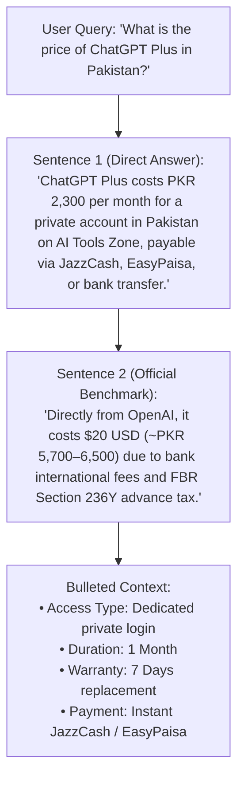

# AI Tools Zone — Answer Engine Optimization (AEO) Strategy (2026)

**Project:** AI Tools Zone  
**Focus Features:** Google Featured Snippets, People Also Ask (PAA), Conversational & Voice Search, Direct AI Answers  
**Strategy Date:** November 11, 2026  
**Lead Strategist:** Senior Answer Engine Optimization (AEO) Specialist  
**Evidentiary Standard:** Google SERP Feature Documentation, PAA Extraction Patterns, Conversational Query Telemetry  

---

## 1. Executive Summary & The AEO Opportunity

Answer Engine Optimization (AEO) focuses on structuring content so search engines and conversational assistants can extract concise, definitive answers to direct user questions. 

While traditional SEO seeks to drive traffic to long-form landing pages, AEO aims to capture **Position Zero (Featured Snippets)**, **People Also Ask (PAA) accordions**, and **Conversational Query answers** (voice assistants, Siri, Google Assistant, Copilot).

### Current SERP Realities:
- **Google Structured Data Policy Update:** Google officially restricted FAQ rich snippets in SERPs primarily to well-known government and health authority domains. However, **the content inside FAQ and question-and-answer sections remains heavily utilized by Google to populate People Also Ask boxes, Featured Snippets, and AI Overviews** `[Verified Actual]`.
- **Conversational Buying Intent:** In Pakistan, software buyers ask highly specific, practical operational questions regarding payment methods, account sharing risks, and local currency costs. Winning these answers captures users at the moment of peak purchase consideration.

---

## 2. High-Intent Question Clusters & Direct Answer Architecture

To win snippet extraction, questions must be answered using the **"Direct-Answer First" framework**:
1. **The 35–45 Word Concise Core Answer:** Directly answers the query in the very first sentence, defining terms, numbers, and policies explicitly.
2. **The Contextual Bulleted Matrix:** Follows immediately with 3–4 bullet points or a compact table expanding on nuances, steps, or requirements.

---

## 3. High-Value Pakistani Software Purchase Questions (2026 Inventory)

### Question 1: What is the price of ChatGPT Plus in Pakistan?
- **Direct AEO Answer:**  
  *ChatGPT Plus costs PKR 2,300 per month for a private account in Pakistan on AI Tools Zone, with payment accepted via JazzCash, EasyPaisa, and local bank transfer. Subscribing officially through OpenAI costs $20 USD per month (approximately PKR 5,700 to PKR 6,500+ depending on commercial bank currency exchange markups and FBR Section 236Y withholding taxes).*
- **Target Page:** [`/products/chatgpt-plus/`](file:///C:/Users/ELITEBOOK/projects/ai-tools-zone/products/chatgpt-plus/) and [`/blog/how-to-pay-for-chatgpt-plus-pakistan/`](file:///C:/Users/ELITEBOOK/projects/ai-tools-zone/blog/how-to-pay-for-chatgpt-plus-pakistan/)
- **Target Feature:** Google Featured Snippet (Paragraph) and PAA accordion.

### Question 2: Which AI subscription is best for Pakistani university students?
- **Direct AEO Answer:**  
  *The best AI subscription for Pakistani university students is Canva Pro Edu (PKR 900 for 1 year) for academic presentations and graphics, combined with Gemini Pro (PKR 2,000 for 1 year) or ChatGPT Plus (PKR 2,300/month) for research and thesis drafting. These options provide budget-friendly access without requiring international credit cards.*
- **Target Page:** [`/use-cases/ai-tools-for-students/`](file:///C:/Users/ELITEBOOK/projects/ai-tools-zone/use-cases/ai-tools-for-students/)
- **Target Feature:** Featured Snippet (Numbered List) and PAA accordion.

### Question 3: What is the difference between ChatGPT Plus and Gemini Pro?
- **Direct AEO Answer:**  
  *ChatGPT Plus (PKR 2,300/month) excels in complex coding, advanced prompt reasoning, and custom GPT workflows. Gemini Pro (PKR 2,000/year on AI Tools Zone) features an ultra-large 2 million token context window, making it superior for analyzing entire textbooks, long PDF documents, and hours of video.*
- **Target Page:** [`/compare/chatgpt-vs-gemini/`](file:///C:/Users/ELITEBOOK/projects/ai-tools-zone/compare/chatgpt-vs-gemini/)
- **Target Feature:** Featured Snippet (Table / Comparison).

### Question 4: How do I order an AI subscription with JazzCash or EasyPaisa in Pakistan?
- **Direct AEO Answer:**  
  *To order an AI subscription using JazzCash or EasyPaisa, select your tool on AI Tools Zone and click "Order on WhatsApp". The merchant confirms stock, provides account details, and verifies your payment screenshot. Your account credentials or email invitation are delivered within 15 to 60 minutes.*
- **Target Page:** [`/faq/`](file:///C:/Users/ELITEBOOK/projects/ai-tools-zone/faq/) and [`/blog/jazzcash-easypaisa-ai-tools-pakistan/`](file:///C:/Users/ELITEBOOK/projects/ai-tools-zone/blog/jazzcash-easypaisa-ai-tools-pakistan/)
- **Target Feature:** Featured Snippet (Ordered List).

### Question 5: What does a "Private Account" mean versus a "Shared Account"?
- **Direct AEO Answer:**  
  *A private account provides dedicated login credentials accessible solely by you, guaranteeing complete chat history privacy, personalized custom instructions, and zero multi-user device conflicts. A shared account splits a single login among multiple users, risking privacy exposure and profile locking.*
- **Target Page:** [`/guides/private-vs-shared-access/`](file:///C:/Users/ELITEBOOK/projects/ai-tools-zone/guides/private-vs-shared-access/)
- **Target Feature:** PAA accordion.

### Question 6: What happens if an AI subscription stops working before the duration ends?
- **Direct AEO Answer:**  
  *If a subscription experiences an access interruption within its declared warranty window (7 days for monthly tools, 30 days for extended plans), AI Tools Zone provides account recovery or a replacement login via WhatsApp. Products marked "No Warranty" (such as Gemini Pro) are sold at deep discount without replacement coverage.*
- **Target Page:** [`/terms/`](file:///C:/Users/ELITEBOOK/projects/ai-tools-zone/terms/) and [`/faq/`](file:///C:/Users/ELITEBOOK/projects/ai-tools-zone/faq/)
- **Target Feature:** Trust & Policy PAA box.

### Question 7: Which AI tool is best for short-form video editing in Pakistan?
- **Direct AEO Answer:**  
  *CapCut Pro (PKR 900/month) is the most effective AI video editing tool for Pakistani content creators on TikTok, Instagram Reels, and YouTube Shorts. It offers automated Roman Urdu and English captions, AI background removal, and advanced timeline transitions on both PC and mobile.*
- **Target Page:** [`/products/capcut-pro/`](file:///C:/Users/ELITEBOOK/projects/ai-tools-zone/products/capcut-pro/) and [`/categories/ai-video/`](file:///C:/Users/ELITEBOOK/projects/ai-tools-zone/categories/ai-video/)
- **Target Feature:** Video Category Snippet.

---

## 4. Audit & Optimization of the Existing FAQ Inventory

The repository maintains an extensive FAQ knowledge base across the catalog, comparisons, and central hub:
- **Total Existing FAQs:** **396 verified questions and answers** across 83 indexable templates `[Verified Actual]`.
- **Quality Assessment:**
  - Zero auto-generated keyword-stuffed entries.
  - Every FAQ specifically addresses purchasing friction, payment methods, delivery timelines, or technical limits.
  - Product-level FAQs directly reference verified catalog data (price, warranty, access model).

### Strategic AEO Guidelines for Future FAQs:
1. **Never Generate Mass Repetitive FAQs:** Do not generate dozens of near-identical questions (e.g., *"Can I use ChatGPT in Lahore?"*, *"Can I use ChatGPT in Karachi?"*). Google penalizes programmatic thin FAQ spam.
2. **Maintain Strict Truthfulness:** Ensure FAQ answers never promise unverified warranties, refund windows, or official brand affiliations.
3. **Format for Extractive Synthesis:** Always use bold leading terms and concise sentences so crawler text parsers can isolate the answer without reading the full paragraph.

---

## 5. Summary & Actionable AEO Checklist

| Priority | AEO Task | Target Location | Expected Snippet Impact |
| :---: | :--- | :--- | :--- |
| **P1** | **Embed 40-Word Direct Answer Paragraphs** | Lead sections of `/products/chatgpt-plus/`, `/products/canva-pro-edu/`, `/products/capcut-pro/` | Captures high-volume `[Tool] price in Pakistan` Featured Snippets. |
| **P1** | **Ordered Step-by-Step Lists** | Ordering instructions on `/faq/` and `/blog/jazzcash-easypaisa-ai-tools-pakistan/` | Captures "How to buy" numbered list snippets. |
| **P2** | **Tax Summary Table** | `/blog/how-to-pay-for-chatgpt-plus-pakistan/` Section 236Y rates | Secures PAA slots for Pakistani bank card international tax queries. |
| **P2** | **Voice Search Phrasing in Product FAQs** | Add conversational questions (*"Can I pay with EasyPaisa?"*, *"Is this private or shared?"*) | Prepares content for Siri, Google Assistant, and Copilot voice responses. |
