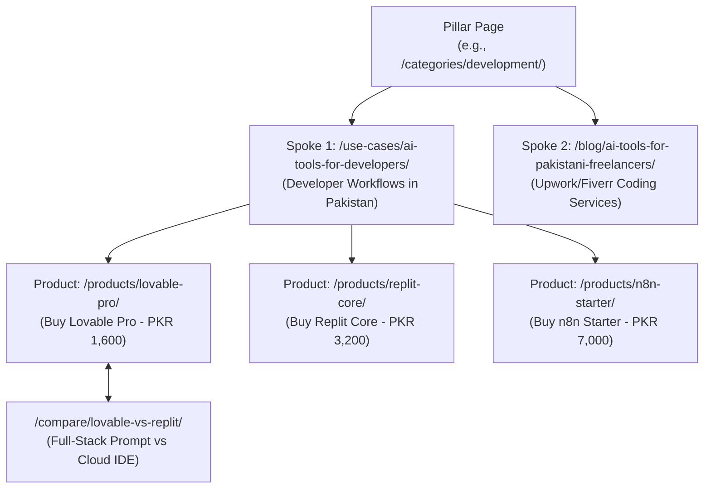

# AI Tools Zone — Topical Authority & Content Strategy (2026)

**Project:** AI Tools Zone  
**Focus:** Semantic Topic Clusters, Hub-and-Spoke Content Architecture & E-E-A-T Dominance  
**Strategy Date:** November 11, 2026  
**Lead Strategist:** Principal Content Strategist & Topical Authority Architect  
**Evidentiary Standard:** Semantic Search Engine Modeling, Topic Graph Coverage, Commercial Intent Prioritization  

---

## 1. Executive Summary & Semantic Topic Clustering

To rank consistently for competitive commercial queries in 2026, a website cannot rely on isolated landing pages. Modern search engines evaluate a domain's **Topical Authority**—the breadth, depth, and interconnectedness of content covering a complete domain of knowledge.

### The Topic Cluster Framework:
AI Tools Zone organizes its content into a **Hub-and-Spoke architecture**:
- **Pillar Pages (Hubs):** Comprehensive, authoritative pages targeting broad commercial or navigational queries (e.g., category hubs, use-case guides, comparison indices).
- **Supporting Spoke Articles:** Deep, intent-specific articles answering targeted long-tail questions (how-to guides, specific tool reviews, tax analyses).
- **Transactional Endpoints:** Product landing pages where users finalize order requests.

---

## 2. The 10 Strategic Topic Clusters for AI Tools Zone

Below is the exhaustive architectural map of the 10 topic clusters that establish market authority in Pakistan:

### Cluster 1: AI Subscriptions in Pakistan (General Marketplace Hub)
- **Pillar Page:** [`/pricing/`](file:///C:/Users/ELITEBOOK/projects/ai-tools-zone/pricing/) (Master PKR Price Guide) & [`/`](file:///C:/Users/ELITEBOOK/projects/ai-tools-zone/)
- **Supporting Articles:** [`/guides/choose-ai-subscription/`](file:///C:/Users/ELITEBOOK/projects/ai-tools-zone/guides/choose-ai-subscription/), [`/guides/catalog-methodology/`](file:///C:/Users/ELITEBOOK/projects/ai-tools-zone/guides/catalog-methodology/)
- **Product Integrations:** Links directly to all 20 catalog products.
- **Primary Search Intent:** Navigational / Commercial (`ai subscriptions in pakistan`, `ai tools price list pkr`).
- **Commercial Opportunity:** Captures broad exploratory searchers and routes them to specific tool categories.

### Cluster 2: ChatGPT & Conversational AI Assistants
- **Pillar Page:** [`/categories/ai-assistants/`](file:///C:/Users/ELITEBOOK/projects/ai-tools-zone/categories/ai-assistants/)
- **Primary Product Pages:** [`/products/chatgpt-plus/`](file:///C:/Users/ELITEBOOK/projects/ai-tools-zone/products/chatgpt-plus/) (PKR 2,300), [`/products/gemini-pro/`](file:///C:/Users/ELITEBOOK/projects/ai-tools-zone/products/gemini-pro/) (PKR 2,000)
- **Comparison Pages:** [`/compare/chatgpt-vs-gemini/`](file:///C:/Users/ELITEBOOK/projects/ai-tools-zone/compare/chatgpt-vs-gemini/), [`/compare/chatgpt-vs-claude/`](file:///C:/Users/ELITEBOOK/projects/ai-tools-zone/compare/chatgpt-vs-claude/), [`/alternatives/chatgpt/`](file:///C:/Users/ELITEBOOK/projects/ai-tools-zone/alternatives/chatgpt/)
- **Supporting Spoke Articles:** [`/blog/how-to-pay-for-chatgpt-plus-pakistan/`](file:///C:/Users/ELITEBOOK/projects/ai-tools-zone/blog/how-to-pay-for-chatgpt-plus-pakistan/), [`/blog/free-ai-tools-pakistan/`](file:///C:/Users/ELITEBOOK/projects/ai-tools-zone/blog/free-ai-tools-pakistan/)
- **Primary Intent:** Transactional & Comparative (`buy chatgpt plus pakistan`, `chatgpt vs gemini pkr`).
- **Strategic Priority:** **P0 (Immediate Core Revenue Engine)**.

### Cluster 3: AI Video Generation & Editing
- **Pillar Page:** [`/categories/ai-video/`](file:///C:/Users/ELITEBOOK/projects/ai-tools-zone/categories/ai-video/)
- **Primary Product Pages:** [`/products/veo-3-ultra/`](file:///C:/Users/ELITEBOOK/projects/ai-tools-zone/products/veo-3-ultra/) (PKR 2,100), [`/products/capcut-pro/`](file:///C:/Users/ELITEBOOK/projects/ai-tools-zone/products/capcut-pro/) (PKR 900)
- **Comparison Pages:** [`/compare/capcut-vs-canva/`](file:///C:/Users/ELITEBOOK/projects/ai-tools-zone/compare/capcut-vs-canva/)
- **Supporting Spoke Articles:** [`/blog/ai-tools-for-content-creators-pakistan/`](file:///C:/Users/ELITEBOOK/projects/ai-tools-zone/blog/ai-tools-for-content-creators-pakistan/)
- **Primary Intent:** Creative Video Workflows (`capcut pro pc subscription pakistan`, `buy veo 3 ultra pakistan`).
- **Strategic Priority:** **P0 (High Growth / Low Competitor Coverage for Veo 3)**.

### Cluster 4: Graphic Design & Creative Suites
- **Pillar Page:** [`/categories/design/`](file:///C:/Users/ELITEBOOK/projects/ai-tools-zone/categories/design/)
- **Primary Product Pages:** [`/products/canva-pro-edu/`](file:///C:/Users/ELITEBOOK/projects/ai-tools-zone/products/canva-pro-edu/) (PKR 900), [`/products/adobe-creative-cloud/`](file:///C:/Users/ELITEBOOK/projects/ai-tools-zone/products/adobe-creative-cloud/) (PKR 1,700), [`/products/figma-pro-private/`](file:///C:/Users/ELITEBOOK/projects/ai-tools-zone/products/figma-pro-private/) (PKR 3,000), [`/products/leonardo-ai-essential/`](file:///C:/Users/ELITEBOOK/projects/ai-tools-zone/products/leonardo-ai-essential/) (PKR 1,900)
- **Comparison Pages:** [`/compare/canva-vs-adobe/`](file:///C:/Users/ELITEBOOK/projects/ai-tools-zone/compare/canva-vs-adobe/), [`/alternatives/canva/`](file:///C:/Users/ELITEBOOK/projects/ai-tools-zone/alternatives/canva/)
- **Primary Intent:** Professional UI/UX & Social Media Graphic Design (`canva pro price pakistan`, `adobe cc subscription in pkr`).
- **Strategic Priority:** **P0 (High Volume Transactional Demand)**.

### Cluster 5: AI Tools for Students & Academic Research
- **Pillar Page:** [`/use-cases/ai-tools-for-students/`](file:///C:/Users/ELITEBOOK/projects/ai-tools-zone/use-cases/ai-tools-for-students/)
- **Product Integrations:** Links to Canva Pro Edu, Gemini Pro (2M token PDF analysis), ChatGPT Plus.
- **Supporting Articles:** [`/blog/ai-tools-for-teachers-pakistan/`](file:///C:/Users/ELITEBOOK/projects/ai-tools-zone/blog/ai-tools-for-teachers-pakistan/)
- **Primary Intent:** Low-budget, high-utility study tools (`best ai tools for students in pakistan`, `cheap canva pro for students`).
- **Commercial Strategy:** High conversion volume through affordable annual packages (Canva Edu at PKR 900/year).

### Cluster 6: AI Tools for Freelancers & Agency Solopreneurs
- **Pillar Page:** [`/use-cases/ai-tools-for-creators/`](file:///C:/Users/ELITEBOOK/projects/ai-tools-zone/use-cases/ai-tools-for-creators/)
- **Supporting Articles:** [`/blog/ai-tools-for-pakistani-freelancers/`](file:///C:/Users/ELITEBOOK/projects/ai-tools-zone/blog/ai-tools-for-pakistani-freelancers/)
- **Product Integrations:** CapCut Pro, ElevenLabs (Voiceovers), ChatGPT Plus, Adobe Creative Cloud.
- **Primary Intent:** Delivering client projects on Upwork and Fiverr (`how freelancers use ai tools pakistan`).
- **Commercial Strategy:** Highlights ROI—spending PKR 2,300 to earn $500+ in freelance contracts.

### Cluster 7: AI Tools for Software Developers & Technical Teams
- **Pillar Page:** [`/categories/development/`](file:///C:/Users/ELITEBOOK/projects/ai-tools-zone/categories/development/) & [`/use-cases/ai-tools-for-developers/`](file:///C:/Users/ELITEBOOK/projects/ai-tools-zone/use-cases/ai-tools-for-developers/)
- **Primary Product Pages:** [`/products/lovable-pro/`](file:///C:/Users/ELITEBOOK/projects/ai-tools-zone/products/lovable-pro/) (PKR 1,600), [`/products/replit-core/`](file:///C:/Users/ELITEBOOK/projects/ai-tools-zone/products/replit-core/) (PKR 3,200), [`/products/n8n-starter/`](file:///C:/Users/ELITEBOOK/projects/ai-tools-zone/products/n8n-starter/) (PKR 7,000)
- **Primary Intent:** AI coding agents and self-hosted automation (`lovable pro ai pakistan`, `n8n subscription price in pakistan`).
- **Strategic Priority:** **P1 (First-Mover Blue Ocean Territory)**. Zero competitor coverage gives AI Tools Zone a complete monopoly over this niche.

### Cluster 8: AI Productivity & Corporate Workflows
- **Pillar Page:** [`/categories/productivity/`](file:///C:/Users/ELITEBOOK/projects/ai-tools-zone/categories/productivity/) & [`/use-cases/ai-tools-for-business/`](file:///C:/Users/ELITEBOOK/projects/ai-tools-zone/use-cases/ai-tools-for-business/)
- **Primary Product Pages:** [`/products/gamma-pro/`](file:///C:/Users/ELITEBOOK/projects/ai-tools-zone/products/gamma-pro/) (PKR 23,000/yr), [`/products/notion-business/`](file:///C:/Users/ELITEBOOK/projects/ai-tools-zone/products/notion-business/) (PKR 2,200)
- **Supporting Articles:** [`/blog/ai-phone-agents-whatsapp-bots-pakistan/`](file:///C:/Users/ELITEBOOK/projects/ai-tools-zone/blog/ai-phone-agents-whatsapp-bots-pakistan/)
- **Primary Intent:** Enterprise presentations, client proposals, and internal team documentation.

### Cluster 9: Local Payment Methods & Pakistani Banking Rails
- **Pillar Page:** [`/blog/jazzcash-easypaisa-ai-tools-pakistan/`](file:///C:/Users/ELITEBOOK/projects/ai-tools-zone/blog/jazzcash-easypaisa-ai-tools-pakistan/)
- **Supporting Articles:** [`/blog/how-to-pay-for-chatgpt-plus-pakistan/`](file:///C:/Users/ELITEBOOK/projects/ai-tools-zone/blog/how-to-pay-for-chatgpt-plus-pakistan/)
- **Primary Intent:** Bypassing credit card friction (`how to buy ai tools with jazzcash`, `fbr tax on digital cards`).
- **Strategic Priority:** **P0 (Primary Conversion Bridge)**. Turns frustrated banking users into direct WhatsApp buyers.

### Cluster 10: Buyer Safety, Warranties & Account Access Models
- **Pillar Page:** [`/guides/private-vs-shared-access/`](file:///C:/Users/ELITEBOOK/projects/ai-tools-zone/guides/private-vs-shared-access/)
- **Supporting Legal Pages:** [`/terms/`](file:///C:/Users/ELITEBOOK/projects/ai-tools-zone/terms/), [`/faq/`](file:///C:/Users/ELITEBOOK/projects/ai-tools-zone/faq/)
- **Primary Intent:** Trust and risk mitigation (`is it safe to buy shared ai accounts`, `ai tools zone warranty policy`).
- **Strategic Priority:** **P1 (Trust & Confidence Builder)**. Directly dismantles buyer fear of fraud or account banning.

---

## 3. Realistic 90-Day Content Publishing Calendar

To preserve brand authority and avoid Google "Helpful Content" algorithmic penalties, AI Tools Zone **strictly rejects mass-generated low-quality AI articles**. Every piece must deliver original information gain:

| Phase Window | Target Cluster | Proposed Article / Resource Title | Target Intent | Primary Linked Product |
| :---: | :--- | :--- | :---: | :--- |
| **Month 1 (Days 1–30)** | **Development** | *Lovable Pro vs Replit Core: Which AI Coding Tool is Best for Pakistani Developers?* | Commercial | `/products/lovable-pro/`, `/products/replit-core/` |
| **Month 1 (Days 1–30)** | **AI Video** | *Google Veo 3 Ultra Guide: How Pakistani Video Creators Access 1080p AI Video* | Informational | `/products/veo-3-ultra/` |
| **Month 2 (Days 31–60)** | **Automation** | *Building WhatsApp & CRM Bots with n8n Starter in Pakistan (Without USD Cards)* | Educational / B2B | `/products/n8n-starter/` |
| **Month 2 (Days 31–60)** | **Design** | *Figma Pro Private vs Canva Pro: Which Should Pakistani UI/UX Designers Choose?* | Commercial | `/products/figma-pro-private/`, `/products/canva-pro-edu/` |
| **Month 3 (Days 61–90)** | **Voice AI** | *ElevenLabs Voice Cloning for Pakistani YouTubers & Urdu Narration Workflows* | Educational | `/products/elevenlabs/` |
| **Month 3 (Days 61–90)** | **Education** | *The Pakistani University Student's AI Stack for 2026: Total Cost Under Rs. 3,000* | Commercial | `/use-cases/ai-tools-for-students/` |

---

## 4. Content Quality Assurance Protocol

Before any new article or comparison is compiled into the production build, it must pass a strict 5-stage editorial review:
1. **Catalog Price Consistency:** All cited PKR prices must match `data/catalog.json` exactly.
2. **Local Payment Alignment:** Must clearly reference supported rails (JazzCash, EasyPaisa, SadaPay, Raast, Bank Transfer).
3. **No Unsupported Claims:** No claims of "official partnership", "guaranteed earnings", or "unlimited lifetime access".
4. **Natural Internal Linking:** Must incorporate 3–5 contextual in-body links pointing upward to relevant Category Hubs and downward to Product Landing Pages.
5. **Human Editorial Review:** Factual verification of prompt engineering capabilities, software version numbers, and Pakistani regulatory context.
