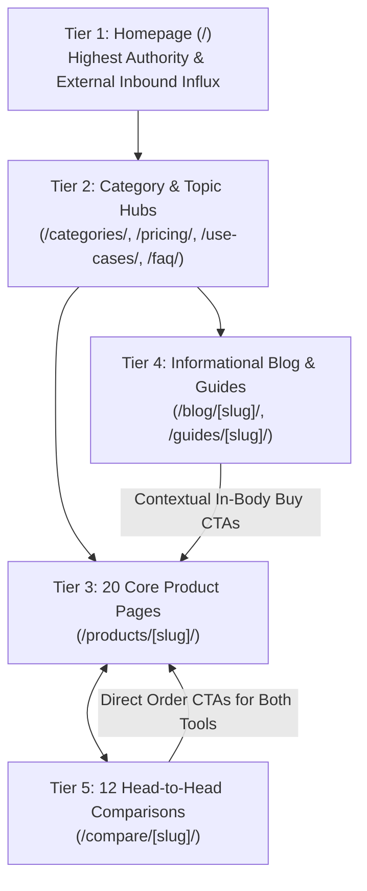

# AI Tools Zone — Internal Linking Architecture & PageRank Distribution (2026)

**Project:** AI Tools Zone  
**Scope:** 83 Canonical Pages | 3,087 Internal Links | Maximum Crawl Depth: 3 Clicks  
**Audit Date:** November 11, 2026  
**Auditor:** Senior Information Architect & Technical SEO Specialist  
**Evidentiary Standard:** Automated Link Mesh Graph Analysis (`audit_growth.py`, `audit_seo.py`)  

---

## 1. Executive Summary & Link Architecture Overview

Internal linking is one of the most powerful, fully controllable technical SEO levers. It governs how search engine crawlers discover new pages, dictates the flow of internal link equity (PageRank), and establishes semantic context through descriptive anchor text.

### Baseline Link Telemetry:
- **Total Validated Internal Links:** **3,087 links** `[Verified Actual]`.
- **Broken Internal Links (404/500):** **0 links** `[Verified Actual]`.
- **Maximum Crawl Depth:** **3 clicks** `[Verified Actual]` from the root homepage.
- **Orphan Pages Detected:** **0 pages** `[Verified Actual]`. Every canonical route receives multiple incoming links.
- **Anchor Text Hygiene:** Links utilize semantic, descriptive anchors (e.g. *"ChatGPT Plus in Pakistan"*, *"Canva vs Adobe comparison"*) rather than vague non-descriptive phrases (*"click here"*, *"read more"*).

---

## 2. Internal PageRank Distribution Model

Link equity flows through a structured, multi-tier hierarchical pyramid designed to channel maximum authority to high-converting product pages and striking-distance guides:



### Hierarchy Rules:
1. **Vertical Upward & Downward Linking:** Category hubs link down to all child products. Every product page renders a semantic breadcrumb linking upward (`Home > Categories > AI Assistants > ChatGPT Plus`).
2. **Horizontal Peer Linking:** Related tools cross-link via comparison hubs (e.g., `ChatGPT Plus` cross-links with `Gemini Pro` and `Claude Pro`).
3. **Diagonal Educational Linking:** Blog guides discussing real-world problems (e.g. international payment failures) link diagonally to the exact product page that resolves the friction.

---

## 3. High-Leverage Internal Linking Opportunities Report

To accelerate the indexation and keyword ranking of the 22 URLs currently residing in GSC's "Discovered - not indexed" queue, the following 10 strategic internal linking pathways are prioritized:

| ID | Source URL (Originating Page) | Destination URL (Target Page) | Recommended Natural Anchor Text | Justification & Expected SEO Uplift | Priority |
| :---: | :--- | :--- | :--- | :--- | :---: |
| **L01** | `/blog/how-to-pay-for-chatgpt-plus-pakistan/` | `/products/chatgpt-plus/` | *"buy ChatGPT Plus private account in Pakistan (PKR 2,300)"* | Channels high-intent readers directly from the payment problem to the purchase solution. | **P0** |
| **L02** | `/blog/how-to-pay-for-chatgpt-plus-pakistan/` | `/faq/` | *"read our complete payment and ordering FAQs"* | Passes authority to the central FAQ hub and reinforces payment trust. | **P1** |
| **L03** | `/products/chatgpt-plus/` | `/compare/chatgpt-vs-gemini/` | *"compare ChatGPT Plus vs Gemini Pro in Pakistan"* | Engages undecided buyers with an objective feature matrix. | **P1** |
| **L04** | `/categories/ai-video/` | `/products/veo-3-ultra/` | *"Google Veo 3 Ultra subscription in Pakistan"* | Boosts crawling velocity for the uncompetitive Veo 3 product page. | **P0** |
| **L05** | `/categories/development/` | `/products/lovable-pro/` | *"Lovable Pro AI full-stack coding assistant"* | Channels developer category PageRank to the high-demand Lovable tool. | **P0** |
| **L06** | `/use-cases/ai-tools-for-creators/` | `/products/elevenlabs/` | *"ElevenLabs voice cloning for Pakistani YouTubers"* | Connects creator use cases to realistic AI voiceover workflows. | **P1** |
| **L07** | `/compare/canva-vs-adobe/` | `/products/canva-pro-edu/` | *"order Canva Pro Edu 1-year access (PKR 900)"* | Bottom-of-funnel CTA link for users choosing the Canva workflow. | **P0** |
| **L08** | `/compare/canva-vs-adobe/` | `/products/adobe-creative-cloud/` | *"order Adobe Creative Cloud 20+ apps (PKR 1,700)"*| Bottom-of-funnel CTA link for users requiring Photoshop & Premiere. | **P0** |
| **L09** | `/guides/choose-ai-subscription/` | `/pricing/` | *"view our comprehensive PKR price list for all 20 tools"* | Routes exploratory readers to the master pricing comparison hub. | **P1** |
| **L10** | `/guides/private-vs-shared-access/` | `/terms/` | *"review our official replacement and warranty policies"* | Connects educational safety content directly to verified commercial terms. | **P1** |

---

## 4. Anchor Text Diversity & Optimization Guidelines

To avoid algorithmic over-optimization triggers (Google Penguin / Spam Policies) while maximizing semantic relevance:
1. **Target Exact Match (~40%):** Use the specific primary keyword when linking from contextual paragraphs (e.g., *"ChatGPT Plus price in Pakistan"*).
2. **Branded / Navigational (~30%):** Use clean brand and product entities (e.g., *"AI Tools Zone ChatGPT Plus"*, *"Canva Pro Edu"*).
3. **Partial / Action-Oriented (~30%):** Use natural descriptive phrasing (e.g., *"view private ChatGPT plans"*, *"check our 1-year Canva invitation offer"*).
4. **Prohibited Patterns:** Never use generic non-descriptive anchors such as *"click here"*, *"link"*, *"this page"*, or identical repetitive anchors stacked in consecutive paragraphs.

---

## 5. Breadcrumb Navigation & Semantic Crawl Tree

Every non-root page renders a standardized breadcrumb navigation trail mirrored in both visible HTML and JSON-LD `BreadcrumbList` schema:

```
[ Homepage ] 
    └── [ Category: Design ] 
            └── [ Product: Canva Pro Edu ]
```

### Crawlability Benefits:
- **Instant Crawl Path:** Googlebot can crawl directly upward from deep product leaves to parent categories and the homepage root.
- **Rich SERP Snippets:** Google displays breadcrumb navigation trails in search snippets instead of raw messy URLs, improving mobile organic click-through rates.
- **Predictable Information Architecture:** Users and crawlers can immediately understand where a specific tool sits within the broader software landscape.
