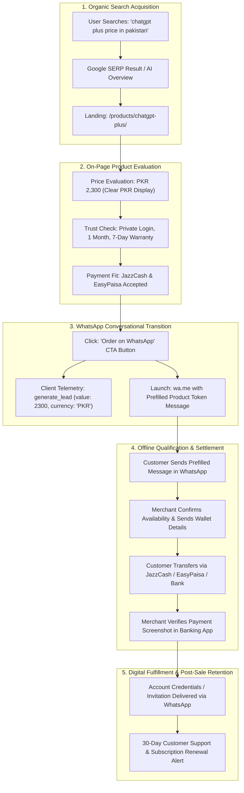

# AI Tools Zone — Customer Acquisition & Conversational CRO Strategy (2026)

**Project:** AI Tools Zone  
**Conversion Rail:** Direct-to-WhatsApp Assisted Fulfillment (`wa.me`)  
**Primary Banking Rails:** JazzCash, EasyPaisa, SadaPay, NayaPay, Raast, Bank Transfer (IBFT)  
**Strategy Date:** November 11, 2026  
**Lead Strategist:** Principal CRO Specialist & Growth Telemetry Engineer  
**Evidentiary Standard:** Behavioral Funnel Telemetry, Telemetry Script Audits (`measurement.js`), Local Pakistani Payment Realities  

---

## 1. Executive Summary & The Conversational Commerce Funnel

Search engine optimization generates visibility, but business sustainability requires converting organic visitors into paying customers. 

In Pakistan's digital services landscape, traditional automated e-commerce checkouts (Stripe, PayPal, Shopify Checkout) face near-total failure due to card declines, high gateway setup fees, consumer mistrust of recurring rebilling, and lack of credit cards among students and freelancers.

AI Tools Zone executes a **Conversational Commerce Funnel**:
Organic search visitors land on structured product or comparison pages, evaluate transparent pricing and access terms, and transition via a single click to an assisted **WhatsApp sales conversation**. Fulfillment is executed manually within minutes after verifying local wallet deposits.



---

## 2. On-Page Trust Architecture & Buyer Confidence

Pakistani software buyers have experienced widespread fraud in informal reseller circles (such as revoked shared accounts, disappearing sellers, and unfulfilled "lifetime" promises). Building deep buying confidence on-page is the single most critical conversion driver:

### 2.1 Transparent Commercial Attributes (The 6 Trust Pillars)
Every product landing page prominently communicates six non-negotiable trust pillars:

1. **Clear, Fixed PKR Pricing:** Displays exact integer Pakistani Rupee amounts (`PKR 2,300`) rather than converted USD estimates, eliminating foreign currency exchange surprises.
2. **Explicit Access Model Disclosures:** Clearly labels the account structure:
   - **Private Account:** Dedicated email and password login; complete chat history privacy; custom instructions intact.
   - **Invitation Access:** License or workspace invite sent to customer's personal email (e.g., Canva Edu, YouTube Premium).
   - **Shared Account:** Shared profile seat; transparently disclosed with device guidelines (e.g., Netflix 4K, Surfshark).
   - **License Key:** Official digital product activation key (e.g., Windows 11 Pro).
3. **Realistic Warranty Terms:**
   - Standard monthly tools: **7 Days Replacement Warranty**.
   - Extended and annual subscriptions: **30 Days Replacement Warranty**.
   - Gemini Pro: Truthfully marked **"No Warranty"** on the page and in schema, preventing post-purchase disputes.
4. **Independent Reseller Disclosure:** Explicitly states that AI Tools Zone is an independent digital facilitator, eliminating unrealistic expectations of OpenAI or Adobe corporate affiliation.
5. **Fast Delivery Expectations:** Declares realistic delivery timeframes: **15 to 60 minutes** during operational support hours.
6. **Direct Merchant Contact:** Displays official WhatsApp business contact (`+923430173923`) and support email across all footers.

> [!CAUTION]
> **Prohibited CRO Practices:** AI Tools Zone **strictly rejects** manipulative conversion tactics:
> - Never invent fake customer testimonials or fake 5-star ratings.
> - Never display fake countdown stock timers ("Only 2 left at this price!").
> - Never claim unverified corporate partnerships or official vendor certifications.
> - Never advertise impossible "Lifetime" subscriptions for monthly cloud SaaS tools.

---

## 3. WhatsApp Conversion Rate Optimization (CRO) Engineering

The transition from the web browser to WhatsApp is optimized for zero friction across mobile and desktop devices:

### 3.1 Product-Specific Prefilled Message Tokens
All order links dynamically encode product context, catalog price, and domain origin into the `wa.me` query string:
```text
https://wa.me/923086968038?text=Hi%20AI%20Tools%20Zone%2C%20I%20want%20to%20order%20ChatGPT%20Plus%20(Rs.%202%2C300)%20from%20aitoolszone.tech
```

#### Behavioral Benefits:
- **Zero Typing Effort for Buyer:** The customer does not have to formulate a message or explain what they want; they simply tap the green send arrow in WhatsApp.
- **Instant Merchant Qualification:** The seller immediately knows which product, catalog price, and promotional offer the customer is referring to, enabling instantaneous checkout response.
- **Offline Attribution Tracking:** The string `from aitoolszone.tech` serves as an offline attribution token, confirming that the lead originated from the organic website rather than personal referrals.

### 3.2 Mobile-First Sticky Order Bar
Over 75% of Pakistani organic searches occur on mobile devices. Product pages feature a persistent, high-contrast bottom order bar:
- Sticks to the viewport on mobile screens during vertical scroll.
- Displays the product name, integer PKR price, and a prominent green WhatsApp order button with phone icon.
- Tested and verified across viewports (320px, 375px, 390px, 414px) with zero horizontal overflow (`scrollWidth <= innerWidth`).

### 3.3 Desktop Parity & Clipboard Fallback
For desktop users browsing on PC or Mac:
- Clicking the WhatsApp button launches `web.whatsapp.com` in a clean new tab.
- If clipboard permissions are available, the order message is automatically copied to the user's clipboard.
- If clipboard permissions are blocked by browser security, a selectable text area appears with the message pre-highlighted, ensuring zero drop-off on desktop.

---

## 4. Telemetry Architecture & Conversion Attribution Rigor

Conversion tracking is governed by [`measurement.js`](file:///C:/Users/ELITEBOOK/projects/ai-tools-zone/measurement.js) and Google Analytics 4 (`G-TSBF626Q60`):

### 4.1 Strict Distinction Across Conversion Stages
To prevent misleading reporting, conversion events are strictly categorized:

| Funnel Stage | Event Name | Technical Nature | Source of Truth |
| :--- | :--- | :--- | :--- |
| **1. Button Tap** | `cta_click` | Client-Side JavaScript | `measurement.js` |
| **2. Micro-Conversion** | `generate_lead` | Client-Side GA4 Dispatch | `gtag('event', 'generate_lead', ...)` |
| **3. Network Beacon** | HTTP 204 | Browser Network Transport | Browser DevTools Network Tab |
| **4. GA4 Ingestion** | Realtime Event | Server-Side Google Receipt | GA4 Realtime Console |
| **5. Conversion Reporting**| Key Event | GA4 Admin Configuration | GA4 Acquisition Reports |
| **6. Conversational Lead**| WhatsApp Chat Received | Meta Messaging Client | WhatsApp Business Inbox |
| **7. Macro-Conversion** | Paid Order Fulfilled | Domestic Banking Settlement | JazzCash / EasyPaisa / Bank Statements |

### 4.2 Payload Integrity & Debounce Guard
Inspection of `measurement.js` confirms:
- **800ms Debounce Window:** Consecutive clicks on the same link within 800 milliseconds are automatically dropped, preventing duplicate event spam caused by rapid double-taps on mobile devices.
- **Exact Numeric Formatting:** The `value` parameter is cast via `Number(dataset.price)`, ensuring that prices (e.g. `2300`) are ingested as numeric values for GA4 monetary metrics rather than string literals.
- **ISO Currency Tagging:** Declares `currency: 'PKR'`.

### 4.3 Mandatory Forward-Only GA4 Key Event Action
In GA4 standard property settings, events are tracked as basic interaction metrics by default. The site administrator must toggle `generate_lead` as a **Key Event** in GA4 Admin. Because GA4 applies Key Event status **forward-only**, conversion rate metrics will record starting on the day the toggle is activated.

---

## 5. Offline Sales Reconciliation & Lightweight CRM

Because payment occurs off-site, full attribution closure requires bridging GA4 event counts with actual banking receipts:

### 5.1 Weekly WhatsApp Sales Ledger Template
The merchant maintains a 5-column reconciliation spreadsheet:

| Date | Customer Identifier (Last 4 Digits) | Product Inquired | Payment Method | Confirmed PKR Revenue | Lead Status |
| :---: | :---: | :--- | :--- | :---: | :---: |
| 11/11/2026 | `***-4921` | ChatGPT Plus | JazzCash | PKR 2,300 | Paid & Delivered |
| 11/11/2026 | `***-8310` | Canva Pro Edu | EasyPaisa | PKR 900 | Paid & Delivered |
| 11/11/2026 | `***-1209` | Lovable Pro | SadaPay | PKR 1,600 | Paid & Delivered |
| 11/11/2026 | `***-6643` | Veo 3 Ultra | Bank Alfalah | PKR 2,100 | Paid & Delivered |
| 11/11/2026 | `***-9051` | Gemini Pro | - | - | Abandoned (Price inquiry) |

### 5.2 Calculating the Verified Conversion Efficiency
Using this ledger, the business measures true commercial conversion:
$$\text{On-Site Lead Conversion Rate} = \frac{\text{GA4 } \texttt{generate\_lead} \text{ Events}}{\text{Organic Landing Sessions}} \times 100$$
$$\text{Sales Close Rate} = \frac{\text{Confirmed Paid Orders}}{\text{WhatsApp Inquiries Received}} \times 100$$
$$\text{End-to-End Visitor-to-Customer Rate} = \frac{\text{Confirmed Paid Orders}}{\text{Total Organic Visitors}} \times 100$$
