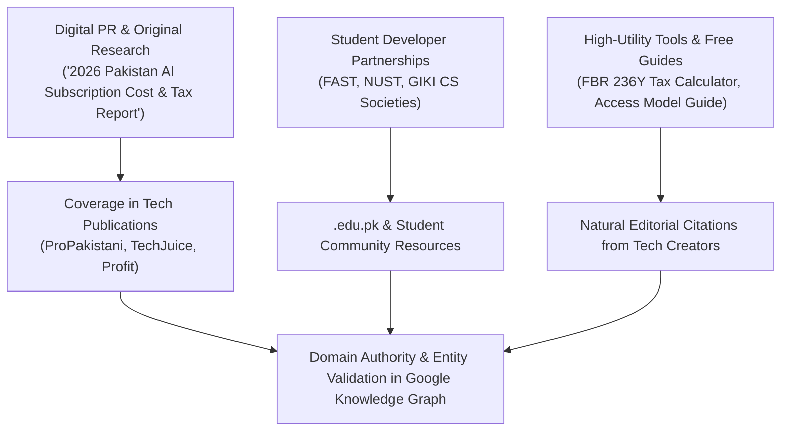

# AI Tools Zone — Brand Authority, Digital PR & White-Hat Link Building Strategy (2026)

**Project:** AI Tools Zone  
**Focus Ecosystem:** Pakistan Technology Media, University Computer Science Societies, Digital Freelance Networks  
**Strategy Date:** November 11, 2026  
**Lead Strategist:** Principal Digital PR & Search Authority Architect  
**Evidentiary Standard:** Google Search Essentials (Spam Policies), White-Hat Outreach Mechanics, Editorial Value Propositions  

---

## 1. Executive Summary & The White-Hat Authority Imperative

In 2026, search algorithms—and generative AI retrieval models—heavily discount artificial backlink manipulation. Google's Spam Policies aggressively detect and neutralize:
- Paid backlink packages on Fiverr or Upwork.
- Private Blog Networks (PBNs) and expired domain link farms.
- Automated forum signatures, comment spam, and guest post syndicates.
- Fabricated digital press releases with commercial keyword anchors.

For AI Tools Zone, **sustainable authority cannot be purchased through black-hat link schemes**. Instead, authority must be earned through **Digital PR, original empirical data studies, university community sponsorships, and high-utility reference tools** that Pakistani tech publications and creators naturally want to cite.

---

## 2. Digital PR Angles & Original Empirical Studies (Pakistan Focus)

Earning high-tier editorial backlinks requires publishing original data that journalists, business reporters, and tech commentators cannot find elsewhere:

### Campaign 1: "The 2026 State of AI Subscription Costs in Pakistan"
- **Concept:** An annual, deeply researched report analyzing the true retail cost of AI software in Pakistan.
- **Key Data Points:**
  - The exchange rate markup across major Pakistani banks (HBL, Meezan, UBL, Bank Alfalah) when converting USD subscriptions.
  - The true financial impact of FBR Section 236Y advance withholding tax (0.5% vs. 1.0%) on the average Pakistani freelancer's annual software budget.
  - The rise of domestic digital wallet rails (JazzCash, EasyPaisa, SadaPay, NayaPay, Raast) as primary software settlement tools.
- **Target Publications:**
  - **ProPakistani** (Technology & Telecom desk)
  - **TechJuice** (Startups, Freelancing & Dev news)
  - **Profit by Pakistan Today** (Digital economy, fintech & taxation reporting)
  - **Dawn Tech / The Express Tribune** (Business & Technology sections)
- **Link Magnet Asset:** An interactive infographic and downloadable executive summary hosted on [`/blog/`](file:///C:/Users/ELITEBOOK/projects/ai-tools-zone/blog/).

---

### Campaign 2: "The Pakistani University Student AI Stack Guide"
- **Concept:** A practical financial survival guide showing university students how to access essential design, coding, and research AI tools for under PKR 3,000 per month without needing an international credit card.
- **Outreach Targets:**
  - Official student society portals and computer science departmental blogs at top Pakistani universities:
    - **FAST-NUCES** (National University of Computer and Emerging Sciences)
    - **NUST** (National University of Sciences & Technology - SEECS)
    - **GIKI** (Ghulam Ishaq Khan Institute)
    - **UET Lahore** (University of Engineering and Technology)
    - **ITU** (Information Technology University Punjab)
    - **COMSATS University**
- **Editorial Hook:** Provides university newsletter editors with a practical, student-centric guide that solves the universal problem of credit card rejection among undergraduates.

---

## 3. Creator Partnerships & Tech Community Outreach

### 3.1 Pakistani YouTube Tech Creators & Freelance Mentors
Pakistan boasts a vibrant community of YouTube tech educators and freelance mentors (teaching graphic design, video editing, digital marketing, and web development):
- **Partnership Mechanics:** Provide genuine subscription access to educational creators who produce software tutorials (e.g., CapCut PC editing tutorials, Canva design masterclasses, Lovable full-stack coding workflows).
- **Attribution & Links:** The creator embeds the exact product link (e.g., [`https://aitoolszone.tech/products/capcut-pro/`](file:///C:/Users/ELITEBOOK/projects/ai-tools-zone/products/capcut-pro/)) in video descriptions and pinned comments as the recommended place for Pakistani viewers to purchase via JazzCash/EasyPaisa.

### 3.2 LinkedIn Digital Worker & Freelance Communities
- **Platform Strategy:** Publish weekly factual carousels and tax analyses on LinkedIn authored by AI Tools Zone's lead editor.
- **Focus Topics:**
  - *"How Pakistani Upwork agencies legally optimize software expenses under Finance Act 2026."*
  - *"Why shared ChatGPT accounts get banned and how to safeguard client IP with private logins."*
- **Community Engagement:** Active participation in Pakistan Freelancers Association (PAFLA) forums and local developer Slack/Discord groups.

---

## 4. Legitimate Local Business Profiles & Brand Citations

To anchor brand entity signals in local search and AI knowledge bases without creating deceptive physical storefront claims:

1. **Google Business Profile (GBP) Policy Compliance:**  
   Because AI Tools Zone operates as an online digital storefront without a physical walk-in retail counter, **do not create a fake physical retail listing with a residential address**. Google strictly suspends service businesses that forge physical storefronts.
2. **Authoritative Tech & Business Directory Citations:**  
   Establish consistent NAP (Name, Brand Description, Website URL, WhatsApp Support Number) on legitimate digital business registries:
   - **Crunchbase:** Independent digital marketplace profile.
   - **Product Hunt:** Launch profiles for specialized tools and comparison matrices.
   - **GitHub Organization:** Host open-source developer toolkits, prompt lists, and build scripts.
   - **Trustpilot / Sitejabber:** Claim official verified merchant profile for authentic customer post-purchase reviews.

---

## 5. Non-Negotiable Black-Hat Link Prohibitions

To ensure domain safety and protect against Google algorithmic demotion, the following practices are **permanently prohibited**:

| Prohibited Practice | Algorithmic Risk Factor | Policy Directive |
| :--- | :--- | :--- |
| **Buying Bulk Backlinks (Fiverr/PBNs)** | Manual Action / Spam Penalty | **Strictly Forbidden.** Never purchase link packages, "DA 50+" blasts, or automated links. |
| **Automated Forum / Blog Comment Spam** | Google Penguin Algorithmic Demotion | **Strictly Forbidden.** Never use automated bots (GSA, ScrapeBox) to post links in comment sections. |
| **Reciprocal Link Schemes** | Link Graph Devaluation | **Strictly Forbidden.** Never engage in "link for link" web rings or excessive reciprocal trading. |
| **Low-Quality Guest Post Farms** | Helpful Content Penalty | **Strictly Forbidden.** Never publish articles on generic multi-niche guest post blogs. |
| **Fabricated Press Releases** | Brand Entity Flagging | **Strictly Forbidden.** Avoid low-grade wire services that blast identical releases to empty aggregator domains. |

---

## 6. 12-Month Authority Building Roadmap

| Quarter | Focus Milestone | Primary Deliverable | Target Link Acquisition | Expected Authority Growth |
| :---: | :--- | :--- | :---: | :---: |
| **Q1 (Days 1–90)** | **Digital PR Foundation** | Publish *2026 Pakistan AI Subscription Cost & Tax Report* on blog. | 3–5 Editorial mentions in Pakistani tech blogs (TechJuice, ProPakistani). | Establishes brand entity as verified data source. |
| **Q2 (Days 91–180)** | **University Society Outreach** | Partner with 3 student CS societies at FAST, NUST, and GIKI. | 3–5 High-quality `.edu.pk` society or departmental resource links. | Massive boost to domain trust and student query rankings. |
| **Q3 (Days 181–270)** | **Creator Tutorial Integration** | Sponsor 5 YouTube tutorial creators (CapCut, Canva, Lovable). | 5–10 YouTube description links + social video referral traffic. | Direct referral sales and brand citation velocity in AI search. |
| **Q4 (Days 271–365)** | **Freelance Community Expansion** | Deliver guest webinar on AI toolchains for PAFLA freelance groups. | Editorial links on freelancer association blogs and partner portals. | Solidifies market leadership across Pakistani freelance sector. |
