# AI Tools Zone — Prioritized Master Implementation Roadmap (2026)

**Project:** AI Tools Zone  
**Production Baseline Commit:** [`e5d26f4`](https://github.com/su92-bsaim-f24-127-hue/ai-tools-zone/commit/e5d26f4)  
**Feature Branch:** `feature/seo-geo-growth-2026`  
**Strategy Date:** November 11, 2026  
**Lead Strategist:** Principal Growth Engineer & Technical SEO Architect  

---

## 1. Governance & Implementation Classification Framework

All proposed initiatives are categorized using an objective risk-reward priority hierarchy:
- **P0 — Critical:** Indexing blockers, telemetry gaps, serious data inaccuracies, security issues. Immediate resolution.
- **P1 — High Priority:** High-intent commercial product SEO, conversion friction, essential technical metadata, Core Web Vitals maintenance.
- **P2 — Medium Priority:** Topical authority expansion, comparison hub optimization, content gap resolution, contextual internal linking.
- **P3 — Long-Term / Strategic:** Digital PR campaigns, educational partnerships, university outreach, international expansion.

> [!IMPORTANT]
> **Owner Authorization Governance:**
> Under strict Phase 7E & Master Project governance, **all production deployments and administrative external account changes require explicit written owner approval**. Local enhancements on the feature branch `feature/seo-geo-growth-2026` are verified in isolation.

---

## 2. Master Implementation Tasks Matrix

| Task ID | Initiative Title | Priority | Category | Affected Files / URLs | Complexity | Risk | Owner Approval Needed? | Validation Method |
| :---: | :--- | :---: | :---: | :--- | :---: | :---: | :---: | :--- |
| **T01** | **Activate GA4 Key Event Toggle for `generate_lead`** | **P0** | Analytics | GA4 Admin Console (Property `G-TSBF626Q60`) | Low | None | **Yes (Admin Action)** | GA4 Realtime event verification; Session key event rate in reports. |
| **T02** | **Targeted GSC URL Recrawl Requests (9 URLs)** | **P0** | Indexing | Google Search Console (`aitoolszone.tech`) | Low | None | **Yes (Owner Action)** | GSC URL Inspection confirms request placed in priority crawl queue. |
| **T03** | **Enforce `max-snippet:-1` Robots Meta Directives** | **P1** | Technical SEO | `templates/`, `seo_pages.py`, 83 HTML templates | Low | Low | No (Safe Feature Scope) | `audit_seo.py` validates presence across all 83 templates. |
| **T04** | **Add OpenGraph `og:image` Tags Across Catalog** | **P1** | Technical SEO | `build_site.py`, all HTML templates | Low | Low | No (Safe Feature Scope) | Social share debugger / automated regex check in test suite. |
| **T05** | **Deploy Direct AEO/GEO Answer Boxes on Products** | **P1** | On-Page / GEO | 20 Product Landing Pages (`/products/[slug]/`) | Medium | Low | No (Safe Feature Scope) | Playwright DOM inspection verifies 50-word answer block. |
| **T06** | **Expand Contextual Internal Linking (10 Pathways)** | **P1** | Architecture | `data/blog-content.json`, `build_site.py` | Medium | Low | No (Safe Feature Scope) | `audit_growth.py` validates link graph increases above 3,087 links. |
| **T07** | **Provision Google Cloud Service Account (Tier 1)** | **P1** | Telemetry | Google Cloud Console / `google-api.json` | Medium | Low | **Yes (Cloud Admin)** | Automated Python script authenticates to GSC & GA4 APIs. |
| **T08** | **Content Depth Upgrade for 22 Unindexed URLs** | **P2** | Content / SEO | 22 Discovered URLs in GSC Coverage Queue | High | Low | **Yes (Content Scope)** | Re-inspect URLs in GSC; verify transition to "Indexed" state. |
| **T09** | **Launch Frontier Developer Cluster (Lovable vs Replit)** | **P2** | Topical Authority| `/blog/`, `/compare/lovable-vs-replit/` | Medium | Low | **Yes (Content Scope)** | Build compilation; canonical verification in `sitemap.xml`. |
| **T10** | **Establish Offline WhatsApp CRM Sales Ledger** | **P2** | CRO / Ops | Internal Google Sheet / Sales Workflow | Low | None | **Yes (Merchant Ops)** | Weekly reconciliation of WhatsApp orders vs GA4 dispatches. |
| **T11** | **Digital PR: State of AI Subscriptions 2026** | **P3** | Authority / PR | `/blog/state-of-ai-subscriptions-pakistan-2026/`| High | Low | **Yes (PR Campaign)** | Editorial mentions and inbound referring domains in GSC Links. |
| **T12** | **Student Society Outreach (FAST, NUST, GIKI)** | **P3** | Authority / PR | University CS societies & departmental blogs | Medium | Low | **Yes (Outreach Scope)**| Verified inbound `.edu.pk` referral traffic in GA4. |

---

## 3. Detailed Specification for Critical & High-Priority Tasks

### Task T01: Activate GA4 Key Event Toggle for `generate_lead`
- **Problem:** GA4 currently treats `generate_lead` as an interaction event, causing all organic session conversion rate reports to read 0.00%.
- **Evidence:** Client-side dispatch is verified in `measurement.js` (`[Verified Actual]`), but GA4 Admin has not marked it as a Key Event.
- **Affected Environment:** Google Analytics 4 Property `G-TSBF626Q60`.
- **Proposed Solution:** Site administrator navigates to **GA4 Admin > Data display > Events** and toggles **"Mark as key event"** to ON for `generate_lead`.
- **Expected Benefit:** Enables instantaneous forward-only conversion rate attribution across all organic landing pages and traffic channels.
- **Business Relevance:** Allows the business to quantify which SEO pages generate paying customers.
- **Implementation Complexity:** Low (< 5 minutes).
- **Risk:** Zero technical risk. Forward-only reporting rule applies.
- **Priority:** **P0 (Critical)**.

---

### Task T02: Targeted GSC Recrawl Requests for 9 Priority URLs
- **Problem:** Phase 7C deployed major on-page and snippet optimizations on November 11, 2026, but natural Googlebot recrawling can take days to weeks.
- **Evidence:** GSC coverage export confirms URLs are awaiting fresh crawl passes `[Verified Actual]`.
- **Affected URLs:**
  1. `/products/chatgpt-plus/`
  2. `/products/canva-pro-edu/`
  3. `/products/capcut-pro/`
  4. `/products/gemini-pro/`
  5. `/products/adobe-creative-cloud/`
  6. `/blog/how-to-pay-for-chatgpt-plus-pakistan/`
  7. `/categories/ai-video/`
  8. `/categories/design/`
  9. `/faq/`
- **Proposed Solution:** GSC property owner pastes each URL into the URL Inspection tool and clicks **"Request Indexing"**.
- **Expected Benefit:** Places high-converting commercial pages in Google's high-priority crawl queue.
- **Business Relevance:** Accelerates the display of updated CTR snippets and verified FBR Section 236Y tax facts in live SERPs.
- **Implementation Complexity:** Low (< 10 minutes).
- **Risk:** Zero risk. Fits within Google's daily submission quota.
- **Priority:** **P0 (Critical)**.

---

### Task T03: Enforce `max-snippet:-1` Robots Meta Directives
- **Problem:** Existing pages rely on default search engine snippet truncation lengths, limiting visibility for rich textual answers.
- **Evidence:** HTML inspection reveals `<meta name="robots" content="index, follow">` without explicit snippet length parameters.
- **Affected Files:** `seo_pages.py`, `build_site.py`, all HTML templates.
- **Proposed Solution:** Update meta robots generation to:
  `<meta name="robots" content="index, follow, max-snippet:-1, max-image-preview:large, max-video-preview:-1">`.
- **Expected Benefit:** Authorizes Google to display extended multi-sentence answer snippets and full-size thumbnail images in mobile search and Google Discover.
- **Business Relevance:** Increases organic SERP real estate and click-through rates.
- **Implementation Complexity:** Low.
- **Risk:** Zero risk; industry-standard best practice.
- **Priority:** **P1 (High)**.

---

### Task T04: Add Social OpenGraph `og:image` Tags
- **Problem:** When product and guide URLs are shared across WhatsApp, LinkedIn, or Twitter, link previews display without an image or use fallback favicons.
- **Evidence:** `audit_seo.py` flags missing explicit `og:image` tags on select category and comparison pages.
- **Affected Files:** `templates/`, `build_site.py`.
- **Proposed Solution:** Inject standardized OpenGraph image tags pointing to absolute CDN image assets (`https://aitoolszone.tech/assets/og-preview.png`).
- **Expected Benefit:** Rich, visual link cards when customers share tools with colleagues and classmates on WhatsApp.
- **Business Relevance:** Boosts viral peer-to-peer referral traffic.
- **Implementation Complexity:** Low.
- **Risk:** Zero risk.
- **Priority:** **P1 (High)**.

---

### Task T05: Direct AEO/GEO Answer Callout Containers
- **Problem:** AI search crawlers (`OAI-SearchBot`, `PerplexityBot`) and Featured Snippet parsers require concise, unambiguous text blocks near the top of the DOM.
- **Evidence:** Competitor analysis reveals that competitor pages lack structured answer boxes.
- **Affected Files:** `build_site.py`, `templates/`, 20 Product Landing Pages.
- **Proposed Solution:** Add a semantic, accessible summary card `<aside class="geo-fast-facts">` directly below the H1 on product pages containing:
  - Concise 40-word direct definition.
  - 4-item bulleted attribute matrix (Price, Duration, Access Model, Warranty).
- **Expected Benefit:** Dramatically increases probability of extraction in Google AI Overviews and ChatGPT Search citations.
- **Business Relevance:** Establishes AI Tools Zone as the primary source of truth in AI search.
- **Implementation Complexity:** Medium.
- **Risk:** Low. Must preserve clean mobile layout without CLS.
- **Priority:** **P1 (High)**.

---

## 4. Phase Execution Sequencing

```mermaid
flowchart LR
    subgraph Sprint1["Sprint 1 (Immediate / Week 1)"]
        T01["T01: GA4 Key Event"]
        T02["T02: GSC Recrawl"]
        T03["T03: Robots Meta"]
        T04["T04: OpenGraph Tags"]
    end

    subgraph Sprint2["Sprint 2 (Weeks 2–3)"]
        T05["T05: GEO Answer Boxes"]
        T06["T06: Internal Linking"]
        T07["T07: Service Account"]
        T10["T10: Offline CRM Ledger"]
    end

    subgraph Sprint3["Sprint 3 (Weeks 4–8)"]
        T08["T08: 22 Unindexed URLs"]
        T09["T09: Frontier Dev Cluster"]
    end

    subgraph Sprint4["Sprint 4 (Weeks 9–12)"]
        T11["T11: Digital PR Report"]
        T12["T12: University Outreach"]
    end

    Sprint1 --> Sprint2 --> Sprint3 --> Sprint4
```

