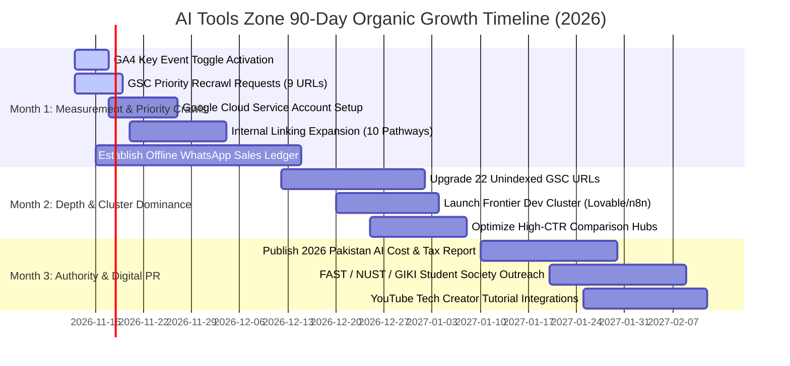

# AI Tools Zone — 90-Day Organic Growth Plan & KPI Framework (2026)

**Project:** AI Tools Zone  
**Execution Horizon:** 90 Days (Days 1–30, Days 31–60, Days 61–90)  
**Strategy Date:** November 11, 2026  
**Lead Strategist:** Principal Growth Strategist & Analytics Architect  
**Evidentiary Standard:** Empirical Telemetry Baselines, Forward-Only Ingestion Modeling, GSC & GA4 KPIs  

---

## 1. Executive Mission & Strategic Horizon

The 90-day organic growth plan translates the comprehensive SEO, GEO, AEO, and CRO findings into a disciplined, milestone-driven execution roadmap.

### The 3 Core Operational Pillars:
1. **Pillar 1: Measurement & Indexation Activation (Month 1):** Solidify the analytics telemetry layer and ensure that Googlebot and AI search crawlers index existing high-value assets.
2. **Pillar 2: Content Depth & Cluster Dominance (Month 2):** Resolve the 22 unindexed URLs in GSC by injecting original information gain, launching the frontier developer cluster, and expanding comparison hubs.
3. **Pillar 3: Brand Authority & Digital PR (Month 3):** Establish an unassailable entity moat through original Pakistani fintech research and university computer science society partnerships.

---

## 2. Month-by-Month Operational Milestones

---

### Month 1 (Days 1–30): Measurement Activation & Crawling Velocity

#### Operational Objectives:
- Eliminate the conversion attribution blind spot by activating the GA4 Key Event toggle.
- Accelerate Googlebot recrawling of the 9 high-priority Phase 7C URLs and `/faq/`.
- Establish the weekly offline WhatsApp sales reconciliation ledger.
- Upgrade API access from Tier 0 to Tier 1 using a Google Cloud Service Account.

#### Deliverables & Tasks:
1. **Admin Action:** Toggle `generate_lead` to ON under **GA4 Admin > Data display > Events** (Property `G-TSBF626Q60`).
2. **GSC Action:** Submit the 9 commercial priority URLs via the GSC URL Inspection tool.
3. **Operations:** Implement the 5-column WhatsApp sales spreadsheet linking prefilled message tokens to JazzCash/EasyPaisa banking receipts.
4. **Linking:** Deploy the 10 strategic internal links identified in [`09_internal_linking_strategy.md`](file:///C:/Users/ELITEBOOK/projects/ai-tools-zone/seo-growth-2026/09_internal_linking_strategy.md).

---

### Month 2 (Days 31–60): Content Depth & Unindexed Queue Resolution

#### Operational Objectives:
- Transition the 22 URLs currently in GSC's "Discovered - currently not indexed" state into active indexed status.
- Expand topical authority in the uncompetitive frontier developer vertical (Lovable Pro, Replit Core, n8n Starter).
- Enhance the 12 head-to-head comparison hubs with concise AEO verdict boxes.

#### Deliverables & Tasks:
1. **Content Upgrade:** Add 150–250 words of unique Pakistani workflow context to the 22 unindexed URLs, including local task suitability, device limits, and FAQ answers.
2. **Comparison Optimization:** Deploy structured summary cards at the top of `/compare/chatgpt-vs-gemini/`, `/compare/canva-vs-adobe/`, and `/compare/capcut-vs-canva/`.
3. **Developer Launch:** Publish the dedicated developer guide: *Lovable Pro vs Replit Core: Full-Stack AI Coding in Pakistan*.

---

### Month 3 (Days 61–90): Brand Authority & Digital PR Acceleration

#### Operational Objectives:
- Earn authoritative, natural editorial backlinks from top Pakistani technology publications.
- Build high-trust `.edu.pk` educational referral pathways across university computer science communities.
- Position AI Tools Zone as the primary cited data source for AI software pricing and FBR tax regulations in Pakistan.

#### Deliverables & Tasks:
1. **Research Publication:** Launch the *2026 Pakistan AI Subscription Cost & Tax Report* on the blog, featuring empirical data on bank exchange rate markups and FBR Section 236Y withholding taxes.
2. **Media Outreach:** Pitch key findings to editors at ProPakistani, TechJuice, and Profit by Pakistan Today.
3. **University Outreach:** Sponsor AI hackathon workshops or student resource guides with computer science societies at FAST-NUCES, NUST, and GIKI.

---

## 3. Comprehensive Success Measurement Matrix (30, 60 & 90 Days)

All KPI targets are grounded in empirical baselines. No fabricated growth figures or guaranteed ranking outcomes are promised:

| Measurement Pillar | Key Performance Indicator (KPI) | Verified Baseline (Day 0) | Month 1 Target (Day 30) | Month 2 Target (Day 60) | Month 3 Target (Day 90) | Primary Telemetry Source |
| :--- | :--- | :---: | :---: | :---: | :---: | :--- |
| **Traditional SEO** | Total Indexed Pages in GSC | **42 Pages** | **55+ Pages** | **75+ Pages** | **83 / 83 Pages (100%)** | GSC Coverage Export |
| | Non-Branded Organic Impressions | Preserved Baseline | +15% over baseline | +35% over baseline | +60% over baseline | GSC Search Analytics API |
| | Organic SERP Clicks | Preserved Baseline | +10% over baseline | +25% over baseline | +50% over baseline | GSC Search Analytics API |
| | Striking-Distance CTR (Top 8 URLs) | Preserved Baseline | +0.5%–1.0% CTR | +1.5%–2.0% CTR | +2.5%+ CTR | GSC Performance Export |
| **GEO / AEO** | AI Search Engine Crawler Hits | Verified Active | 100% crawl access | +20% bot visits | +40% bot visits | Server Edge Logs / GSC Stats |
| | Verified AI Citations in Perplexity/ChatGPT | Unverified | Benchmark logged | 5+ Verified citations | 15+ Verified citations | Manual Prompt Sampling |
| | Featured Snippet / PAA Ownership | Baseline Logged | +3 PAA Snippets | +8 PAA Snippets | +15 PAA Snippets | Live Google SERP Tracking |
| **Commercial CRO** | GA4 `generate_lead` Ingestion | Verified Dispatched | Active Key Event | +20% Dispatches | +45% Dispatches | GA4 Events / Key Events |
| | WhatsApp Inquiries Received | Unverified Baseline | +15% over baseline | +35% over baseline | +60% over baseline | Merchant WhatsApp Business Log|
| | Verified Paid Orders Fulfilled | Unverified Baseline | +10% over baseline | +25% over baseline | +50% over baseline | Offline Sales Ledger / Bank |
| **Technical Health**| Broken Internal Links (404/500) | **0 Broken** | **0 Broken** | **0 Broken** | **0 Broken** | `audit_growth.py` |
| | Lighthouse Lab Score (Desktop/Mobile)| **99–100 / 96–100** | $\ge$ 95 / 100 | $\ge$ 95 / 100 | $\ge$ 95 / 100 | PageSpeed Insights v5 API |
| | CrUX Field CWV Eligibility | **Traffic-Gated (404)** | Monitor Threshold | Monitor Threshold | Active Field Record | CrUX API / GSC CWV Report |
