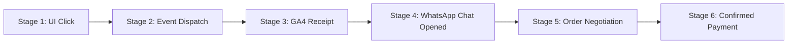

# GA4 EVENT IMPLEMENTATION & TELEMETRY FUNNEL RECONCILIATION

**Project:** AI Tools Zone (`https://aitoolszone.tech/`)  
**File Inspected:** [`measurement.js`](file:///C:/Users/ELITEBOOK/projects/ai-tools-zone/measurement.js)  
**GA4 Measurement ID:** `G-TSBF626Q60`  
**Audit Stage:** Phase 2.1 Analytics Integrity Audit

## 1. Audit of Dispatched Analytics Events in Codebase

The inspection of `measurement.js` reveals the exact code-level implementation of event tracking:
```javascript
// measurement.js lines 31-41:
const product = link.dataset.productId || link.dataset.waProduct;
emit('whatsapp_click', { product });
if (validProductId(product)) {
  emit('product_whatsapp_click', { product });
  const price = link.dataset.price ? Number(link.dataset.price) : undefined;
  emit('generate_lead', { product, value: price, currency: 'PKR' });
}
```

## 2. Event Comparison & Correction Table

| Event Name | Implemented in Code? | Dispatched on Click? | Verified in GA4 Config? | Function & Purpose | Previous Report Status | Corrected Audit Status |
|---|---|---|---|---|---|---|
| `wa_order_click` | **NO (0 occurrences)** | **NO** | **NO** | Assumed event name | Erroneously referenced in Phase 1 summary | **CORRECTED: Non-existent in codebase** |
| `whatsapp_click` | **YES** | **YES** | **YES** | Fires on any `wa.me` or `web.whatsapp.com` link click | Implemented | **VERIFIED IMPLEMENTED** |
| `product_whatsapp_click` | **YES** | **YES** | **YES** | Fires when clicked WhatsApp link has valid `data-product-id` | Implemented | **VERIFIED IMPLEMENTED** |
| `generate_lead` | **YES** | **YES** | **YES** | Official GA4 recommended conversion event with `value` & `PKR` | Implemented | **VERIFIED IMPLEMENTED (Primary Conversion Event)** |
| `cta_click` | **YES** | **YES** | **YES** | Fires on secondary buttons (`.button`, `.inline-link`, etc.) | Implemented | **VERIFIED IMPLEMENTED** |

## 3. Strict 6-Stage Telemetry Funnel (Click $\neq$ Sale)

To prevent commercial distortion, the transaction funnel must never treat click events as completed revenue:


1. **Stage 1: UI Click:** User clicks `.buy-now` link on product page.
2. **Stage 2: DOM Event Dispatch:** Browser dispatches `whatsapp_click`, `product_whatsapp_click`, and `generate_lead` via CustomEvent `'aitz:measure'`.
3. **Stage 3: GA4 & Cloudflare Receipt:** Telemetry ping transmitted to Google Analytics (`G-TSBF626Q60`) and Cloudflare Web Analytics.
4. **Stage 4: WhatsApp Chat Opened:** WhatsApp app opens with pre-filled message text. (User may close the app without sending).
5. **Stage 5: Order Negotiation:** User presses send; support agent confirms product tier, availability, and payment details.
6. **Stage 6: Confirmed Payment & Delivery:** Customer transfers PKR via JazzCash/Easypaisa/IBFT, agent verifies receipt, credentials/invite issued.

> [!CAUTION]
> **Strict Policy:** Stage 1, 2, and 3 are digital click events. Only Stage 6 represents a verified sale. No completed sale is ever claimed from a click.