# Deliverable 02: Controlled Internal Linking Strategy & Architecture

## 1. Strategy Overview

The objective of the controlled internal linking implementation is to build a coherent topical graph across commercial, category, product, and informational assets in Pakistan without keyword stuffing or catalog distortion.

```mermaid
graph TD
  Home["Homepage (/)"] --> Products["All Tools (/products/)"]
  Home --> Pricing["PKR Pricing (/pricing/)"]
  Home --> Students["AI for Students (/use-cases/ai-tools-for-students/)"]
  Home --> VideoCat["AI Video Category (/categories/ai-video/)"]
  Home --> DesignCat["Design Category (/categories/design/)"]
  Home --> BuyGuide["Where to Buy Guide (/blog/where-to-buy-ai-tools-pakistan/)"]

  Products --> ChatGPT["ChatGPT Plus (/products/chatgpt-plus/)"]
  Products --> CapCut["CapCut Pro (/products/capcut-pro/)"]
  Products --> Leonardo["Leonardo AI (/products/leonardo-ai-essential/)"]
  Products --> Coursera["Coursera Plus (/products/coursera-plus-premium/)"]
  Products --> BuyGuide

  Students --> ChatGPT
  Students --> Coursera
  Students --> Grammarly["Grammarly Premium (/products/grammarly-premium/)"]
  Students --> QuillBot["QuillBot Premium (/products/quillbot-premium/)"]
  Students --> Notion["Notion Business (/products/notion-business/)"]
  Students --> StudentGuide["Student Thesis Guide (/blog/ai-tools-for-pakistani-students-research-thesis/)"]

  VideoCat --> CapCut
  VideoCat --> Runway["Runway ML Gen-3 (/products/runway-ml-gen-3/)"]
  VideoCat --> Descript["Descript Creator (/products/descript-creator/)"]
  VideoCat --> VideoComp["CapCut vs Runway (/compare/capcut-vs-runway/)"]
  VideoCat --> VideoGuide["Best AI Video Guide (/blog/best-ai-video-generators-pakistan/)"]

  DesignCat --> Leonardo
  DesignCat --> Canva["Canva Pro (/products/canva-pro-edu/)"]
  DesignCat --> Adobe["Adobe CC (/products/adobe-creative-cloud/)"]
  DesignCat --> DesignComp["Leonardo vs Midjourney (/compare/leonardo-vs-midjourney/)"]
  DesignCat --> DesignGuide["Best AI Image Guide (/blog/best-ai-image-generators-pakistan/)"]

  ChatGPT --> PayGuide["How to Pay Guide (/blog/how-to-pay-for-chatgpt-plus-pakistan/)"]
  ChatGPT --> Pricing
  ChatGPT --> Students
  PayGuide --> ChatGPT
  PayGuide --> BuyGuide
  BuyGuide --> Products
  BuyGuide --> Pricing
```

## 2. Target Keyword to Destination URL Mapping

| Keyword Cluster | Target Buyer Keywords | Canonical Destination URL | Content Type | Planned Anchor Variations |
| :--- | :--- | :--- | :--- | :--- |
| **Cluster A** | `premium AI accounts Pakistan` `buy AI tools in Pakistan` `where to buy AI tools in Pakistan` | `/products/` `/blog/where-to-buy-ai-tools-pakistan/` | Commercial Catalog Informational Guide | - explore premium AI accounts in Pakistan - buy AI tools in Pakistan with local payment - where to buy AI tools in Pakistan buying guide |
| **Cluster B** | `affordable AI subscriptions Pakistan` | `/pricing/` | Pricing Matrix Hub | - affordable AI subscriptions in Pakistan - compare AI subscription prices in PKR - view budget-friendly plans under PKR 1,000 |
| **Cluster C** | `cheap AI tools for students Pakistan` `best AI productivity tools for students Pakistan` | `/use-cases/ai-tools-for-students/` `/blog/ai-tools-for-pakistani-students-research-thesis/` | Workflow Use-Case Informational Guide | - cheap AI tools for students in Pakistan - best AI productivity tools for Pakistani students - academic research and thesis AI software |
| **Cluster D** | `AI video editing tools Pakistan` | `/categories/ai-video/` `/blog/best-ai-video-generators-pakistan/` | Category Hub Informational Guide | - AI video editing tools in Pakistan - explore AI video generators and editors - compare CapCut and Runway plans |
| **Cluster E** | `AI image generator subscription Pakistan` | `/categories/design/` `/blog/best-ai-image-generators-pakistan/` | Category Hub Informational Guide | - AI image generator subscriptions in Pakistan - design and AI image generation tools - compare Leonardo AI and Adobe plans |
| **Cluster F** | `how to buy ChatGPT Plus in Pakistan` | `/products/chatgpt-plus/` `/blog/how-to-pay-for-chatgpt-plus-pakistan/` | Product Page Payment Guide | - how to buy ChatGPT Plus in Pakistan - ChatGPT Plus subscription in Pakistan - read the ChatGPT payment troubleshooting guide |

## 3. Strict Safety & Content Reconciliation Safeguards

1. **Zero URL Cannibalization:**
   - The site already has `/blog/where-to-buy-ai-tools-pakistan/` and `/blog/how-to-pay-for-chatgpt-plus-pakistan/`. We strictly enhance and link these existing canonical URLs rather than creating duplicate variants (e.g. `/blog/where-to-buy-ai-tools-in-pakistan/`).
2. **Zero Commercial Data Alteration:**
   - No changes to product prices, durations, delivery SLAs, warranties, or access types.
3. **Zero Production Push:**
   - All changes remain on `feature/competitor-product-keyword-growth` without `git push`, merge to `main`, or production deployment.
4. **Full Test Enforcement:**
   - Every change must pass `python audit_seo.py`, `python audit_growth.py`, and `python scripts/test_render_text_security.py` with 0 errors.

## 4. Four-Phase Execution Roadmap

- **Phase 1: Existing Page Optimization** (`/`, `/products/`, `/pricing/`, `/use-cases/ai-tools-for-students/`)
- **Phase 2: Category and Product Linking** (`/categories/ai-video/`, `/categories/design/`, `/products/chatgpt-plus/`, CapCut, Leonardo, comparison pages)
- **Phase 3: Supporting Content Creation & Alignment** (Enhancing `/blog/where-to-buy-ai-tools-pakistan/`, `/blog/how-to-pay-for-chatgpt-plus-pakistan/`, and student thesis guide)
- **Phase 4: Comprehensive QA & Verification** (Link validation, orphan check, anchor text audit, regression testing, measurement plan)