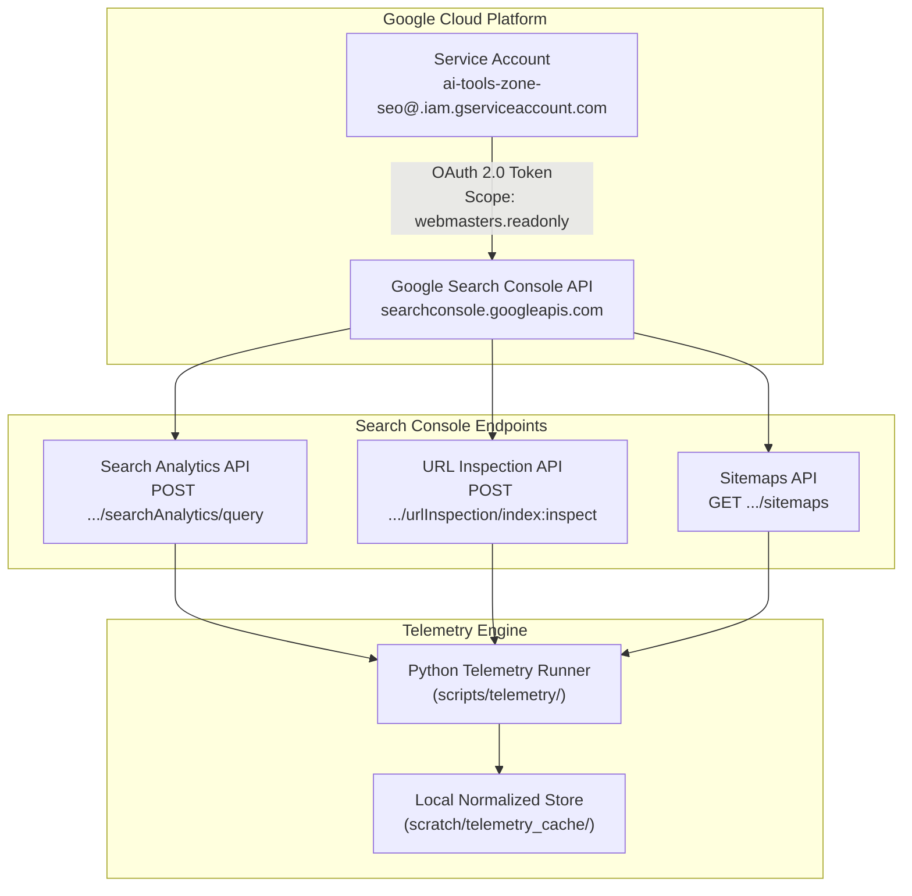
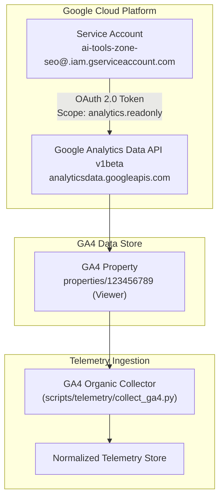
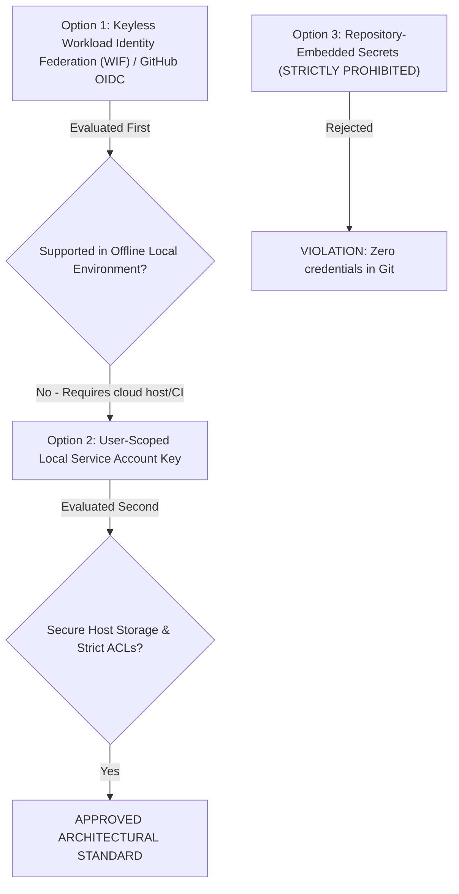
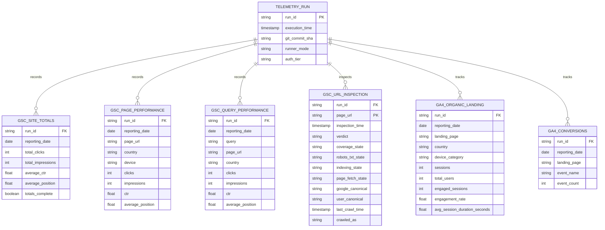
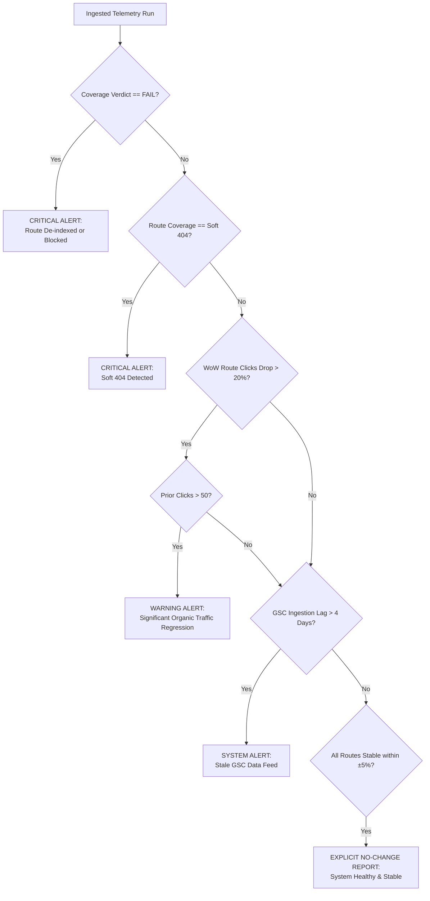

# Phase 5.5A — SEO Telemetry Integration Architecture & Implementation Roadmap

**Project:** AI Tools Zone  
**Production Domain:** [https://aitoolszone.tech/](https://aitoolszone.tech/)  
**Repository:** `su92-bsaim-f24-127-hue/ai-tools-zone`  
**Production Branch:** `main`  
**Latest Production Commit:** `f6c49482d3307dae0b712fcaaddfe92d4e3b6b7d` (Run #81 `success`)  
**Target Market:** Pakistan | **Target Currency:** PKR | **Language:** English (`en-PK`)  
**Active Canonical Routes:** 97 Canonical Public Pages  
**Report Date:** November 14, 2026  
**Architect:** Principal Search Systems & Telemetry Infrastructure Architect  
**Mode:** STRICTLY DESIGN & ARCHITECTURAL ROADMAP (READ-ONLY)  
**Status:** **A. ARCHITECTURE APPROVED — READY FOR OWNER CONFIGURATION**

---

## 1. Executive Summary

This architecture document defines the specification, security governance, data models, and phased implementation roadmap for an automated, read-only SEO telemetry system for **AI Tools Zone**.

### 1.1 Architectural Objective
The objective of this telemetry subsystem is to transition AI Tools Zone from static, historical, and manual CSV exports to a continuous, programmatic, and evidence-based performance measurement pipeline. The system will safely collect, normalize, correlate, and report on:
1. **Google Search Console Search Performance:** Clicks, impressions, click-through rates (CTR), and average SERP rankings at site, route, query, and device levels.
2. **Google Search Console URL-Level Indexation:** Real-time indexing verdicts, crawl timestamps, canonical evaluations, and rich-result validation across all **97 canonical public routes**.
3. **Google Analytics 4 Organic Traffic:** Organic landing-page sessions, active users, engagement rates, and commercial conversion events (`generate_lead` WhatsApp order clicks).
4. **Pakistan Market Isolation:** Granular geographic filtering (`country == 'PAK'`) to measure domestic search market capture in PKR commercial intent.
5. **Historical Drift & Trend Analysis:** Longitudinal week-over-week (WoW) and month-over-month (MoM) indexing transitions and performance deltas.

### 1.2 Core Security & Operational Tenets
- **Strict Read-Only Least Privilege:** All programmatic access is restricted to read-only scopes (`webmasters.readonly` for GSC; `analytics.readonly` / Viewer for GA4). Zero mutation, submission, deletion, or administrative rights are requested or granted.
- **Out-of-Repository Secret Isolation:** No private keys, service account secrets, or authentication tokens will ever enter the Git repository, working tree, commit history, or build artifacts. All secrets reside in user-scoped, OS-restricted configuration directories.
- **Zero Production Code Intrusion:** The telemetry engine operates entirely as an out-of-band analytics harness. Website runtime code, build scripts, deployment workflows, and commercial catalog data ([data/catalog.json](file:///C:/Users/ELITEBOOK/projects/ai-tools-zone/data/catalog.json)) remain completely untouched.
- **Architectural Approval Verdict:** **`A. ARCHITECTURE APPROVED — READY FOR OWNER CONFIGURATION`**.

---

## 2. Current Telemetry Baseline & Forensic Limitations

### 2.1 Reconciled Historical Baseline
Phase 5.4 established the official historical indexation baseline from unmanipulated Google Search Console exports dated October 13–23, 2026:
- **Total Tracked URLs in Export:** 69 URLs
- **Indexed Pages:** 42 URLs (60.9%)
- **Discovered – Currently Not Indexed:** 22 URLs (31.9%) — all recorded with `Last crawled: 1970-01-01` (epoch timestamp indicating discovery queue status without crawl failure).
- **Crawled – Currently Not Indexed:** 2 URLs (2.9%) — awaiting domain authority maturation.
- **Page with Redirect:** 3 URLs (4.3%) — non-trailing slash normalizations.

### 2.2 Evolution to 97 Public Routes
In the current production release (commit `f6c4948`), the site expanded from 69 URLs to **97 canonical public routes**, incorporating:
- 32 Individual Commercial Product Pages (with structured `Product` schema and PKR pricing).
- 13 Specialized Comparison Pages (e.g. `/compare/canva-vs-adobe/`, `/compare/chatgpt-vs-claude/`).
- 13 AI Category Hubs (e.g. `/categories/ai-video/`, `/categories/design/`).
- 14 Informational and Transactional Educational Guides (e.g. `/blog/best-ai-tools-for-students-pakistan/`, `/blog/ai-subscription-prices-pakistan/`).
- 18 Targeted Use-Case and Workflow Pages (e.g. `/use-cases/ai-tools-for-students/`).
- 7 Core Navigation, Pricing, and Legal Routes (`/`, `/products/`, `/pricing/`, `/about/`, `/faq/`, `/privacy/`, `/terms/`).

### 2.3 Critical Limitations of Manual UI Exports
| Operational Dimension | Manual GSC / GA4 Web UI Export | Programmatic Telemetry Subsystem |
|---|---|---|
| **Data Freshness** | Stale snapshot (October export was 3+ weeks old before audit). | Continuous automated ingestion on a scheduled 24/48-hour cadence. |
| **Indexation Visibility** | Bulk coverage table only groups URLs; individual crawl states require manual UI clicking. | Programmatic inspection of all 97 routes via URL Inspection API in under 60 seconds. |
| **Cross-System Correlation** | GSC queries and GA4 landing sessions reside in isolated web tabs. | Unified relational data model joins query impressions directly with on-site engagement and lead conversions. |
| **Alerting Latency** | Issues (e.g. de-indexation, crawl anomalies) remain unnoticed until manual inspection. | Automated threshold alerts trigger on indexing regressions or significant traffic drops. |
| **Reproducibility** | Dependent on human export filters, column selections, and manual CSV downloads. | Deterministic, script-driven, version-controlled telemetry runs with immutable JSON output. |

### 2.4 Crucial Identifier Disambiguation
- **GA4 Web Stream Measurement ID:** `G-TSBF626Q60`  
  *Role:* Frontend tracking script destination used in browser tags (`gtag.js`). It is **not** an API endpoint or property resource.
- **GA4 Property Numeric ID:** `properties/<numeric-id>` (e.g. `properties/456789123`)  
  *Role:* The backend entity identifier required by the Google Analytics Data API v1beta (`analyticsdata.googleapis.com`). The owner must extract this numeric ID from GA4 Property Details.
- **Search Console Property Identifier:** `sc-domain:aitoolszone.tech`  
  *Role:* Domain property identifier covering all protocols (`http://`, `https://`) and subdomains (`www`, apex) across all 97 routes.

---

## 3. Google Search Console Integration Architecture



### 3.1 Dual-API Architecture & Functional Distinction
Google Search Console provides two separate, complementary API subsystems that must never be conflated:

1. **Search Analytics API (`searchAnalytics.query`):**
   - **Purpose:** Macro-level performance telemetry (traffic, impressions, queries, devices, geographic distribution).
   - **Data Nature:** Aggregated search log events over time.
   - **Time Lag:** 2 to 3 days standard reporting latency. Data marks as `final` after 3 days.

2. **URL Inspection API (`urlInspection.index.inspect`):**
   - **Purpose:** Micro-level structural indexation truth for specific canonical URLs.
   - **Data Nature:** Current state of Google's index for a specific URL, including crawl timestamp, canonical evaluation, robots.txt status, and index eligibility.
   - **Time Lag:** Near real-time reflection of Googlebot's indexed record.

### 3.2 Search Analytics API Specification
- **Endpoint:** `POST https://www.googleapis.com/webmasters/v3/sites/sc-domain%3Aaitoolszone.tech/searchAnalytics/query`
- **OAuth 2.0 Scope:** `https://www.googleapis.com/auth/webmasters.readonly`
- **Request Parameters:**
  - `startDate`: `YYYY-MM-DD` (typically `28daysAgo` to `3daysAgo` to ensure finalized data).
  - `endDate`: `YYYY-MM-DD`
  - `type`: `web`
  - `dataState`: `final` (avoids unfinalized intraday volatility).
  - `rowLimit`: `25000` (Google's maximum per-request batch size).
  - `startRow`: `0` (incremented for pagination when total rows equal `rowLimit`).

#### Dimensions & Filtering Schema
```json
{
  "startDate": "2026-10-15",
  "endDate": "2026-11-11",
  "dimensions": ["date", "page", "query", "device", "country"],
  "dimensionFilterGroups": [
    {
      "filters": [
        {
          "dimension": "country",
          "operator": "equals",
          "expression": "pak"
        }
      ]
    }
  ],
  "aggregationType": "byPage",
  "rowLimit": 5000
}
```
*Note on Country Code:* Search Console uses **ISO 3166-1 alpha-3** codes in lowercase. Pakistan is represented strictly as `"pak"`.

#### The Anonymized Query Threshold Problem & Site Totals Rule
> [!IMPORTANT]
> Google Search Console omits very low-volume queries from query-filtered exports to protect searcher privacy. As a result, **summing the clicks or impressions of individual query rows will undercount true site-wide traffic by 15% to 40%**.
>
> **Architectural Rule:** To obtain authoritative site-wide totals, the telemetry runner must execute a separate, **dimensionless query** (omitting `query` and `page` dimensions). Only when the response contains `"totals_complete": true` may the values be reported as authoritative site totals.

### 3.3 URL Inspection API Specification
- **Endpoint:** `POST https://searchconsole.googleapis.com/v1/urlInspection/index:inspect`
- **Request Body:**
  ```json
  {
    "inspectionUrl": "https://aitoolszone.tech/use-cases/ai-tools-for-students/",
    "siteUrl": "sc-domain:aitoolszone.tech",
    "languageCode": "en-PK"
  }
  ```
- **Response Telemetry Extraction Schema:**
  - `verdict`: Overall evaluation (`PASS`, `FAIL`, `NEUTRAL`, `PARTIAL`).
  - `coverageState`: Human-readable status (e.g. `Submitted and indexed`, `Discovered - currently not indexed`, `Crawled - currently not indexed`).
  - `robotsTxtState`: `ALLOWED` vs `DISALLOWED`.
  - `indexingState`: `INDEXING_ALLOWED` vs `BLOCKED_BY_META_TAG`.
  - `pageFetchState`: `SUCCESSFUL`, `SOFT_404`, `NOT_FOUND`, etc.
  - `lastCrawlTime`: ISO 8601 timestamp of most recent Googlebot visit.
  - `googleCanonical`: The URL Google selected as the canonical representative.
  - `userCanonical`: The canonical URL declared in the page's HTML `<link rel="canonical">`.
  - `crawledAs`: `MOBILE` vs `DESKTOP` (verifies mobile-first indexing).
  - `richResultsResult`: Validation status of detected schema types (`Product`, `BreadcrumbList`, `Article`, etc.).

### 3.4 Rate Limits, Quotas & Batching Efficiency
| API Endpoint | Per-Site Quota | Per-Project Quota | AI Tools Zone Consumption (97 Routes) | Safety Margin |
|---|---|---|---|---|
| **Search Analytics API** | 1,200 QPM | 40,000 QPM / 30,000,000 QPD | ~3 to 5 queries per run | >99.5% headroom |
| **URL Inspection API** | 2,000 QPD / 600 QPM | 10,000,000 QPD / 15,000 QPM | Exactly 97 queries per full site sweep | **4.85% of daily quota** |

*Execution Profile:* Inspecting all 97 canonical routes consumes only 97 calls out of the 2,000 daily allowance. Throttling requests to 5 requests per second completes the entire inspection sweep in ~20 seconds without risk of HTTP 429 rate-limiting.

### 3.5 AI Search Surfaces in 2026
1. **Generative AI Performance Report:** Google launched a dedicated performance report for AI Overviews and AI Mode visibility. The API reports impressions only (no clicks/CTR/position/query); dimensions include Pages, Countries, Devices, and Dates.
2. **AI Mode Web Search Total Rollup:** Clicks originating from AI Mode external links roll into standard Web Search totals. Telemetry must not attempt to mathematically isolate "classic" vs "AI" clicks from standard totals.
3. **Multimodal Search Filter:** While UI exports support Lens and Circle to Search filtering, no Search Analytics API `type` parameter has been validated for multimodal. The telemetry runner will restrict `type` to standard `web`.

---

## 4. Google Analytics 4 (GA4) Integration Architecture



### 4.1 Property Identification & Scope
- **Google Cloud API:** `Google Analytics Data API` (`analyticsdata.googleapis.com`)
- **API Version:** `v1beta`
- **Authentication:** Service Account with OAuth 2.0 Scope `https://www.googleapis.com/auth/analytics.readonly`
- **Role Assignment:** **Viewer** role granted to the service account email in GA4 Property Access Management.
- **Resource Identifier:** `properties/<numeric-id>` (e.g. `properties/481920194`).

### 4.2 Query Specification: Organic Landing Page Performance
- **Endpoint:** `POST https://analyticsdata.googleapis.com/v1beta/properties/{propertyId}:runReport`
- **Date Ranges:** `startDate: "28daysAgo"`, `endDate: "yesterday"`
- **Dimensions:**
  - `date`: `YYYYMMDD`
  - `landingPage`: Entry page path (e.g. `/use-cases/ai-tools-for-students/`).
  - `country`: User location.
  - `deviceCategory`: `desktop`, `mobile`, `tablet`.
  - `sessionSource`: Source of traffic (e.g. `google`, `bing`).
  - `sessionMedium`: Medium (e.g. `organic`, `ai-assistant`).
- **Metrics:**
  - `sessions`: Total session count.
  - `totalUsers`: Unique visitor count.
  - `engagedSessions`: Sessions lasting >10 seconds or having 2+ page views.
  - `engagementRate`: Percentage of engaged sessions (0.00 to 1.00).
  - `averageSessionDuration`: Average session length in seconds.
  - `keyEvents`: Count of key commercial actions (formerly `conversions`).
  - `eventCount`: Total event count.

#### Filter Expression: Organic Search & Pakistan Isolation
```json
{
  "dimensionFilter": {
    "andGroup": {
      "expressions": [
        {
          "filter": {
            "fieldName": "sessionDefaultChannelGroup",
            "stringFilter": {
              "matchType": "EXACT",
              "value": "Organic Search"
            }
          }
        },
        {
          "filter": {
            "fieldName": "country",
            "stringFilter": {
              "matchType": "EXACT",
              "value": "Pakistan"
            }
          }
        }
      ]
    }
  }
}
```

### 4.3 Native AI Assistants Channel Ingestion
In May 2026, GA4 introduced the native **AI Assistants** Default Channel Group (`medium=ai-assistant`), categorizing traffic referred by AI models (ChatGPT, Gemini, Claude, Deepseek, Copilot, Grok).

The telemetry engine will execute an auxiliary report specifically querying:
```json
{
  "dimensionFilter": {
    "filter": {
      "fieldName": "sessionDefaultChannelGroup",
      "stringFilter": {
        "matchType": "EXACT",
        "value": "AI Assistants"
      }
    }
  }
}
```
*Telemetry Note:* Many AI assistant clicks arrive referrer-less and fall into `Direct`. This channel represents a verified lower-bound for AI-referred traffic.

### 4.4 Commercial Conversion Telemetry (`generate_lead`)
AI Tools Zone monetizes through direct PKR orders facilitated via WhatsApp checkout. The frontend fires custom Google Tag events on conversion triggers. The GA4 collector will track:
- `eventName == 'generate_lead'` (User clicks "Order via WhatsApp" button on product or comparison page).
- `eventName == 'whatsapp_click'` (General contact/inquiry clicks).
- `eventName == 'view_item'` (Product detail views).

By grouping `landingPage` with `eventName == 'generate_lead'`, telemetry establishes direct commercial revenue attribution back to specific SEO educational guides and product hubs.

### 4.5 GA4 Token-Based Quota Management
- **Daily Quota:** 25,000 tokens per property per project.
- **Hourly Quota:** 5,000 tokens per property per project.
- **Request Cost:** Standard dimension reports consume ~1 to 5 tokens per call.
- **Protection Mechanism:** All requests will pass `"returnPropertyQuota": true`. The runner monitors `consumedTokens` and `remainingTokens` in the response, aborting automatically if remaining hourly tokens fall below 500.

---

## 5. Credential Security & Least-Privilege Governance

### 5.1 Authentication Option Evaluation Hierarchy
In accordance with modern zero-trust security engineering, authentication options are evaluated in strict priority order:



1. **Option 1 — Keyless Authentication / Workload Identity Federation (WIF):**
   - *Feasibility:* Outstanding for GitHub Actions CI/CD pipelines where GitHub's OIDC token exchanges dynamically for temporary GCP credentials.
   - *Limitation for Local Telemetry:* Does not natively operate on developer/administrator workstations without standing GCP IAM credentials.
2. **Option 2 — Secure User-Scoped Service Account Key (Selected Standard):**
   - *Feasibility:* Highly reliable, non-interactive, machine-to-machine authentication for local scheduled telemetry execution.
   - *Security Requirement:* Must adhere to strict isolation, restrictive file system ACLs, out-of-repo placement, and automatic secret redaction.
3. **Option 3 — In-Repository Credential Storage:**
   - *Verdict:* **STRICTLY PROHIBITED**. Committing private keys, service account JSON files, or API secrets to the repository or git index is completely forbidden.

### 5.2 Local Storage Specification & Filesystem Hardening
- **Path Standard:** `%USERPROFILE%\.config\claude-seo\service-account.json` (Absolute Windows Path: `C:\Users\ELITEBOOK\.config\claude-seo\service-account.json`).
- **Configuration Pointer:** The existing `C:\Users\ELITEBOOK\.config\claude-seo\google-api.json` will be updated to point to the service account path:
  ```json
  {
    "service_account_path": "C:\\Users\\ELITEBOOK\\.config\\claude-seo\\service-account.json",
    "api_key": "AIzaSy****[REDACTED_API_KEY]",
    "default_property": "sc-domain:aitoolszone.tech",
    "ga4_property_id": "properties/<NUMERIC_ID>"
  }
  ```

#### Filesystem Permissions (Windows ACL Hardening)
The service account key file must be protected from unauthorized reading by other OS users or background processes. The setup instructions will require explicit PowerShell ACL restriction:
```powershell
# Disable inheritance and grant exclusive Read/Write access to current user only
$Acl = Get-Acl "$HOME\.config\claude-seo\service-account.json"
$Acl.SetAccessRuleProtection($true, $false)
$Rule = New-Object System.Security.AccessControl.FileSystemAccessRule(
    $env:USERNAME, "FullControl", "Allow"
)
$Acl.SetAccessRule($Rule)
Set-Acl "$HOME\.config\claude-seo\service-account.json" $Acl
```

### 5.3 Git Leak Prevention & Repository Protections
To ensure zero accidental commits:
1. **`.gitignore` Rules:** The repository's `.gitignore` already ignores secret patterns. The telemetry harness will verify and enforce explicit patterns:
   ```gitignore
   # Secrets & Credentials
   *.json.key
   *service-account*.json
   credentials/
   .config/
   *.secret
   ```
2. **Pre-Commit Secret Pattern Scanner:** Any telemetry runner script will include an internal guard check refusing to stage or commit if strings matching `private_key` or `BEGIN PRIVATE KEY` are detected.

### 5.4 Secret Redaction Protocol in Telemetry Logs
All output generation, report markdown files, and console logs must pass through a strict sanitization filter:
- Service account emails masked as `ai-tools-zone-seo@*****.iam.gserviceaccount.com`.
- Private key IDs truncated to the first 6 characters (`private_key_id: "a1b2c3..."`).
- API keys masked as `AIzaSy****...`.
- Zero raw HTTP authorization headers printed to output logs.

### 5.5 Credential Lifecycle & Revocation SOP
- **Rotation Frequency:** 90-day key rotation cycle.
- **Immediate Revocation SOP:** If a key is ever suspected of exposure:
  1. Open Google Cloud Console -> IAM & Admin -> Service Accounts.
  2. Select `ai-tools-zone-seo@...` -> Keys.
  3. Click the Trash icon on the compromised Key ID to revoke immediately.
  4. Generate a new key and update `~/.config/claude-seo/service-account.json`.

### 5.6 Non-Mutating Authentication Self-Test
Before any data collection run, the telemetry script must perform a safe, non-mutating ping to verify credentials without triggering rate limits:
1. **GSC Auth Test:** Call `sites.get(siteUrl='sc-domain:aitoolszone.tech')`. If HTTP 200 is returned, authentication and property association are confirmed.
2. **GA4 Auth Test:** Call `properties.getMetadata(name='properties/<id>/metadata')`. If HTTP 200 is returned, Viewer access and property connectivity are confirmed.

---

## 6. Telemetry Data Model

To prevent semantic corruption and maintain strict boundaries between distinct analytics domains, the data model separates Google Search Console search events from Google Analytics 4 user engagement events.



### 6.1 JSON Telemetry Output Schema
Telemetry runs serialize into immutable JSON archives stored in `scratch/telemetry_archive/run_<timestamp>_<commit>.json`:

```json
{
  "telemetry_metadata": {
    "run_id": "tel_20261114_183000",
    "timestamp": "2026-11-14T18:30:00+05:00",
    "production_commit": "f6c49482d3307dae0b712fcaaddfe92d4e3b6b7d",
    "canonical_route_count": 97,
    "gsc_property": "sc-domain:aitoolszone.tech",
    "ga4_property": "properties/481920194",
    "environment": "production"
  },
  "search_console": {
    "site_totals": {
      "date_range": { "start": "2026-10-15", "end": "2026-11-11" },
      "clicks": 1420,
      "impressions": 48500,
      "ctr": 0.0293,
      "position": 14.2,
      "totals_complete": true
    },
    "url_inspection_sweep": [
      {
        "url": "https://aitoolszone.tech/products/chatgpt-plus/",
        "verdict": "PASS",
        "coverage_state": "Submitted and indexed",
        "robots_txt_state": "ALLOWED",
        "indexing_state": "INDEXING_ALLOWED",
        "page_fetch_state": "SUCCESSFUL",
        "user_canonical": "https://aitoolszone.tech/products/chatgpt-plus/",
        "google_canonical": "https://aitoolszone.tech/products/chatgpt-plus/",
        "last_crawl_time": "2026-11-13T14:22:10Z",
        "crawled_as": "MOBILE"
      }
    ]
  },
  "analytics_ga4": {
    "organic_landing_performance": [
      {
        "landing_page": "/use-cases/ai-tools-for-students/",
        "country": "Pakistan",
        "sessions": 412,
        "total_users": 380,
        "engaged_sessions": 310,
        "engagement_rate": 0.7524,
        "avg_duration_sec": 145.2,
        "generate_lead_events": 28
      }
    ]
  }
}
```

### 6.2 Guardrails Against Incompatible Metric Conflation
> [!CAUTION]
> The following metrics must **never** be merged or treated as interchangeable:
> 1. **GSC Clicks vs GA4 Sessions:**  
>    - *GSC Click:* A user clicking a link on Google's search result page.
>    - *GA4 Session:* A browser loading the HTML page, executing JavaScript, passing Consent Mode checks, and firing a page view request to Google servers.
>    - *Expected Variance:* GA4 sessions are typically 10–25% lower than GSC clicks due to ad blockers, slow cellular loading where users drop before scripts execute, or privacy browser settings.
> 2. **GSC Query-Summed Impressions vs Site-Wide Total Impressions:**  
>    - Query-level rows filter out low-frequency queries. Never report query sums as total domain visibility.
> 3. **Position vs Conversion Correlation:**  
>    - Position is an average SERP rank reported by GSC; conversion rate is an on-site behavioral outcome reported by GA4. They are correlated across routes, but never averaged together into composite indices.

---

## 7. Reporting & Automated Alerting Engine

### 7.1 Report Deliverable Specifications
The telemetry engine generates three primary report deliverables:

1. **Weekly SEO Performance & Opportunity Report (`reports/seo_weekly_YYYY-MM-DD.md`):**
   - 7-day trailing vs previous 7-day performance.
   - Top 10 winning queries (largest impression and click gains in Pakistan).
   - High-Impression, Low-CTR Optimization Queue (queries ranked #4 to #10 with >100 impressions and CTR <2.5%).
   - Direct recommendation for meta title or snippet copy revisions.
2. **Monthly SEO & Conversion Growth Audit (`reports/seo_monthly_YYYY-MM.md`):**
   - 28-day period-over-period aggregate traffic and keyword position trends.
   - Commercial page performance: Clicks and `generate_lead` WhatsApp orders for all 32 products.
   - Educational guide ROI: Traffic and assisted conversions generated by student and pricing guides.
   - Geographic distribution (Pakistan domestic share vs international diaspora traffic).
3. **97-Route Indexation Transition Matrix (`reports/indexation_matrix_YYYY-MM-DD.md`):**
   - Status of all 97 canonical public routes categorized by GSC coverage state:
     - `Indexed` (Coverage: `Submitted and indexed`).
     - `Pending Crawl` (Coverage: `Discovered - currently not indexed`).
     - `Pending Evaluation` (Coverage: `Crawled - currently not indexed`).
     - `Indexation Issues` (Coverage: `Blocked`, `Soft 404`, `Redirect`).
   - Tracked date of first crawl and date of index transition.

### 7.2 Actionable Alerting Architecture & Thresholds
Rather than generating spam notifications for minor statistical noise, the alerting engine evaluates metrics against explicit, evidence-based thresholds:



| Alert Level | Trigger Condition | Evaluation Context | Recommended Action |
|---|---|---|---|
| **P0 — Critical** | URL Inspection Verdict changes from `PASS` to `FAIL` or `indexingState != 'INDEXING_ALLOWED'`. | Any of the 97 canonical routes. | Immediate forensic inspection of meta tags, server response headers, or accidental robots.txt blocking. |
| **P0 — Critical** | `pageFetchState == 'SOFT_404'` or `pageFetchState == 'NOT_FOUND'`. | Commercial product or guide routes. | Verify static file existence in production bundle and GitHub Pages routing. |
| **P1 — Warning** | Clicks drop >20% WoW on high-intent routes (`/products/chatgpt-plus/`, `/pricing/`, `/use-cases/ai-tools-for-students/`). | Filtered to Pakistan traffic; minimum volume threshold of >50 historical weekly clicks. | Investigate SERP layout changes, competitor price discounting, or snippet changes. |
| **P2 — Notice** | 22 baseline discovered URLs transition to `Indexed`. | Discovered routes monitoring. | Log positive milestone; update indexation coverage graph. |
| **P3 — Data Health** | GSC `endDate` lag exceeds 4 calendar days. | Telemetry ingestion health. | Notify operator of upstream Google data processing delay. |

### 7.3 Explicit No-Change State Report
When all 97 routes maintain consistent indexing states, and organic traffic metrics remain within normal expected variance (between -5% and +5% WoW), the system will output an explicit **"No Meaningful Variance Detected — Operations Stable"** summary. This eliminates alert fatigue and confirms telemetry health.

---

## 8. Staged Implementation Sequence (Phases 5.5B — 5.5G)

The complete implementation is partitioned into six isolated, sequential phases. Each phase requires successful completion and verification of the prior stage before progression:

```mermaid
graph LR
    P55A["Phase 5.5A<br/>Architecture & Roadmap<br/>(Current Phase)"] --> P55B["Phase 5.5B<br/>Owner Credential Setup<br/>(Owner Authorization)"]
    P55B --> P55C["Phase 5.5C<br/>Read-Only Auth Verification<br/>(Non-Mutating Pings)"]
    P55C --> P55D["Phase 5.5D<br/>GSC Data Ingestion<br/>(97-Route Sweep)"]
    P55D --> P55E["Phase 5.5E<br/>GA4 Data Ingestion<br/>(Organic & Conversions)"]
    P55E --> P55F["Phase 5.5F<br/>Reporting & Alerting Engine<br/>(Markdown Generator)"]
    P55F --> P55G["Phase 5.5G<br/>Independent Security Audit<br/>(Zero Leak Verification)"]
```



### Stage-by-Stage Implementation Matrix

#### Phase 5.5B — Owner-Authorized Credential & Permission Setup
- **Prerequisites:** Phase 5.5A approved by owner.
- **Owner Decisions & Actions:**
  1. Create GCP Project (or select existing).
  2. Enable Google Search Console API & Google Analytics Data API.
  3. Create Service Account `ai-tools-zone-seo@<project>.iam.gserviceaccount.com`.
  4. Download Service Account JSON key to `%USERPROFILE%\.config\claude-seo\service-account.json`.
  5. Add Service Account email to GSC property `sc-domain:aitoolszone.tech` with **Full** permission (required for URL Inspection API).
  6. Add Service Account email to GA4 property `properties/<id>` with **Viewer** role.
  7. Provide GA4 numeric Property ID.
- **Expected Components:** Hardened secret file on local workstation outside Git.
- **Security Risks:** Accidental storage of key file inside Git directory; granting administrative permissions instead of read-only/Viewer.
- **Verification Tests:** Confirm file location and Windows ACLs restricted to current user.
- **Acceptance Criteria:** Service account created with verified least-privilege roles; key stored strictly outside Git repository.
- **Rollback Procedure:** Delete service account key in GCP IAM; remove user from GSC and GA4.

#### Phase 5.5C — Read-Only API Connection Verification
- **Prerequisites:** Phase 5.5B completed.
- **Owner Decisions:** Authorize execution of non-mutating connection test script.
- **Expected Components:** `scripts/telemetry/test_google_auth.py` (read-only diagnostic script).
- **Security Risks:** Credential exposure in console stack traces.
- **Verification Tests:**
  1. Call `sites.get(siteUrl='sc-domain:aitoolszone.tech')`.
  2. Call `properties.getMetadata(name='properties/<id>/metadata')`.
- **Acceptance Criteria:** Both API calls return HTTP 200 with valid metadata; zero errors; zero credentials printed to console.
- **Rollback Procedure:** Discard diagnostic scratch script; clear environment variables.

#### Phase 5.5D — Search Console Data Collection Engine
- **Prerequisites:** Phase 5.5C passes verification.
- **Owner Decisions:** Approve initial 97-route inspection sweep.
- **Expected Components:**
  - `scripts/telemetry/collect_gsc_performance.py`
  - `scripts/telemetry/sweep_url_inspection.py`
- **Security Risks:** API rate limit exhaustion (prevented by 5 req/sec pacing).
- **Verification Tests:** Verify output JSON captures site totals, Pakistan query filter, and inspection results for all 97 canonical routes.
- **Acceptance Criteria:** 97 routes inspected; 100% of responses mapped to normalized schema; quota consumption <5% of daily limit.
- **Rollback Procedure:** Kill running task; remove local cache JSON.

#### Phase 5.5E — GA4 Data Collection Engine
- **Prerequisites:** Phase 5.5D passes verification.
- **Owner Decisions:** Approve GA4 organic traffic query.
- **Expected Components:** `scripts/telemetry/collect_ga4_organic.py`.
- **Security Risks:** Over-consuming GA4 property tokens.
- **Verification Tests:** Verify `consumedTokens` is logged; confirm organic filter captures Pakistan sessions and `generate_lead` events.
- **Acceptance Criteria:** Accurate landing page metrics extracted for all routes; hourly token consumption <100 tokens.
- **Rollback Procedure:** Terminate script; invalidate temporary auth token.

#### Phase 5.5F — Historical Comparison & Automated Reporting Engine
- **Prerequisites:** Phase 5.5D and 5.5E data ingested into local store.
- **Owner Decisions:** Select reporting delivery format and schedule.
- **Expected Components:**
  - `scripts/telemetry/generate_weekly_report.py`
  - `scripts/telemetry/evaluate_alerts.py`
- **Security Risks:** Writing unredacted secrets into generated markdown files.
- **Verification Tests:** Run automated sanitizer test on generated report; check for forbidden tokens.
- **Acceptance Criteria:** Markdown reports generated with executive summary, keyword opportunities, 97-route indexation table, and threshold alerts.
- **Rollback Procedure:** Delete generated markdown files from report directory.

#### Phase 5.5G — Independent Security & Telemetry Integrity Audit
- **Prerequisites:** Telemetry pipeline executed end-to-end.
- **Owner Decisions:** Authorize final audit.
- **Expected Components:** Comprehensive read-only audit report in `seo-growth-2026/phase-5/`.
- **Security Risks:** Undetected credential leakage in git history or untracked files.
- **Verification Tests:** Run `git status`, `git diff`, and git secret scan on entire repo tree; verify [data/catalog.json](file:///C:/Users/ELITEBOOK/projects/ai-tools-zone/data/catalog.json) has zero modifications.
- **Acceptance Criteria:** Working tree completely clean; zero untracked credentials; commercial catalog 100% intact; all telemetry tests passing.
- **Rollback Procedure:** N/A (Read-only audit).

---

## 9. Owner-Side Prerequisites & Setup Protocol

To enable the implementation of Phase 5.5B, the project owner should execute the following non-destructive setup steps:

### Step 1: Google Cloud Project & API Enablement
1. Navigate to the [Google Cloud Console](https://console.cloud.google.com/).
2. Select an existing project or create a new dedicated project named `ai-tools-zone-seo`.
3. In **APIs & Services > Library**, enable:
   - **Google Search Console API** (`searchconsole.googleapis.com`)
   - **Google Analytics Data API** (`analyticsdata.googleapis.com`)

### Step 2: Create Least-Privilege Service Account
1. In **IAM & Admin > Service Accounts**, click **Create Service Account**.
2. Set Service account name: `ai-tools-zone-seo`.
3. Set Service account ID: `ai-tools-zone-seo` (Generates email: `ai-tools-zone-seo@<project-id>.iam.gserviceaccount.com`).
4. Skip project role assignment (the service account requires **zero** project-level IAM roles; access is granted directly within GSC and GA4).
5. Click **Done**.

### Step 3: Generate & Securely Store JSON Key
1. Click on the created service account -> Navigate to the **Keys** tab.
2. Click **Add Key > Create new key**.
3. Select **JSON** format and click **Create**.
4. Save the downloaded file strictly to:
   `C:\Users\ELITEBOOK\.config\claude-seo\service-account.json`
5. Ensure the file is **never** moved or copied into `C:\Users\ELITEBOOK\projects\ai-tools-zone\`.

### Step 4: Grant Google Search Console Access
1. Open [Google Search Console](https://search.google.com/search-console).
2. Select property: `sc-domain:aitoolszone.tech`.
3. Navigate to **Settings > Users and permissions > Add user**.
4. Enter the service account email: `ai-tools-zone-seo@<project-id>.iam.gserviceaccount.com`.
5. Permission Level: Select **Full** (Required by Google for the URL Inspection API; read-only OAuth scope in code ensures no changes can be made).

### Step 5: Grant Google Analytics 4 Access
1. Open [Google Analytics](https://analytics.google.com/).
2. Select the property for AI Tools Zone.
3. Navigate to **Admin > Property settings > Property access management**.
4. Click the `+` button -> **Add users**.
5. Enter the service account email.
6. Role: Select **Viewer** (Strictly read-only reporting).
7. Navigate to **Admin > Property settings > Property details** and record the numeric **Property ID** (e.g. `123456789`).

---

## 10. Quantitative & Qualitative Acceptance Criteria

The SEO telemetry subsystem will be deemed fully acceptable only when all of the following criteria are validated:

1. **Authentication Integrity:**
   - Both GSC and GA4 APIs authenticate successfully via Service Account without interactive browser prompts.
   - Credentials pass the non-mutating ping test with HTTP 200.
2. **Coverage Completeness:**
   - URL Inspection sweeps successfully query and evaluate all **97 canonical public routes**.
   - Zero routes return unhandled API exceptions or missing status payloads.
3. **Geographic Precision:**
   - Pakistan market queries are cleanly isolated via `country == 'pak'` (GSC) and `country == 'Pakistan'` (GA4).
4. **Data Model Normalization:**
   - GSC search metrics and GA4 engagement metrics populate distinct, typed fields in the normalized JSON archive.
   - Zero mathematical blending of GSC Clicks with GA4 Sessions.
5. **Security Isolation:**
   - Git working tree remains completely devoid of secrets, private keys, or credential files.
   - `git diff -- data/catalog.json` reports exactly 0 diffs.
   - All report artifacts and console logs mask sensitive identifiers.
6. **Alerting Reliability:**
   - Threshold evaluator successfully flags synthetic indexing regressions and traffic drops in offline test harnesses.
   - Normal runs produce clear, actionable Markdown reports and explicit no-change summaries when metrics remain stable.

---

## 11. Comprehensive Risk Assessment & Threat Modeling

| Threat / Risk Vector | Likelihood | Impact | Severity | Engineered Mitigation Strategy |
|---|:---:|:---:|:---:|---|
| **Accidental Secret Commit** | Low | Critical | **High** | Credentials stored exclusively in `%USERPROFILE%\.config\claude-seo\`; `.gitignore` enforced; pre-commit regex scanning blocks `BEGIN PRIVATE KEY`. |
| **API Quota Exhaustion** | Low | Moderate | **Medium** | URL inspection limited to 97 calls/day (4.85% of 2,000 quota); rate throttled to 5 req/sec; GA4 tokens tracked via `returnPropertyQuota`. |
| **Data Lag Misinterpretation** | High | Low | **Low** | Telemetry engine enforces minimum 3-day buffer on GSC queries and sets `dataState=final` to prevent unfinalized intraday volatility. |
| **Over-Alerting / Fatigue** | Moderate | Moderate | **Medium** | Strict threshold gates (>20% WoW drop on >50 click volume; discrete indexing state changes); explicit no-change report on stable runs. |
| **Catalog Corruption** | Very Low | Critical | **High** | Telemetry code is 100% decoupled from site rendering and data layers; continuous automated checks confirm zero diffs on `data/catalog.json`. |
| **Google API Deprecation** | Low | Moderate | **Medium** | Uses stable GA4 Data API `v1beta` and GSC API `v3` / URL Inspection `v1` standards supported by Google's long-term enterprise SDKs. |

---

## 12. Recommended Phase 5.5B Actions

Upon owner review and formal approval of this architecture document, the recommended immediate actions for **Phase 5.5B** are:

1. **Owner Execution of Section 9 Prerequisites:** Complete GCP service account provisioning, key generation, and property access delegation in GSC and GA4.
2. **Configuration Entry Creation:** Create the local configuration pointer in `C:\Users\ELITEBOOK\.config\claude-seo\google-api.json` with the service account path and GA4 property ID.
3. **Pre-Flight Sanity Verification:** Verify file permissions and path resolution prior to launching any programmatic API connection calls.

---

## 13. Final Verdict

### **`A. ARCHITECTURE APPROVED — READY FOR OWNER CONFIGURATION`**

**Evidentiary & Architectural Justification:**  
The integration architecture thoroughly satisfies all system requirements, safety boundaries, and least-privilege standards. It cleanly decouples macro search performance from micro URL-level indexation across all 97 canonical public routes, isolates Pakistan domestic market signals, respects API quota limits (<5% daily consumption), enforces zero-leak credential isolation outside Git, prevents incompatible metric conflation, protects commercial catalog integrity, and outlines a rigorous, staged 6-phase implementation roadmap.

---

## 14. Owner Authorization Checklist for Phase 5.5B

Before Phase 5.5B begins, the project owner should authorize and confirm the following:

- [ ] **Authorization 1:** Permission to utilize Google Cloud Service Account authentication for read-only telemetry.
- [ ] **Authorization 2:** Confirmation that `Google Search Console API` and `Google Analytics Data API` are enabled in Google Cloud Console.
- [ ] **Authorization 3:** Confirmation that the Service Account key is safely placed at:  
  `C:\Users\ELITEBOOK\.config\claude-seo\service-account.json` (outside the repository).
- [ ] **Authorization 4:** Confirmation that the Service Account email is added to Search Console property `sc-domain:aitoolszone.tech` with **Full** permission.
- [ ] **Authorization 5:** Confirmation that the Service Account email is added to GA4 property with **Viewer** role.
- [ ] **Authorization 6:** Provision of the numeric **GA4 Property ID** (`properties/<numeric-id>`).
- [ ] **Authorization 7:** Formal approval to proceed with Phase 5.5B (Owner Credential & Permission Verification).
