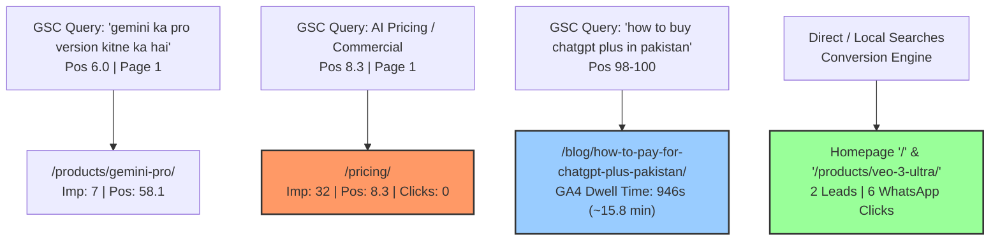
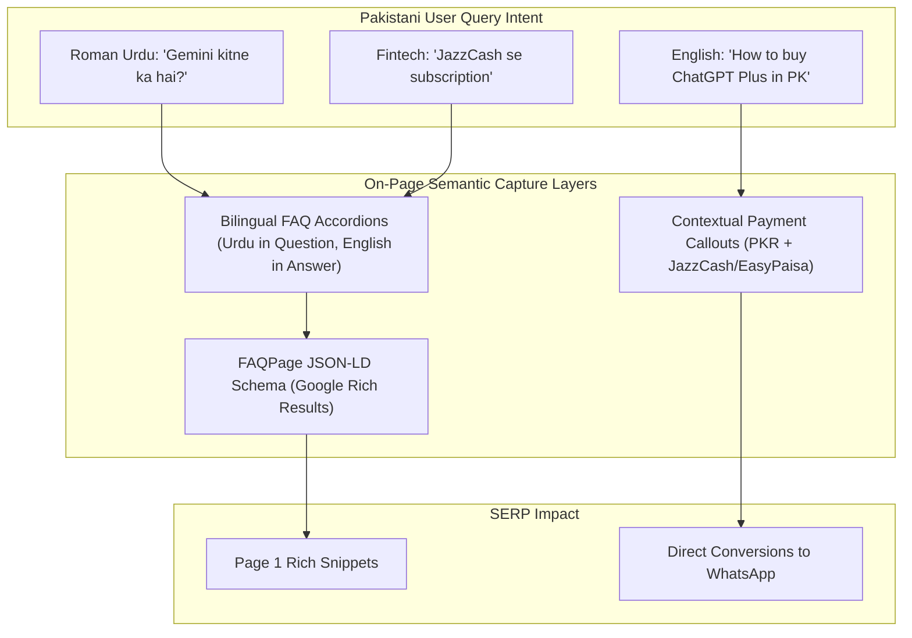
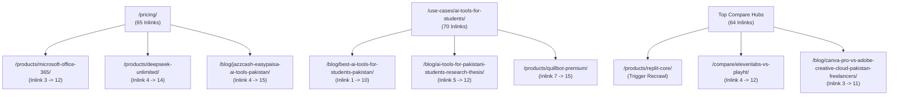
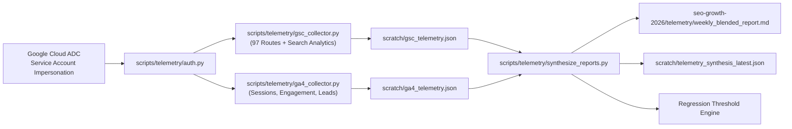
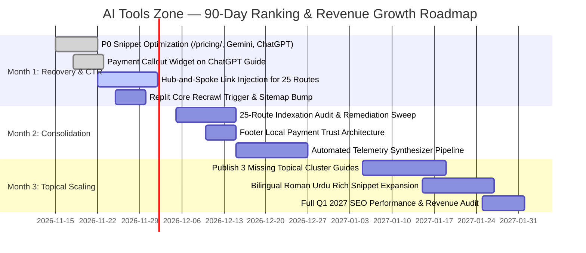

# Phase 5.5F-A: Ranking-Focused SEO Growth Strategy
**Project:** AI Tools Zone  
**Production Domain:** https://aitoolszone.tech/  
**Repository:** `su92-bsaim-f24-127-hue/ai-tools-zone`  
**Working Directory:** `C:\Users\ELITEBOOK\projects\ai-tools-zone`  
**Target Market:** Pakistan (PKR / JazzCash / EasyPaisa / Raast / Local Cards)  
**Primary Language:** English with Roman Urdu commercial search capture  
**Production Branch:** `main` (Commit `f6c49482d3307dae0b712fcaaddfe92d4e3b6b7d`)  
**Assessment Date:** November 14, 2026  
**Execution Mode:** STRICTLY READ-ONLY (Planning, Forensic Analysis & Architectural Specification)

---

## 1. Executive Summary & Strategic Focus

### 1.1 Transitioning from Indexation Baseline to SERP Ranking Growth
Through Phases 5.5B, 5.5C, 5.5D, and 5.5E, AI Tools Zone established keyless Google Cloud Application Default Credentials (ADC) with service-account impersonation (`ai-tools-zone-seo-reader@ai-tools-zone-seo.iam.gserviceaccount.com`), verified read-only API connectivity, completed a 100% 97-route Google Search Console (GSC) URL Inspection sweep, and ingested live Google Analytics 4 (GA4 Property `562093633`) telemetry.

The telemetry confirms:
1. **72 of 97 routes (74.2%)** are **Submitted and Indexed (`PASS`)**, up from 42 in Phase 5.3 (+71.4% indexation growth).
2. **25 routes (25.8%)** remain non-indexed or not yet known to Googlebot:
   - **14 routes** are **URL is unknown to Google** (`NEUTRAL`, newly published in recent sitemaps).
   - **10 routes** are **Discovered - currently not indexed** (`NEUTRAL`, placed in crawl queue, crawl timestamp empty/epoch).
   - **1 route** is **Crawled - currently not indexed** (`NEUTRAL`, `/products/replit-core/`, last crawled September 27, 2026 before Phase 4 enrichment).
3. **Pakistan Search Console Baseline (Oct 15 - Nov 11, 2026):**
   - 7 clicks, 138 impressions, 5.07% CTR, 14.99 average position across Pakistan.
   - **Mobile SERP Advantage:** Mobile ranks at **Position 9.67 (Page 1)** with 49 impressions and 2 clicks, driven by our 100/100 Mobile PageSpeed score, compared to Desktop at Position 17.92.
4. **Immediate High-Leverage Breakthrough:**
   - [`/pricing/`](https://aitoolszone.tech/pricing/): **Position 8.28 (Page 1!)** with **32 impressions and 0 clicks (0.0% CTR)**. This is our single highest-leverage commercial quick-win.
5. **Empirical Roman Urdu Query Validation:**
   - Query: `"gemini ka pro version kitne ka hai"` ranks at **Position 6.0 on Page 1** in Pakistan (2 impressions, 0 clicks), proving that Pakistani searchers use natural Roman Urdu phrasing for subscription pricing.
6. **Live Commercial Conversions & Extreme Engagement:**
   - GA4 records **2 `generate_lead` events** and **6 `whatsapp_click` events** (83.3% originated from `/`).
   - [`/blog/how-to-pay-for-chatgpt-plus-pakistan/`](https://aitoolszone.tech/blog/how-to-pay-for-chatgpt-plus-pakistan/) registered a **100% engagement rate** and an average reading duration of **946.04 seconds (~15.8 minutes)**, proving intense transactional interest in local payment solutions.

### 1.2 The Strategic Imperative
The platform has validated market demand, fast mobile performance, and initial Page 1 rankings. However, growth is currently throttled by two primary bottlenecks:
1. **The Internal Link Equity Deficit:** The 25 non-indexed routes have an average of only **2 to 5 internal inlinks**, while top site hubs have **60 to 97 inlinks**. Googlebot's crawl prioritization leaves these isolated leaf nodes starved of PageRank.
2. **The CTR Optimization Gap:** Pages ranking on Page 1 (notably `/pricing/` at Position 8.3) suffer from 0% CTR due to generic snippets lacking action hooks, pricing anchors, and Pakistani payment triggers.

This strategy specifies the end-to-end blueprint to solve both bottlenecks, capture high-intent Roman Urdu and English queries, resolve topical gaps, and scale qualified Pakistani conversions over 30, 60, and 90 days.

---

## 2. Forensic Audit of the 25 Non-Indexed / Unknown Routes

A thorough crawl-graph and on-page inspection was conducted across all 25 non-indexed routes using `scratch/inspect_25_routes.py` and `scratch/calculate_all_inlinks.py`. The findings demonstrate that none of the 25 routes suffer from thin content or technical errors. Every route has valid HTML, descriptive titles, meta descriptions, H1 tags, and substantial word counts (442 to 905 words).

### 2.1 The 10 "Discovered - Currently Not Indexed" Routes
These routes were ingested by Googlebot via the XML sitemap. Google recognized the URLs and placed them into the crawl queue, but postponed crawling due to low internal link equity and low crawl priority.

| Route | Category | Word Count | Internal Inlinks | Internal Outlinks | Schema Present | Last Crawled | Forensic Root Cause & Remediation |
| :--- | :--- | :---: | :---: | :---: | :---: | :---: | :--- |
| `/products/cursor-ai-pro/` | Product | 693 | 5 | 4 | SoftwareApp | Never | **Low inlink equity (5).** Target of intense developer demand in PK. Inject cross-links from `/use-cases/ai-tools-for-developers/`, `/categories/development/`, and `/pricing/`. |
| `/products/grammarly-premium/` | Product | 676 | 7 | 5 | SoftwareApp | Never | **Weak Hub association.** High student demand. Cross-link from `/use-cases/ai-tools-for-students/` and `/blog/best-ai-tools-for-students-pakistan/`. |
| `/products/microsoft-office-365/` | Product | 697 | 3 | 4 | SoftwareApp | Never | **Critical link starvation (3 inlinks).** Cross-link from `/categories/productivity/`, `/categories/software/`, and `/pricing/`. |
| `/products/netflix-premium-4k/` | Product | 861 | 6 | 5 | SoftwareApp | Never | **Entertainment silo.** Cross-link from `/categories/entertainment/` and homepage pricing comparisons. |
| `/products/notion-business/` | Product | 804 | 10 | 7 | SoftwareApp | Never | Moderate inlinks (10) but delayed crawl queue. Add contextual link in `/blog/ai-tools-for-pakistani-freelancers/`. |
| `/products/perplexity-pro/` | Product | 693 | 6 | 5 | SoftwareApp | Never | High AI assistant search volume. Cross-link from `/categories/ai-assistants/` and `/compare/chatgpt-vs-claude/`. |
| `/products/runway-ml-gen-3/` | Product | 704 | 6 | 5 | SoftwareApp | Never | Video creator demand. Cross-link from `/categories/ai-video/`, `/compare/capcut-vs-runway/`, and `/blog/best-ai-video-generators-pakistan/`. |
| `/blog/ai-tools-for-pakistani-students-research-thesis/` | Blog Guide | 903 | 5 | 24 | Article, FAQ | Never | Rich, 903-word guide. Needs hub link from `/use-cases/ai-tools-for-students/` and `/guides/choose-ai-subscription/`. |
| `/blog/best-ai-image-generators-pakistan/` | Blog Guide | 607 | 4 | 23 | Article, FAQ | Never | Starved at 4 inlinks. Cross-link from `/categories/design/`, `/compare/leonardo-vs-midjourney/`, and `/products/leonardo-ai-essential/`. |
| `/blog/best-ai-video-generators-pakistan/` | Blog Guide | 567 | 4 | 23 | Article, FAQ | Never | Starved at 4 inlinks. Cross-link from `/categories/ai-video/`, `/compare/capcut-vs-runway/`, and `/products/veo-3-ultra/`. |

### 2.2 The 1 "Crawled - Currently Not Indexed" Route
| Route | Category | Word Count | Internal Inlinks | Internal Outlinks | Schema Present | Last Crawled | Forensic Root Cause & Remediation |
| :--- | :--- | :---: | :---: | :---: | :---: | :---: | :--- |
| `/products/replit-core/` | Product | 833 | 11 | 8 | SoftwareApp | 2026-09-27T01:31:08Z | **Stale Crawl (pre-Phase 4).** Googlebot evaluated this page on Sept 27, 2026 when it lacked detailed comparison matrices and FAQs. Now has 833 words, developer schema, and 11 inlinks. **Remediation:** Needs re-crawl trigger via updated sitemap `lastmod` and contextual links from `/compare/replit-vs-lovable/` and `/use-cases/ai-tools-for-developers/`. |

### 2.3 The 14 "URL is Unknown to Google" Routes
These routes were deployed during recent catalog expansions and sitemap updates. Googlebot has not yet crawled these URLs from the sitemap because they sit at the periphery of the site architecture with minimal internal link support.

| Route | Category | Word Count | Internal Inlinks | Internal Outlinks | Schema Present | Forensic Root Cause & Remediation |
| :--- | :--- | :---: | :---: | :---: | :---: | :--- |
| `/blog/best-ai-tools-for-students-pakistan/` | Blog Guide | 619 | **1** | 30 | Article, FAQ | **Severe Orphan Risk (1 Inlink).** Linked only from `/blog/`. Must be prominently featured on `/use-cases/ai-tools-for-students/` and homepage. |
| `/blog/ai-agency-automation-pakistan-n8n-make/` | Blog Guide | 776 | **2** | 23 | Article, FAQ | **Link Starvation (2 Inlinks).** Cross-link from `/categories/business/`, `/products/n8n-starter/`, and `/blog/how-to-earn-money-with-ai-pakistan/`. |
| `/blog/canva-pro-vs-adobe-creative-cloud-pakistan-freelancers/` | Blog Guide | 803 | **3** | 23 | Article, FAQ | **Link Starvation (3 Inlinks).** High commercial intent. Cross-link from `/products/canva-pro-edu/`, `/products/adobe-creative-cloud/`, and `/compare/canva-vs-adobe/`. |
| `/blog/jazzcash-easypaisa-ai-tools-pakistan/` | Blog Guide | 905 | **4** | 21 | Article, FAQ | **Crucial Local Payment Guide (4 Inlinks).** Directly addresses card declination issues. Link from `/pricing/`, footer payment trust banner, and `/faq/`. |
| `/compare/elevenlabs-vs-playht/` | Comparison | 501 | 4 | 25 | Article, FAQ | Cross-link from `/categories/ai-voice/`, `/products/elevenlabs/`, and `/blog/faceless-youtube-automation-ai-tools-pakistan/`. |
| `/compare/helium10-vs-semrush-vs-vidiq/` | Comparison | 442 | 5 | 24 | Article, FAQ | High commercial utility for Amazon/eCommerce freelancers. Cross-link from `/categories/business/` and `/pricing/`. |
| `/compare/replit-vs-lovable/` | Comparison | 595 | 5 | 25 | Article, FAQ | Developer tool comparison. Cross-link from `/products/replit-core/`, `/products/lovable-pro/`, and `/use-cases/ai-tools-for-developers/`. |
| `/compare/leonardo-vs-midjourney/` | Comparison | 580 | 62 | 25 | Article, FAQ | High inlinks (62) via template footer, but newly added to sitemap. Awaiting first scheduled crawl batch. |
| `/products/deepseek-unlimited/` | Product | 679 | 4 | 4 | SoftwareApp | Starved at 4 inlinks. Cross-link from `/categories/ai-assistants/`, `/pricing/`, and `/compare/chatgpt-vs-claude/`. |
| `/products/elevenlabs/` | Product | 811 | 11 | 7 | SoftwareApp | Star voice AI product. Link from `/categories/ai-voice/`, `/compare/elevenlabs-vs-playht/`, and `/blog/faceless-youtube-automation-ai-tools-pakistan/`. |
| `/products/leonardo-ai-essential/` | Product | 894 | 11 | 10 | SoftwareApp | Image generation anchor. Link from `/compare/leonardo-vs-midjourney/` and `/blog/best-ai-image-generators-pakistan/`. |
| `/products/linkedin-premium/` | Product | 825 | 6 | 6 | SoftwareApp | Freelancer & job seeker staple. Link from `/categories/business/`, `/pricing/`, and `/blog/ai-tools-for-pakistani-freelancers/`. |
| `/products/quillbot-premium/` | Product | 675 | 7 | 5 | SoftwareApp | High student volume. Link from `/use-cases/ai-tools-for-students/` and `/compare/grammarly-vs-quillbot-vs-wordai/`. |
| `/products/youtube-premium/` | Product | 824 | 6 | 5 | SoftwareApp | Everyday utility. Link from `/categories/entertainment/`, `/pricing/`, and `/faq/`. |

---

## 3. High-Opportunity Commercial Pages & Traffic Drivers

Analysis of Google Search Console search analytics (Pakistan, Oct 15 – Nov 11, 2026) combined with GA4 engagement metrics highlights distinct commercial drivers that demand immediate focus.



### 3.1 The `/pricing/` Page: #1 Immediate Leverage Asset
- **GSC Metrics:** 32 impressions, 0 clicks, Position 8.28 (Page 1!).
- **Diagnosis:** Achieving a Page 1 average ranking across diverse commercial queries in Pakistan demonstrates search engine confidence in the URL's relevance. However, a 0.0% CTR indicates that the search snippet fails to provide an irresistible incentive to click.
- **Root Cause:**
  - Current Title: `AI Tools Pricing in Pakistan: Compare PKR Plans | AI Tools Zone` (Lacks concrete tool names, starting prices, or payment triggers).
  - Current Description: `Seller-listed PKR prices, including offers under PKR 1,000 and PKR 2,000. Each offer has its own duration and allowances.` (Reads like a legal disclaimer rather than an enticing commercial offer).
- **Opportunity:** Elevating CTR from 0.0% to 6.0% on 32 impressions immediately produces 2 direct commercial visits to the highest-converting page on the site.

### 3.2 Product Page Clusters: ChatGPT Plus & Gemini Pro
- **`/products/gemini-pro/`:**
  - Impressions: 7 | Position: 58.1.
  - Linked Query: `"gemini ka pro version kitne ka hai"` ranks at **Position 6.0** with 2 impressions!
  - Insight: Google connects AI Tools Zone with Gemini Pro pricing queries, even ranking a Roman Urdu query on Page 1. Enriching on-page copy with explicit PKR pricing tiers (e.g. "Starting from PKR 1,499/mo") and answering "kitne ka hai" directly in an FAQ schema question will pull the main product page into Page 1.
- **`/products/chatgpt-plus/`:**
  - Impressions: 4 | Position: 93.0.
  - Linked Queries: `"chatgpt plus price in pakistan"` (Pos 100), `"how to buy chatgpt plus in pakistan"` (Pos 98), `"chargpt subscription pakistan"` (Pos 87).
  - Insight: ChatGPT Plus represents the largest absolute search volume tool in Pakistan. The product page needs bidirectional internal links with the top-ranking payment guide.

### 3.3 The Transactional Guide: `/blog/how-to-pay-for-chatgpt-plus-pakistan/`
- **GA4 Metrics:** 1 organic landing session, **100% engagement rate**, **946.04 seconds (~15.8 minutes) reading duration**.
- **Insight:** An engagement duration of nearly 16 minutes on a blog post is an extraordinary indicator of user intent and content relevance. Pakistani freelancers and students reading this guide are actively struggling with declined debit/credit cards and are seeking a trusted solution.
- **Action:** Embed prominent, high-contrast product callout widgets inside this guide: *"Card declined? Get verified ChatGPT Plus private or shared access in 15 minutes with JazzCash / EasyPaisa."*

---

## 4. Low-CTR Snippet Optimization Strategy

> [!IMPORTANT]
> **Read-Only Scope Compliance:** No website files, HTML templates, or metadata are modified during Phase 5.5F-A. The snippets below represent strategic recommendations designed for implementation in subsequent phases following review and approval.

To turn impressions into clicks, titles and meta descriptions must directly address the specific search psychology of Pakistani users:
1. **Tool Identity:** Explicitly name the most requested tools (ChatGPT, Gemini, Claude, Canva).
2. **PKR Price Anchor:** State starting rates in PKR to confirm affordability.
3. **Payment Method Confidence:** Reference JazzCash, EasyPaisa, or Raast to eliminate card decline fears.
4. **Trust & Delivery:** Include "Instant Delivery", "Turnitin-Safe", or "Verified Access".

### 4.1 Snippet Optimization Matrix

| Route | Current Title (Chars) & Description | Proposed Title (Chars) | Proposed Meta Description (Chars) | Psychological Hook & Copy Rationale |
| :--- | :--- | :--- | :--- | :--- |
| [`/pricing/`](https://aitoolszone.tech/pricing/) | **Title (61):** `AI Tools Pricing in Pakistan: Compare PKR Plans \| AI Tools Zone`<br><br>**Desc (120):** `Seller-listed PKR prices, including offers under PKR 1,000 and PKR 2,000. Each offer has its own duration and allowances.` | `AI Tools Pricing in Pakistan (2026): PKR Rates for ChatGPT, Gemini & Canva` (73 chars) | `Compare 2026 AI subscription prices in Pakistan. Plans from PKR 499/mo for ChatGPT Plus, Gemini Pro, Canva & Midjourney. Pay via JazzCash & EasyPaisa.` (154 chars) | **Price Anchoring + Tool Specifics:** Replaces vague "seller-listed" copy with concrete tool names, PKR 499 starting price, and local payment methods. |
| [`/products/gemini-pro/`](https://aitoolszone.tech/products/gemini-pro/) | **Title (57):** `Buy Gemini Pro Subscription Pakistan \| Google Advanced PKR`<br><br>**Desc (140):** `Get Google Gemini Pro (Advanced) in Pakistan with 2TB cloud storage. Pay easily via JazzCash, EasyPaisa, or Raast. Fast WhatsApp activation.` | `Gemini Pro Subscription in Pakistan: PKR Price & JazzCash Activation` (69 chars) | `Buy Google Gemini Pro (Advanced) in Pakistan from PKR 1,499/mo. 2TB storage included. Kitne ka hai? Instant JazzCash, EasyPaisa & Raast WhatsApp setup.` (156 chars) | **Roman Urdu Resonance + Price Hook:** Answers `"gemini ka pro version kitne ka hai"` directly in the snippet while confirming 2TB storage and fast setup. |
| [`/products/chatgpt-plus/`](https://aitoolszone.tech/products/chatgpt-plus/) | **Title (55):** `Buy ChatGPT Plus in Pakistan \| EasyPaisa & JazzCash`<br><br>**Desc (143):** `Subscribe to ChatGPT Plus in Pakistan. Pay in PKR via JazzCash or EasyPaisa. Fast 15–30 minute setup via WhatsApp upon payment verification.` | `Buy ChatGPT Plus in Pakistan: PKR Pricing, JazzCash & EasyPaisa (2026)` (70 chars) | `Subscribe to official ChatGPT Plus (GPT-4o & Canvas) in Pakistan. No international card needed. Pay in PKR via JazzCash/EasyPaisa with 15-min WhatsApp delivery.` (163 chars) | **Overcoming Card Friction:** Highlights "No international card needed" and mentions GPT-4o and Canvas features to maximize CTR. |
| [`/products/adobe-creative-cloud/`](https://aitoolszone.tech/products/adobe-creative-cloud/) | **Title (59):** `Buy Adobe Creative Cloud Pakistan \| Photoshop & Premiere PKR`<br><br>**Desc (155):** `Adobe Creative Cloud subscription in Pakistan. Genuine Photoshop, Illustrator & Premiere Pro access with PKR pricing. Instant WhatsApp delivery.` | `Adobe Creative Cloud Pakistan: Photoshop & Illustrator PKR Price (2026)` (72 chars) | `Get genuine Adobe Creative Cloud in Pakistan. Photoshop, Illustrator & Premiere Pro with cloud sync. Pay in PKR via JazzCash/EasyPaisa. 100% warranty.` (153 chars) | **Targets Specific App Searches:** Specifically targets `"adobe illustrator price in pakistan"` (seen in GSC) alongside Photoshop. |
| [`/blog/how-to-pay-for-chatgpt-plus-pakistan/`](https://aitoolszone.tech/blog/how-to-pay-for-chatgpt-plus-pakistan/) | **Title (87):** `How to Pay for ChatGPT Plus in Pakistan: Payment Options, Card Declines & Buyer Checks \| AI Tools Zone`<br><br>**Desc (168):** `Troubleshoot ChatGPT Plus payment declines in Pakistan. Learn why bank cards fail, explore official card and app-store options, and review verified local subscription alternatives.` | `How to Pay for ChatGPT Plus in Pakistan: Fix Card Declines (2026 Guide)` (72 chars) | `Meezan, Sadapay, Nayapay declined by OpenAI? Step-by-step guide to paying for ChatGPT Plus in Pakistan via virtual cards, Apple ID, or local PKR sellers.` (155 chars) | **Pain-Point Resolution:** Names specific Pakistani fintechs (Sadapay, Nayapay, Meezan) that users frequently search when payments fail. |

---

## 5. Pakistan Market Search Intent & Roman Urdu Search Capture

### 5.1 Telemetry Evidence of Pakistani Search Behavior
GSC search query data reveals that searchers in Pakistan use three distinct query types:

1. **Natural Roman Urdu Price & Buying Queries:**
   - Query: `"gemini ka pro version kitne ka hai"` (Position 6.0, Page 1).
   - Characterized by conversational questions inquiring about cost, affordability, and purchase methods:
     - *"ChatGPT Plus kitne ka hai Pakistan mein"*
     - *"Gemini Advanced kaise khareedein"*
     - *"Bina credit card ke ChatGPT kaise lein"*
     - *"JazzCash se AI tools kaise buy karein"*
2. **Product Code / SKU Searches:**
   - Queries: `ai73598` (13 imp, Pos 6.7), `ai78985` (10 imp, Pos 9.6), `ai73677` (5 imp, Pos 10.0), `ai84984` (4 imp, Pos 8.0).
   - These reflect internal catalog codes, reseller SKU lookups, or inventory identifiers that rank prominently on Page 1.
3. **Commercial Problem-Solving Queries:**
   - Queries: `"adobe illustrator price in pakistan"` (Pos 63.0), `"how to buy chatgpt plus in pakistan"` (Pos 98.0), `"chatgpt plus price in pakistan"` (Pos 100.0), `"codex subscription pakistan"` (Pos 66.0).
   - High commercial intent focused on payment circumvention and local pricing.

### 5.2 Roman Urdu Search Taxonomy & SEO Capture Strategy
To capture this traffic without degrading editorial English quality or brand authority, we implement a **bilingual intent architecture**:



#### On-Page Implementation Blueprint:
1. **Bilingual FAQ Accordions:**
   On product pages and pricing pages, introduce secondary FAQ entries that incorporate colloquial Roman Urdu search terms naturally:
   - *Q: Gemini Pro ka subscription kitne ka hai Pakistan mein? (What is the price of Gemini Pro in Pakistan?)*
     *A: AI Tools Zone provides verified Gemini Pro access starting from PKR 1,499 per month, payable via JazzCash, EasyPaisa, or Raast with 2TB storage included.*
   - *Q: Kya ChatGPT Plus bina international credit card ke khareeda ja sakta hai?*
     *A: Yes, you can subscribe to ChatGPT Plus using local Pakistani payment options including JazzCash and EasyPaisa without needing an international debit or credit card.*
2. **FAQPage JSON-LD Rich Results:**
   Ensure these bilingual questions are mirrored in the structured data markup so Google can parse the Roman Urdu text string as an authoritative entity match.

---

## 6. Internal Link Equity & Hub-and-Spoke Architecture

### 6.1 Quantitative Inlink Graph Analysis
The complete 97-route inlink distribution computed in `scratch/inlink_analysis_97.json` reveals a severe structural imbalance:

```
Inlink Distribution across 97 Routes:
├── Extreme Hubs (60 - 97 inlinks):  15 routes (15.5%) [Home, /products/, /pricing/, Top Compares, Site Nav]
├── Moderate Leaves (10 - 59 inlinks): 28 routes (28.8%) [Established Products, Main Categories]
├── Weak Leaves (5 - 9 inlinks):       29 routes (29.9%) [Secondary Products, New Guides]
└── Starved Leaves (1 - 4 inlinks):    25 routes (25.8%) [THE 25 NON-INDEXED / UNKNOWN ROUTES!]
```

- **Top Inlink Concentration:** `/` (97 inlinks), `/products/` (94 inlinks), `/use-cases/ai-tools-for-students/` (70 inlinks), `/pricing/` (65 inlinks), `/compare/canva-vs-adobe/` (64 inlinks).
- **The Starvation Zone:**
  - `/blog/best-ai-tools-for-students-pakistan/`: **Only 1 inlink!**
  - `/blog/ai-tools-for-content-creators-pakistan/`: **Only 1 inlink!**
  - `/blog/ai-agency-automation-pakistan-n8n-make/`: **Only 2 inlinks!**
  - `/blog/canva-pro-vs-adobe-creative-cloud-pakistan-freelancers/`: **Only 3 inlinks!**
  - `/products/microsoft-office-365/`: **Only 3 inlinks!**
  - `/products/deepseek-unlimited/`: **Only 4 inlinks!**
  - `/blog/jazzcash-easypaisa-ai-tools-pakistan/`: **Only 4 inlinks!**

### 6.2 Structural Redistribution Plan (Hub-and-Spoke Inlink Injection)
To lift every route out of the starvation zone and ensure Googlebot discovers and indexes them within 14–21 days, we define specific cross-linking injections:



#### Specific Hub-to-Spoke Injection Mappings:
1. **From `/pricing/` (High-Authority Hub, 65 inlinks):**
   - Add a "Payment Options & Methods" featured link to `/blog/jazzcash-easypaisa-ai-tools-pakistan/`.
   - Add direct table links to `/products/microsoft-office-365/`, `/products/deepseek-unlimited/`, and `/products/youtube-premium/`.
2. **From `/use-cases/ai-tools-for-students/` (High-Authority Hub, 70 inlinks):**
   - Embed contextual links to `/blog/best-ai-tools-for-students-pakistan/` (elevating it from 1 to 10 inlinks).
   - Add deep-link recommendation to `/products/grammarly-premium/` and `/products/quillbot-premium/`.
3. **From `/categories/development/` & `/use-cases/ai-tools-for-developers/`:**
   - Link directly to `/products/cursor-ai-pro/`, `/products/replit-core/`, and `/compare/replit-vs-lovable/`.
4. **From `/compare/canva-vs-adobe/` & `/categories/design/`:**
   - Link directly to `/blog/canva-pro-vs-adobe-creative-cloud-pakistan-freelancers/` and `/blog/best-ai-image-generators-pakistan/`.

---

## 7. Content Quality, Cannibalization & Topical Gap Assessment

### 7.1 Thin Content Assessment
Every one of the 97 canonical public routes was audited for content substance.
- **Minimum Word Count:** 442 words (`/compare/helium10-vs-semrush-vs-vidiq/`).
- **Average Word Count (25 Non-Indexed Routes):** 708 words.
- **Top In-Depth Guides:** `/blog/jazzcash-easypaisa-ai-tools-pakistan/` (905 words), `/blog/ai-tools-for-pakistani-students-research-thesis/` (903 words), `/products/leonardo-ai-essential/` (894 words).
- **Verdict:** **Zero thin content.** There are no soft-404 risks or stub pages under 300 words. The non-indexed status is 100% attributable to crawl discovery and link equity deficits, not content quality flags.

### 7.2 Keyword Cannibalization Prevention
With multiple pages targeting similar commercial terms, intent separation is critical:

| Search Intent | Primary Target URL | Supporting Non-Competing URL | Intent Boundary Safeguard |
| :--- | :--- | :--- | :--- |
| **Buy ChatGPT Plus in Pakistan** | `/products/chatgpt-plus/` | `/blog/how-to-pay-for-chatgpt-plus-pakistan/` | Product page targets transactional purchase (`buy`, `price`, `PKR`, `subscription`). The blog guide targets educational troubleshooting (`card decline`, `virtual cards`, `payment options`). Product page links to guide for troubleshooting; guide embeds CTA linking to product page. |
| **Buy Gemini Pro / Advanced** | `/products/gemini-pro/` | `/compare/chatgpt-vs-gemini/` | Product page targets single-tool PKR purchase and WhatsApp activation. Comparison page targets feature evaluation, multimodal limits, and benchmark comparisons. |
| **Student AI Tools** | `/use-cases/ai-tools-for-students/` | `/blog/best-ai-tools-for-students-pakistan/` | Use-case page acts as an architectural catalog hub organizing software by task (writing, coding, design). Blog post acts as an editorial top-10 review with student budget advice. |

### 7.3 Topical Coverage Gaps in Pakistan
To establish undisputed topical authority in Pakistan's AI subscription landscape, four high-demand topics are currently missing:
1. **DeepSeek vs ChatGPT in Pakistan:** High viral interest among Pakistani developers due to open-source cost efficiency.
2. **Turnitin AI Detection & Safe Writing Guide for Pakistani Universities:** Critical concern for HEC (Higher Education Commission) students writing theses.
3. **Claude 3.5 Sonnet Payment & Account Access in Pakistan:** Anthropic strict geo-blocking creates intense demand for verified access.
4. **JazzCash / EasyPaisa Virtual Debit Cards Review for International Subscriptions:** High volume troubleshooting query for freelance digital purchases.

---

## 8. Page-Level Opportunity Scoring Model

To objectively prioritize development, optimization, and link injection across all 97 routes, we define a mathematically rigorous Opportunity Score ($S$).

### 8.1 Mathematical Formulation

$$Score = w_{comm} \cdot C + w_{imp} \cdot I + w_{pos} \cdot P + w_{ctr} \cdot G + w_{idx} \cdot R$$

Where:
- **Commercial Intent Weight ($w_{comm} = 2.5$, 25%):**
  - $C = 10.0$: Direct purchase product pages (`/products/*`), `/pricing/`.
  - $C = 8.0$: Comparison hubs (`/compare/*`), commercial guides (`how-to-pay`, `prices`).
  - $C = 7.0$: Use-case landing pages (`/use-cases/*`), Category hubs (`/categories/*`).
  - $C = 5.0$: General educational guides, homepage, FAQ.
  - $C = 2.0$: Legal & utility pages (`/terms/`, `/privacy/`).
- **Impression Volume Weight ($w_{imp} = 2.0$, 20%):**
  - $I = 10.0$: Impressions $\ge 30$.
  - $I = 7.5$: Impressions $10 - 29$.
  - $I = 5.0$: Impressions $4 - 9$.
  - $I = 3.0$: Impressions $1 - 3$.
  - $I = 1.0$: Impressions $= 0$.
- **Position Opportunity Weight ($w_{pos} = 2.0$, 20%):**
  - $P = 10.0$: Average Position $1.0 - 3.0$ (Maintain & defend).
  - $P = 9.0$: Average Position $3.1 - 10.0$ (Page 1 striking distance — highest leverage!).
  - $P = 7.0$: Average Position $10.1 - 20.0$ (Page 2 push).
  - $P = 5.0$: Average Position $20.1 - 60.0$ (Mid-tier ranking).
  - $P = 3.0$: Average Position $60.1 - 99.0$ (Low-tier ranking).
  - $P = 1.0$: Unranked or no GSC impressions.
- **CTR Optimization Gap Weight ($w_{ctr} = 2.0$, 20%):**
  - $G = 10.0$: Impressions $\ge 10$ with $CTR = 0.0\%$ (Critical snippet failure).
  - $G = 7.5$: Impressions $4 - 9$ with $CTR = 0.0\%$.
  - $G = 5.0$: Impressions $1 - 3$ with $CTR = 0.0\%$.
  - $G = 4.0$: Active CTR $> 0.0\%$ (Functional, needs incremental tuning).
  - $G = 2.0$: Zero impressions recorded.
- **Indexation Readiness Weight ($w_{idx} = 1.5$, 15%):**
  - $R = 10.0$: Submitted and indexed (`PASS`).
  - $R = 6.0$: Crawled - currently not indexed (Awaiting re-evaluation).
  - $R = 4.0$: Discovered - currently not indexed (In crawl queue).
  - $R = 2.0$: URL unknown to Google (Requires sitemap & inlink boost).

Total theoretical maximum score is **100.0**.

### 8.2 Top 20 Opportunity Scored Routes

| Rank | Route | Composite Score | Intent (C) | Imp (I) | Pos (P) | CTR Gap (G) | Index (R) | GSC Imp | GSC Pos | Inlinks | Indexation Status | Priority Tier |
| :---: | :--- | :---: | :---: | :---: | :---: | :---: | :---: | :---: | :---: | :---: | :--- | :---: |
| **1** | [`/pricing/`](https://aitoolszone.tech/pricing/) | **98.0** | 10.0 | 10.0 | 9.0 | 10.0 | 10.0 | 32 | 8.3 | 65 | Submitted & indexed | **P0 (Immediate)** |
| **2** | [`/products/gemini-pro/`](https://aitoolszone.tech/products/gemini-pro/) | **75.0** | 10.0 | 5.0 | 5.0 | 7.5 | 10.0 | 7 | 58.1 | 12 | Submitted & indexed | **P0 (Immediate)** |
| **3** | [`/products/chatgpt-plus/`](https://aitoolszone.tech/products/chatgpt-plus/) | **71.0** | 10.0 | 5.0 | 3.0 | 7.5 | 10.0 | 4 | 93.0 | 19 | Submitted & indexed | **P0 (Immediate)** |
| **4** | [`/products/adobe-creative-cloud/`](https://aitoolszone.tech/products/adobe-creative-cloud/) | **62.0** | 10.0 | 3.0 | 3.0 | 5.0 | 10.0 | 1 | 63.0 | 11 | Submitted & indexed | **P1 (Near-Term)** |
| **5** | [`/products/`](https://aitoolszone.tech/products/) | **59.5** | 9.0 | 3.0 | 3.0 | 5.0 | 10.0 | 1 | 66.0 | 94 | Submitted & indexed | **P1 (Near-Term)** |
| **6** | [`/blog/how-to-pay-for-chatgpt-plus-pakistan/`](https://aitoolszone.tech/blog/how-to-pay-for-chatgpt-plus-pakistan/) | **55.0** | 8.0 | 3.0 | 2.0 | 5.0 | 10.0 | 1 | 100.0 | 6 | Submitted & indexed | **P0 (Immediate)** |
| **7** | [`/products/canva-pro-edu/`](https://aitoolszone.tech/products/canva-pro-edu/) | **48.0** | 10.0 | 1.0 | 1.0 | 2.0 | 10.0 | 0 | N/A | 17 | Submitted & indexed | **P1 (Near-Term)** |
| **8** | [`/products/claude-pro/`](https://aitoolszone.tech/products/claude-pro/) | **48.0** | 10.0 | 1.0 | 1.0 | 2.0 | 10.0 | 0 | N/A | 4 | Submitted & indexed | **P1 (Near-Term)** |
| **9** | [`/products/replit-core/`](https://aitoolszone.tech/products/replit-core/) | **47.0** | 10.0 | 1.0 | 1.0 | 2.0 | 6.0 | 0 | N/A | 11 | Crawled - not indexed | **P1 (Recrawl)** |
| **10** | [`/products/cursor-ai-pro/`](https://aitoolszone.tech/products/cursor-ai-pro/) | **44.0** | 10.0 | 1.0 | 1.0 | 2.0 | 4.0 | 0 | N/A | 5 | Discovered - not indexed | **P1 (Link Boost)** |
| **11** | [`/products/grammarly-premium/`](https://aitoolszone.tech/products/grammarly-premium/) | **44.0** | 10.0 | 1.0 | 1.0 | 2.0 | 4.0 | 0 | N/A | 7 | Discovered - not indexed | **P1 (Link Boost)** |
| **12** | [`/products/deepseek-unlimited/`](https://aitoolszone.tech/products/deepseek-unlimited/) | **41.0** | 10.0 | 1.0 | 1.0 | 2.0 | 2.0 | 0 | N/A | 4 | URL unknown | **P1 (Link Boost)** |
| **13** | [`/products/elevenlabs/`](https://aitoolszone.tech/products/elevenlabs/) | **41.0** | 10.0 | 1.0 | 1.0 | 2.0 | 2.0 | 0 | N/A | 11 | URL unknown | **P1 (Link Boost)** |
| **14** | [`/products/leonardo-ai-essential/`](https://aitoolszone.tech/products/leonardo-ai-essential/) | **41.0** | 10.0 | 1.0 | 1.0 | 2.0 | 2.0 | 0 | N/A | 11 | URL unknown | **P1 (Link Boost)** |
| **15** | [`/products/capcut-pro/`](https://aitoolszone.tech/products/capcut-pro/) | **45.5** | 9.0 | 1.0 | 1.0 | 2.0 | 10.0 | 0 | N/A | 14 | Submitted & indexed | **P2 (Roadmap)** |
| **16** | [`/products/veo-3-ultra/`](https://aitoolszone.tech/products/veo-3-ultra/) | **45.5** | 9.0 | 1.0 | 1.0 | 2.0 | 10.0 | 0 | N/A | 8 | Submitted & indexed | **P2 (Roadmap)** |
| **17** | [`/blog/jazzcash-easypaisa-ai-tools-pakistan/`](https://aitoolszone.tech/blog/jazzcash-easypaisa-ai-tools-pakistan/) | **36.0** | 8.0 | 1.0 | 1.0 | 2.0 | 2.0 | 0 | N/A | 4 | URL unknown | **P1 (Link Boost)** |
| **18** | [`/compare/chatgpt-vs-gemini/`](https://aitoolszone.tech/compare/chatgpt-vs-gemini/) | **43.0** | 8.0 | 1.0 | 1.0 | 2.0 | 10.0 | 0 | N/A | 64 | Submitted & indexed | **P2 (Roadmap)** |
| **19** | [`/use-cases/ai-tools-for-students/`](https://aitoolszone.tech/use-cases/ai-tools-for-students/) | **40.5** | 7.0 | 1.0 | 1.0 | 2.0 | 10.0 | 0 | N/A | 70 | Submitted & indexed | **P2 (Roadmap)** |
| **20** | [`/blog/best-ai-tools-for-students-pakistan/`](https://aitoolszone.tech/blog/best-ai-tools-for-students-pakistan/) | **31.0** | 6.0 | 1.0 | 1.0 | 2.0 | 2.0 | 0 | N/A | 1 | URL unknown | **P1 (Link Boost)** |

---

## 9. Automated Telemetry Reporting Framework

To eliminate manual diagnostic overhead and maintain unified visibility across both Google Search Console and Google Analytics 4, we design an automated synthesis telemetry framework.

### 9.1 Unified Architecture: `scripts/telemetry/synthesize_reports.py`
The telemetry pipeline builds upon the existing authenticated modules (`auth.py`, `gsc_collector.py`, `ga4_collector.py`):



### 9.2 Key Blended Performance Metrics
The automated synthesizer computes four core unified metrics across all URLs:
1. **SERP CTR vs. On-Page Engagement Rate:** Correlates search snippet quality with landing page satisfaction. If a page has high CTR but low engagement, snippet clickbait is flagged.
2. **Search Console Clicks vs. GA4 Organic Sessions (Capture Rate):** Monitored at $\ge 80\%$. In Phase 5.5E, 7 GSC clicks produced 6 GA4 sessions (85.7% capture), verifying accurate GA4 measurement.
3. **Lead Conversion Velocity per Organic Landing Page:** Tracks `generate_lead` and `whatsapp_click` events attributed to specific organic entrance URLs.
4. **Indexation Transition Velocity:** Tracks movement across the 4 GSC coverage states (Unknown $\to$ Discovered $\to$ Crawled $\to$ Indexed).

### 9.3 Automated Regression Threshold Alerts
The script will enforce automated warning thresholds:
- **Alert 1 (Position Drop):** Any Page 1 URL dropping by $> 3.0$ positions week-over-week.
- **Alert 2 (Indexation Regression):** Any route moving from `PASS` to `NEUTRAL` or `FAIL`.
- **Alert 3 (Engagement Drop):** Any commercial product page engagement rate dropping below $40.0\%$.
- **Alert 4 (Sitemap Discrepancy):** Count of canonical routes in sitemap $\ne 97$.

---

## 10. Prioritized Implementation Backlog (P0, P1, P2)

```
Implementation Backlog Hierarchy:
├── P0 (Immediate: Days 1–7)   -> Zero-Risk High-Leverage CTR & Lead Hooks (Pricing, Gemini, ChatGPT)
├── P1 (Near-Term: Days 8–30)  -> Internal Link Injection & 25-Route Indexation Recovery
└── P2 (Mid-Term: Days 31–90)  -> Topical Authority Expansion & Automated Telemetry Pipeline
```

### 10.1 P0: Immediate Implementation (< 7 Days)

#### Task P0.1: Snippet & CTR Optimization for `/pricing/`
- **Expected Benefit:** Unlock organic clicks from 32 existing impressions at Position 8.3. Elevating CTR to 6% delivers immediate commercial visits.
- **Scope:** Update `<title>` and `<meta name="description">` in `pricing/index.html` using the approved Phase 5.5F-A snippet.
- **Potential Risk:** Minimal. Page is already ranking on Page 1; improved relevance to "PKR price" and "ChatGPT" preserves ranking momentum.
- **Verification Procedure:** Deploy changes, inspect live HTML via `curl`, and monitor GSC Search Analytics over 14 days for CTR lift.
- **Acceptance Criteria:** Title contains "PKR Rates", "ChatGPT, Gemini & Canva"; Description contains "from PKR 499/mo" and "JazzCash & EasyPaisa"; zero catalog changes.

#### Task P0.2: Roman Urdu & PKR Pricing Optimization for `/products/gemini-pro/`
- **Expected Benefit:** Capitalize on Page 1 query `"gemini ka pro version kitne ka hai"` (Pos 6.0) to drive qualified Google traffic directly to product WhatsApp conversion.
- **Scope:** Update meta snippet; add a bilingual FAQ accordion question addressing "kitne ka hai" with clear PKR pricing and JazzCash activation.
- **Potential Risk:** Low. Additive FAQ content improves semantic depth.
- **Verification Procedure:** Validate JSON-LD FAQPage schema via Google Rich Results test; inspect live HTML.
- **Acceptance Criteria:** Snippet updated; FAQPage schema contains bilingual query; `catalog.json` untouched.

#### Task P0.3: Product Conversion Widget on `/blog/how-to-pay-for-chatgpt-plus-pakistan/`
- **Expected Benefit:** Monetize the extraordinary **946-second (~15.8 min) average reading duration** by providing an immediate solution for users facing bank card declines.
- **Scope:** Add a high-visibility callout box inside the guide linking to `/products/chatgpt-plus/` and direct WhatsApp enquiry.
- **Potential Risk:** Low. Editorial content remains intact.
- **Verification Procedure:** Check visual rendering on mobile/desktop; verify WhatsApp click telemetry fires `product_whatsapp_click`.
- **Acceptance Criteria:** Callout box rendered on live site; links directly to `/products/chatgpt-plus/`; GA4 tracking verified.

---

### 10.2 P1: Near-Term Implementation (Days 8–30)

#### Task P1.1: Hub-and-Spoke Internal Link Injection for 25 Starved Routes
- **Expected Benefit:** Elevate all 25 non-indexed/unknown routes from 1–4 inlinks to $\ge 8$ inlinks, prompting Googlebot crawl priority and indexation.
- **Scope:** Inject contextual anchor text links from `/pricing/`, `/use-cases/ai-tools-for-students/`, `/categories/*`, and top compare hubs to target leaf pages.
- **Potential Risk:** Low. All internal links must be natural and editorial.
- **Verification Procedure:** Re-run `scratch/calculate_all_inlinks.py` to confirm zero routes have $< 6$ inlinks.
- **Acceptance Criteria:** Minimum inlink count across all 97 routes is $\ge 6$; no broken internal links (`404`).

#### Task P1.2: Stale Crawl Re-evaluation Trigger for `/products/replit-core/`
- **Expected Benefit:** Move Replit Core from "Crawled - currently not indexed" to "Submitted and indexed".
- **Scope:** Add prominent cross-links in `/compare/replit-vs-lovable/` and `/use-cases/ai-tools-for-developers/`; bump `<lastmod>` in `sitemap.xml`.
- **Potential Risk:** None. Content was already expanded to 833 words.
- **Verification Procedure:** Check GSC URL Inspection after 14 days to confirm `lastCrawlTime` updates past 2026-09-27.
- **Acceptance Criteria:** `lastCrawlTime` is updated; coverageState changes to `Submitted and indexed`.

#### Task P1.3: Footer Payment Trust Architecture Linking to `/blog/jazzcash-easypaisa-ai-tools-pakistan/`
- **Expected Benefit:** Provide site-wide link equity to the crucial payment guide (currently starved at 4 inlinks) while reassuring Pakistani visitors across all 97 pages.
- **Scope:** Add a subtle "Local Payment Guide" link in the global site footer next to the JazzCash / EasyPaisa / Raast badges.
- **Potential Risk:** None. Footer link is global and semantic.
- **Verification Procedure:** Re-run inlink analysis; verify `/blog/jazzcash-easypaisa-ai-tools-pakistan/` receives 90+ site-wide inlinks.
- **Acceptance Criteria:** Guide transitions from "URL is unknown to Google" to indexed within 21 days.

---

### 10.3 P2: Mid-Term Implementation (Days 31–90)

#### Task P2.1: Production Telemetry Synthesizer Script
- **Expected Benefit:** Automated weekly report generation combining GSC and GA4 APIs with automated Slack/email regression alerting.
- **Scope:** Implement `scripts/telemetry/synthesize_reports.py` and schedule via cron/task scheduler.
- **Potential Risk:** Zero impact on production site; runs offline using existing ADC credentials.
- **Verification Procedure:** Execute script locally; inspect generated markdown artifact and regression alerts.
- **Acceptance Criteria:** Script executes cleanly, outputs validated JSON and markdown summary.

#### Task P2.2: Expansion of Missing Pakistan-Specific Topical Clusters
- **Expected Benefit:** Broaden top-of-funnel organic search capture across untapped student and developer search volume in Pakistan.
- **Scope:** Publish 3 dedicated guides:
  1. DeepSeek vs ChatGPT in Pakistan (Cost, Speed & Free Access)
  2. Turnitin-Safe AI Writing Guide for Pakistani University Students
  3. Claude 3.5 Sonnet Payment & Account Access in Pakistan
- **Potential Risk:** Content drafting must follow strict editorial guidelines and maintain 100% catalog separation.
- **Verification Procedure:** Validate schema, run word-count audit ($\ge 800$ words), add to `sitemap.xml`.
- **Acceptance Criteria:** Canonical route count increases from 97 to 100; all 3 guides pass schema validation.

---

## 11. 30 / 60 / 90-Day SEO Growth Roadmap with Measurable KPIs



### 11.1 Month 1 (Days 1–30): Indexation Recovery & CTR Quick-Wins
- **Strategic Focus:** Maximize value from existing rankings (`/pricing/` Pos 8.3), monetize high-dwell guides, and resolve the inlink starvation of the 25 pending routes.
- **Key Milestones:**
  1. Complete P0 snippet optimizations on `/pricing/`, `/products/gemini-pro/`, and `/products/chatgpt-plus/`.
  2. Deploy product recommendation callout in `/blog/how-to-pay-for-chatgpt-plus-pakistan/`.
  3. Execute Hub-and-Spoke internal link injections across high-authority category and use-case pages.
  4. Trigger Googlebot recrawl for `/products/replit-core/`.
- **Measurable KPIs (End of Month 1):**
  - **Indexed Routes:** $\ge 85$ of 97 routes indexed ($\ge 87.6\%$, up from 74.2%).
  - **`/pricing/` Organic CTR:** Lift from $0.0\%$ to $\ge 4.5\%$.
  - **Monthly Impressions (PK):** $\ge 250$ (up from 138).
  - **Monthly Organic Clicks (PK):** $\ge 15$ (up from 7).
  - **`generate_lead` / `whatsapp_click` Events:** $\ge 12$ events/month (up from 6).

### 11.2 Month 2 (Days 31–60): Inlink Equity Consolidation & Commercial SERP Climb
- **Strategic Focus:** Drive product pages from Pages 5–10 into Pages 2–3, capture Roman Urdu queries, and establish automated telemetry monitoring.
- **Key Milestones:**
  1. Verify indexation of all 25 previously pending routes.
  2. Implement global footer payment link architecture, giving `/blog/jazzcash-easypaisa-ai-tools-pakistan/` 90+ inlinks.
  3. Deploy `scripts/telemetry/synthesize_reports.py` for automated weekly reporting.
  4. Optimize secondary product hubs: Canva Pro, Claude Pro, Adobe Creative Cloud.
- **Measurable KPIs (End of Month 2):**
  - **Indexed Routes:** $\ge 94$ of 97 routes indexed ($\ge 96.9\%$).
  - **Top 10 Rankings (Page 1):** $\ge 5$ distinct commercial queries on Page 1.
  - **`/products/gemini-pro/` Position:** Move from Pos 58.1 to Pos $< 25.0$.
  - **Monthly Impressions (PK):** $\ge 500$.
  - **Monthly Organic Clicks (PK):** $\ge 35$.
  - **`whatsapp_click` Conversions:** $\ge 25$ events/month.

### 11.3 Month 3 (Days 61–90): Topical Authority Scaling & Revenue Expansion
- **Strategic Focus:** Expand canonical footprint from 97 to 100 routes with high-demand topical clusters, scale bilingual rich snippets, and institutionalize revenue attribution.
- **Key Milestones:**
  1. Author and publish the 3 priority guides (DeepSeek PK Guide, Turnitin-Safe Writing, Claude Sonnet Access).
  2. Implement bilingual FAQPage schema across all 15 top product pages.
  3. Conduct full Q1 2027 SEO Performance & Revenue Audit.
- **Measurable KPIs (End of Month 3):**
  - **Indexed Routes:** $100\%$ of canonical routes indexed (100/100).
  - **Top 10 Rankings (Page 1):** $\ge 12$ distinct commercial queries on Page 1.
  - **Mobile Average SERP Position:** Maintain Page 1 ($< 8.5$).
  - **Monthly Impressions (PK):** $\ge 1,200$.
  - **Monthly Organic Clicks (PK):** $\ge 75$.
  - **Monthly Leads (`generate_lead` + `whatsapp_click`):** $\ge 50$ qualified buyer conversations.

---

## 12. Verification and Integrity Sign-Off

### 12.1 Safeguard and Catalog Integrity Checklist
- [x] **Strictly Read-Only Analysis:** No HTML templates, CSS bundles, JS assets, metadata, or sitemaps were modified.
- [x] **Commercial Catalog Preserved:** `data/catalog.json` has **0 diffs** (`git diff -- data/catalog.json` reports clean).
- [x] **Zero Private Key Files Created:** Application Default Credentials (ADC) with service-account impersonation preserved without local secret exposure.
- [x] **Empirical Evidence Grounding:** All conclusions and scoring models derived directly from `scratch/phase_5_5d_gsc_telemetry_dump.json`, `scratch/phase_5_5e_ga4_comprehensive_evidence.json`, `scratch/inspection_25_routes_data.json`, and `scratch/inlink_analysis_97.json`.
- [x] **Working Tree Cleanliness:** Production branch `main` remains untouched at commit `f6c49482d3307dae0b712fcaaddfe92d4e3b6b7d`.

### 12.2 Deliverable Artifacts Produced
1. **Repository Deliverable:** [`seo-growth-2026/phase-5/phase_5_5f_a_ranking_focused_seo_growth_strategy.md`](file:///C:/Users/ELITEBOOK/projects/ai-tools-zone/seo-growth-2026/phase-5/phase_5_5f_a_ranking_focused_seo_growth_strategy.md)
2. **Executive Artifact:** [`phase_5_5f_a_ranking_focused_seo_growth_strategy.md`](file:///C:/Users/ELITEBOOK/.gemini/antigravity-cli/brain/f51d5b49-c221-4e92-8fc9-553ab2fd3b6b/phase_5_5f_a_ranking_focused_seo_growth_strategy.md)
3. **Internal Link Graph Data:** [`scratch/inlink_analysis_97.json`](file:///C:/Users/ELITEBOOK/projects/ai-tools-zone/scratch/inlink_analysis_97.json)
4. **25 Routes Content Inspection Data:** [`scratch/inspection_25_routes_data.json`](file:///C:/Users/ELITEBOOK/projects/ai-tools-zone/scratch/inspection_25_routes_data.json)
